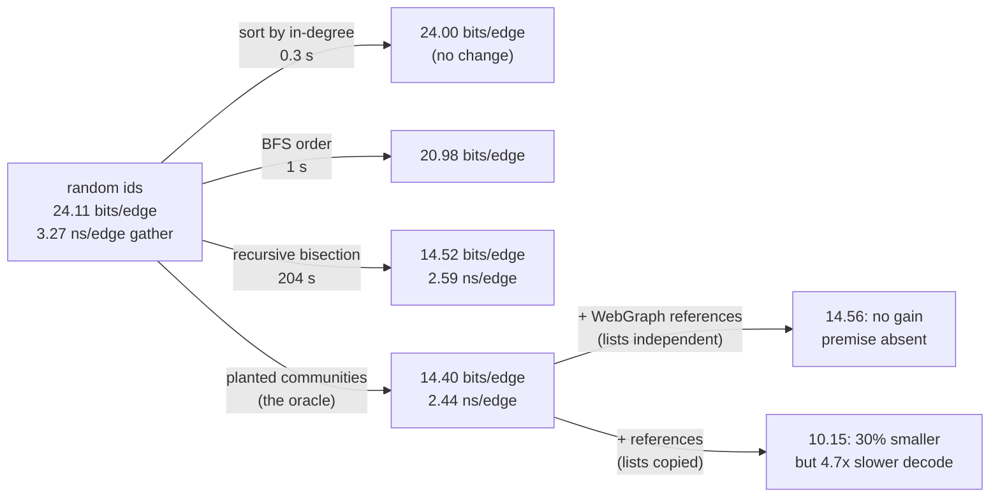

# Topic 52 — Graph Reordering & Compression: bytes per edge, and why vertex ids are the lever

FalkorDB stores a graph as sparse matrices, and a sparse matrix is a list of
integers per row: 4 bytes per edge in the column-index array of a settled
GraphBLAS matrix, 12.5 for a relationship's tensor, around 24 as the module
reports it ([reading-graphblas-bytes.md](reading-graphblas-bytes.md) counts
each). Every graph-compression paper starts from the same observation about that
array — the integers are not random — and every one of them quietly depends on
how the vertices were **numbered**. The WebGraph papers number pages by sorted
URL and report 2–5 bits per link; Dhulipala et al.'s Table 2 shows the same codec
at 14.6–21.6 bits per edge on web-Google, LiveJournal, FB-NewOrlean and Twitter in
the order the data arrived in, and at 4.7–11.6 after recomputing the ids. This topic asks the question a FalkorDB developer
should ask first: before choosing a codec, how much of the size — and of the
cache misses of a traversal — is decided by the vertex ids alone, and what does
the codec cost you on the scan once the ids are good?

The ordering side has three families: **cheap** ones (sort by degree, BFS or DFS
order), **community** ones (Leiden, label propagation, Rabbit Order) and
**optimising** ones (recursive bisection, Gorder), which spend minutes to hours
to find ids that minimise an explicit objective. The codec side has two: lists of
gaps, copies and intervals (WebGraph, Ligra+'s byte codes) and compressed
matrices (k²-trees). Topic 24 already has Leiden; this topic uses its idea as
one of the three families and measures the rest.



## The problem, measured (bench lane 1, provided — runs today)

`cargo run --release --bin compress_bench` — one seeded graph of 6,000,000
vertices and 64,747,251 directed edges: power-law out-degrees (Pareto tail, mean
10.79, max 1,756), 21,972 planted communities of 32–512 vertices, 75% of edges
inside the source's community. The generator lays the vertices out community by
community (the *planted* order); the bench then **loads the graph with random
ids**, which is what ids look like when they were handed out by arrival or hash,
and relabels it four ways. Every row is the **same graph**: the same 64.7 M
edges, the same degrees, the same communities. Apple M3 Pro, measured
2026-10-26, load average 5.27 at the start of the run (other benchmarks were
running; counts and bit sizes are exact, timings are best of 5 for scans and of 2
for BFS):

```
   ordering                order ms  LogGap   gamma  varint  +vertex  miss % CSR ns/e var ns/e   BFS ms
   random (as loaded)            87   18.01   35.78   24.11    30.04    90.3     3.27     9.95   2541.0
   in-degree sorted             308   17.74   35.35   24.00    29.93    85.9     3.06     9.24   2535.5
   BFS                         1023   14.68   29.68   20.98    26.91    62.0     2.71     7.95   1591.7
   planted (oracle)               0    8.72   18.17   14.40    20.33    23.5     2.44     5.44   1859.1

   sanity: scan checksum e5358af47cfd3b71 and BFS (reached, edges, depth) = (17992203, 194160603, 26) summed over 3 sources are identical under every labelling: ok
   sanity: fastest CSR scan 2.44 ns/edge = 0.4 G edges/s — below 20 G/s, so the loop did real work: ok
   planted vs random: varint 14.40 vs 24.11 bits/edge (1.7x smaller), CSR scan 2.44 vs 3.27 ns/edge (1.3x faster), simulated misses 23.5% vs 90.3%
```

Columns: `LogGap` is Dhulipala et al.'s objective (mean bits of each gap between
consecutive neighbours); `gamma` the Elias-γ price of the gap lists;
`varint` the real byte-coded size of the gap lists (zig-zag first edge, then
`gap − 1`, seven bits per byte, as in Ligra+'s byte code) in bits per edge, and
`+vertex` the same with a 32-bit offset and degree per vertex; `miss %` the miss
rate of an exact 8-way LRU model of a 4 MiB cache fed the gather's addresses (a
model, 64-byte lines, not this machine's cache); `CSR ns/e` the time of one
gather pass, `s += vals[t]` over every edge of the uncompressed 32-bit CSR, per
edge; `var ns/e` the same pass decoding the varint form; `BFS ms` three
breadth-first searches from the three highest-degree vertices. The three
sanity lines are part of the result: every labelling must produce the same scan
checksum and the same BFS reach, because relabelling cannot change either — and
the scan's speed must be below anything a single core could do (topic 12's
19,047,619 GB/s lesson).

**Changing only the ids moved everything.** From random to planted ids the
byte-coded size falls from **24.11 to 14.40 bits per edge (1.67×)**, the
simulated miss rate from **90.3% to 23.5%**, the gather scan from **3.27 to 2.44
ns per edge (1.34×)** and the BFS from 2,541 to 1,859 ms (1.37×). Compare the
plain CSR at 32 bits per edge (34.97 with offsets): random ids with the best
byte code are 25% smaller than CSR, planted ids 55% smaller.

Four things the table says that a paper's headline does not:

1. **Degree sorting does almost nothing.** Giving the most-cited vertices the
   smallest ids (the InDegSort of the Gorder paper) changes the size by 0.5%
   (24.11 → 24.00) and the miss rate from 90.3% to 85.9%: hubs get compact ids,
   but each vertex's *list* is still scattered across the whole id space. Locality
   of ids is a property of neighbourhoods, not of popularity.
2. **BFS order is the cheap order that works**: 1 second, 13% smaller (20.98),
   misses 62%. It is also the order BFS likes best (1,592 ms, faster than the
   planted order's 1,859): an ordering derived from an algorithm helps that
   algorithm most, a point the Gorder replication makes about DFS and RCM.
3. **The compressed scan is slower.** Decoding the varint form takes 5.44 ns per
   edge against 2.44 for the raw CSR with the best ids — **2.2× slower** — and
   9.95 against 3.27 with random ids (3.0×). The size win is real (2.2× smaller
   edges) and the single-thread scan pays for it. Ligra+'s result, that the
   compressed graph can be faster, is about 40 hardware threads sharing one
   memory bus (reading-ligra-plus.md Step 6); this lane is one thread, so it
   shows the other half of that trade.
4. **The ordering matters more to the compressed scan than to the raw one**:
   random → planted is 1.34× for CSR and 1.83× for varint (9.95 → 5.44), plausibly
   because decoding touches fewer bytes and the gap values shrink to one or two
   bytes (not separately measured).

### The reference lanes (lanes 2 and 3, your exercises — numbers in [notes.md](notes.md))

From reference implementations written to the stub contracts, run through the
same bench and then removed, on the same graph:

| ordering / codec | bits per edge | decode-scan ns/edge (varint for lane 2, WebGraph coding for lane 3) | what it shows |
|---|---|---|---|
| recursive bisection (lane 2), varint | **14.52** | 5.97 | within 0.8% of the planted oracle (14.40) with no knowledge of the communities; its LogGap, 8.51, is *below* the oracle's 8.72. It took **204 s** against BFS's 1.0 s. |
| WebGraph coding (lane 3), lane-1 graph, planted ids | 14.56 | 24.27 | **no gain**: gaps-only is 14.41 and byte-varint 14.40. References need similar lists; this generator's lists are independent draws. |
| WebGraph coding, web-like graph (40% of lists are noisy copies of their predecessor) | **10.15** | 21.98 | 30% below gaps-only (14.44) and byte-varint (14.39) — where the premise holds, the technique pays. Decoding is 4.7× slower than varint's 4.63. |

The negative result belongs in the headline: on the lane-1 graph WebGraph's
reference copying buys **nothing**, because its premise (similarity: neighbouring
vertices share successors) is absent from the generator. The web-like variant
constructs the premise and the technique recovers 30%. And the reference
decoder (an eager, unoptimised one, 24 ns per edge, ~10× the CSR scan) is a
reminder that WebGraph's own paper adopted lazy iteration because eager decoding
was slower (§6, footnote 4).

## The concepts, step by step

1. **A neighbour list is a sorted list of integers; ids decide how small the
   differences are.** [reading-webgraph-framework.md](reading-webgraph-framework.md)
   Step 2: store `successor − previous − 1`. With random ids a gap in a list
   of degree `d` is about `n / d` — here 6,000,000 / 10.8, some 555,000, three
   bytes — while an edge inside a planted community of at most 512 consecutive ids
   has a gap below 512, one or two. The `varint` column is exactly that,
   measured.
2. **Copying and intervals depend on the numbering too, in two further ways.**
   References need similar lists in nearby ids; intervals need consecutive
   neighbours. The WebGraph paper's own Table 7 is the price list: 2.22 to 5.05
   bits per link on one crawl depending on the window and chain bound.
3. **The ordering can be optimised directly.** LogGap — the mean bits of a gap —
   correlates 0.9853 with WebGraph's bits per edge
   ([reading-recursive-bisection.md](reading-recursive-bisection.md)); recursive
   bisection minimises it by local search, and lane 2's reference reaches 14.52
   against the oracle's 14.40.
4. **Orderings are also cache optimisations, and the cheap ones come close.**
   The Gorder replication measures RAM-miss rate 3.1% for Gorder, 3.7% for RCM,
   9.0% for random on PageRank over a 1.94 G-edge graph, and finds RCM and ChDFS
   — seconds to compute — first in 24 and 16 of 81 series
   ([reading-gorder-replication.md](reading-gorder-replication.md)).
5. **Compression is a memory-bandwidth trade, not a size trade.** Ligra+ is
   slower single-threaded and about 14% faster on average at 40 cores because
   the machine was waiting on memory ([reading-ligra-plus.md](reading-ligra-plus.md));
   lane 1's single-thread column is the other half.
6. **A matrix can be compressed as a matrix.** A k²-tree prunes empty
   quadrants and answers forward and reverse neighbours from one structure; it
   needs clustered 1s as much as gap coding does
   ([reading-k2-trees.md](reading-k2-trees.md)).
7. **Inside FalkorDB the lever that exists is ids.** GraphBLAS's sparse format
   has no compressed variant to plug a codec into, but renumbering is a
   permutation of rows and columns that changes no result and changes how every
   `Ai` gather hits the cache ([reading-graphblas-bytes.md](reading-graphblas-bytes.md)).

## Production shape — where each idea lives in real code

| piece | where | what to notice |
|---|---|---|
| WebGraph defaults | `webgraph-rs` `webgraph/src/graphs/bvgraph/comp/flags.rs:42-55` | γ outdegrees, unary references, ζ₃ residuals, `L_min = 4`, `W = 7`, `R = 3` — not the paper's `L_min = 3` |
| reference choice | `bvcomp.rs:496-534` | greedy over the last `W` lists, trial-encodes each with a counting writer, skips candidates whose chain is already `R` long |
| copy blocks | `bvcomp.rs:313-393` | a two-cursor merge in two states (copying / skipping); first block incremented so every block is written minus 1 |
| intervals, residuals | `bvcomp.rs:283-309`, `write` `175-239` | runs ≥ `L_min` become `(left, len − L_min)`; first residual zig-zag from the source, rest `gap − 1` |
| ordering for the compressor | `webgraph-rs` `algo/src/llp/` | layered label propagation at several resolutions; needs a symmetric loopless graph; reports a floor-log gap cost |
| byte codes | `ligra` `ligra/byte.h:84-97`, `104-123` | 7 data bits + continue bit; the first edge has a sign bit and 6 data bits |
| run-length byte codes | `ligra/byteRLE.h:99-148`, encoder `232-297` | one header byte per group of ≤ 64 same-width differences; no continue bits |
| matrix bytes | FalkorDB `src/graph/tensor/tensor.c:44-53`, `delta_matrix/delta_new.c:73-76` | a `GrB_UINT64` relation matrix plus a boolean transposed copy |
| index width | GraphBLAS `Include/GraphBLAS.h:1559-1561`; `experiments/probe/` | v10 stores `Ap`/`Ai` as 32-bit when the dimension allows; measured, not assumed |

Anchors are `webgraph-rs` at `8ce86026b9` (crate 0.7.0), `ligra` at `8763202`,
FalkorDB at `ccb449a9a`, GraphBLAS at `7701390417`. Guides:
[reading-webgraph-rs.md](reading-webgraph-rs.md),
[reading-ligra-plus.md](reading-ligra-plus.md),
[reading-graphblas-bytes.md](reading-graphblas-bytes.md).

## Reading guides

1. [reading-webgraph-framework.md](reading-webgraph-framework.md) — Boldi & Vigna (WWW'04): gaps, reference copying, intervals, reference chains, worked on the paper's own tables; the one place its example and its formula disagree.
2. [reading-recursive-bisection.md](reading-recursive-bisection.md) — Dhulipala et al. (KDD'16): LogGap, the bisection step's cost and gains worked on a vertex, and the table where BP does not win.
3. [reading-ligra-plus.md](reading-ligra-plus.md) — Shun, Dhulipala & Blelloch (DCC'15) with the byte-code source: when compression made algorithms faster, and when it did not.
4. [reading-gorder-replication.md](reading-gorder-replication.md) — Lécuyer et al.'s replication of Gorder: orderings measured in cache misses and seconds, and the cheap orders that nearly match the expensive one.
5. [reading-webgraph-rs.md](reading-webgraph-rs.md) — the BV format in Rust, and Layered Label Propagation, the ordering step in the same repository.
6. [reading-k2-trees.md](reading-k2-trees.md) — Brisaboa, Ladra & Navarro (SPIRE'09): compress the adjacency matrix itself; forward and reverse neighbours from one structure.
7. [reading-graphblas-bytes.md](reading-graphblas-bytes.md) — bytes per edge in FalkorDB's matrices, from a probe linked against its own GraphBLAS and from `GRAPH.MEMORY USAGE`.

## Experiments

```
cd experiments
cargo test              # 15 provided tests pass; the 8 stub tests of lanes 2 and 3 fail until implemented
cargo run --release --bin compress_bench
```

- `gen.rs` (PROVIDED) — the seeded community graph (`LANE1`, `WEBLIKE`, `SMALL`,
  `SMALL_WEB`) and the random-id shuffle.
- `csr.rs` (PROVIDED) — CSR, edge-list build, permutation, transpose.
- `order.rs` (PROVIDED, lane 1) — random, in-degree-sorted and BFS orders.
- `gapcode.rs` (PROVIDED, lane 1) — zig-zag + LEB128 gap coding with a real
  decode-and-scan, γ bits, LogGap, and an exact set-associative LRU model of the
  gather's cache misses.
- `measure.rs` (PROVIDED, lane 1) — the CSR gather scan and BFS.
- `bisect.rs` (stub, lane 2) — recursive graph bisection. Contract: a
  permutation, deterministic, and LogGap at least 20% below random's and below
  BFS's on `SMALL`.
- `refcode.rs` (stub, lane 3) — WebGraph-style reference + interval + residual
  coding with a decode-and-scan. Contract: exact round trip, scan equals the CSR
  scan, references collapse repeated lists 5×, beat γ gaps on planted order, and
  cut ≥ 25% on `SMALL_WEB` (where lists are copies) — and, by omission, buy
  nothing on `SMALL`, where they are not.
- `probe/graphblas_bytes.c`, `probe/falkordb_memory_gen.py` (optional, need a
  FalkorDB build) — the two measurements behind
  [reading-graphblas-bytes.md](reading-graphblas-bytes.md).

## Exercises

1. Implement lane 2 until its three tests pass, then check lane 2 against the
   reference table in [notes.md](notes.md): LogGap and bits per edge must land
   within a few percent, and the ordering time is yours to compare.
2. Implement lane 3 until its tests pass and reproduce both of its tables: the
   `lane-1 graph` rows (where referencing buys nothing) and the `web-like` rows
   (where it does).
3. **Order × codec matrix.** Fill the 4 × 3 table of {random, BFS, planted,
   bisection} × {CSR, varint, BV-coded}: bits per edge and scan ns per edge.
   Predict first which cell is the fastest scan; the answer depends on whether
   the scan is bound by decoding or by memory.
4. **Find the crossover.** Run the scan on `n` threads (`std::thread::scope`
   over vertex ranges) for the CSR and the varint form and find the thread count
   at which the varint scan overtakes CSR, if it does. This is Ligra+'s claim,
   tested on your machine.
5. **Build a k²-tree** for lane 1's graph (random ids and planted order) at
   `k = 2` and `k = 4`, with a `rank` structure, and measure bits per edge and
   neighbour-extraction time. Predict first which order makes it smaller and by
   how much.
6. **Close FalkorDB's byte gap.** Settled-matrix arithmetic gives 17–18 B/edge
   for a relation and its transpose; `GRAPH.MEMORY USAGE` slopes at 23.8. Design
   and run the experiment that separates pending deltas (force a flush, then
   re-measure) from index width (read `GxB_*_INTEGER_BITS` inside the module).
7. **Leiden as the ordering.** Use topic 24's Leiden to number vertices by
   (community, degree) on lane 1's graph and compare LogGap and bits per edge
   with the planted order and with bisection.
8. **Break the oracle.** Raise `p_intra` from 0.75 to 0.95, and then lower it to
   0.4. Predict which of {planted, bisection} degrades more and why, then run.

## Cross-topic threads

- **Topic 24 (Leiden) ↔ 52.** Community detection is the cheap ordering: sort by
  (community, degree). [reading-louvain-leiden.md](../24-graph-algorithms/reading-louvain-leiden.md)
  and [reading-ligra.md](../24-graph-algorithms/reading-ligra.md) (Ligra's
  `edgeMap`, here with its compressed variant).
- **Topic 20 (GraphBLAS) ↔ 52.** The matrices counted in
  [reading-graphblas-bytes.md](reading-graphblas-bytes.md) are topic 20's;
  renumbering is a row/column permutation that changes no result, and the delta
  matrices of [reading-falkordb-delta-matrix.md](../20-graphblas/reading-falkordb-delta-matrix.md)
  are the reason a settled-matrix number is not the whole story.
- **Topic 13 (graph engines) ↔ 52.** Which engines expose the vertex id order at
  all, and whether any renumbers; record stores allocate ids and never revisit
  them.
- **Topic 51 (dynamic graph storage) ↔ 52.** An ordering is computed on a
  snapshot; a store taking writes continuously must decide when to pay for a
  renumbering and what to do with the ids already handed out
  ([topic 51](../51-dynamic-graph-storage/README.md)).
- **Topic 48 (memory tiering) ↔ 52.** Renumbering by access frequency is the
  same lever as hot/cold page placement, applied to ids.
- **Topic 17 (SIMD) ↔ 52.** The varint decoder here branches per byte;
  topic 17's bit-packed decoding at SIMD speed is the direction a production gap
  codec would take.

## Capstone M52 — an id-order pass and a compact read-only segment

The capstone's sparse-matrix core (M20) hands out vertex ids in arrival order, which
lane 1's `random (as loaded)` row is the model of. M52 makes the order a
decision.

- [ ] A renumbering pass over the CSR matrices: compute (community, degree)
      order with the capstone's Leiden (M24), apply the permutation to every
      relationship matrix and to the node property store, and assert that every
      query result is unchanged up to the permutation.
- [ ] Report, before and after, the same four columns lane 1 prints: LogGap,
      varint bits per edge, simulated gather miss rate, and the scan's ns per
      edge on a graph whose value array exceeds the last-level cache.
- [ ] A read-only compressed segment: gap + varint for settled relationship
      matrices, decoded in the expand operator, with the per-list degree array
      stored beside the offsets as in Ligra+; measure the scan against the
      uncompressed matrix at one and at all threads and record the crossover.
- [ ] Bytes per edge of every relationship matrix in the capstone, printed by
      `GRAPH.MEMORY`-style introspection, with the iso-boolean case counted.
- [ ] Benchmark: lane 1's graph loaded into the capstone and into C FalkorDB,
      the same three-hop expansion before and after renumbering, p50 and p99.
