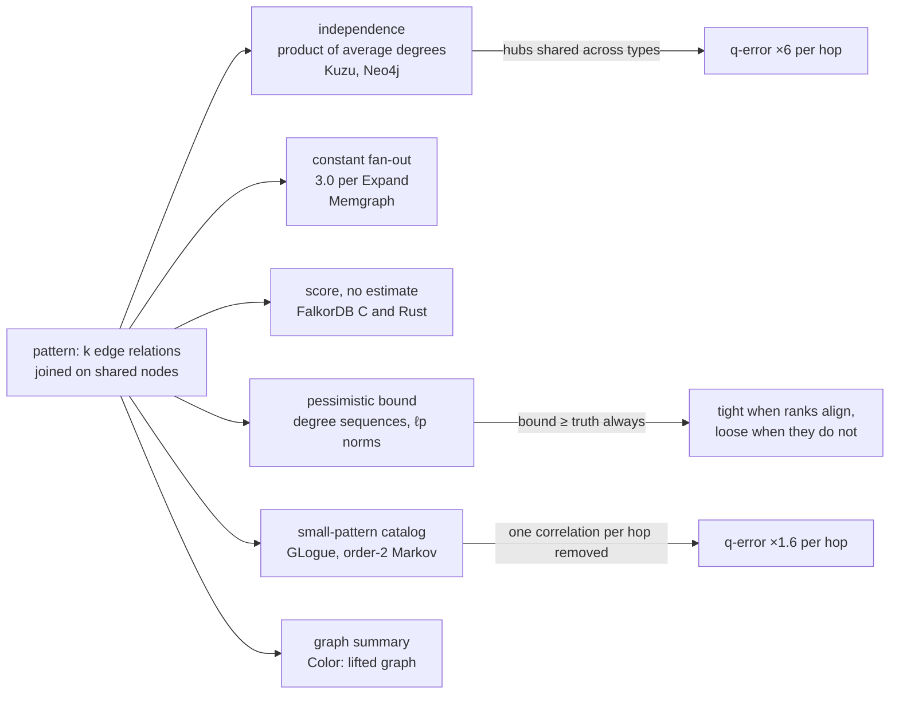

# Topic 53 — Cardinality Estimation for Graph Patterns: Where Multi-Hop Estimation Dies

Topic 10's JOB audit established that on real, correlated data a planner's
row-count guesses are the weakest layer of its stack, and that they get
worse with every join. Topic 13 then asked the graph version of the
question — "at which hop does estimation die?" — and left it unanswered. A
Cypher `MATCH` is a join of one edge relation per hop, so the answer must be
the same kind of number, and this topic measures it: on a seeded labelled
graph with Zipfian degrees, the estimator that Kùzu and Neo4j ship loses a
factor of roughly 6 *per hop* — 9.6× at two hops, 324× at four — when
a node that is popular as a destination of one edge type is also popular as a
source of the next. The same estimator is within 1.1× on the same graph with
that one correlation removed. The estimator is not wrong; its premise is.

Four families of answer exist, and each is built or read here: **average
degrees multiplied** (what the engines do), **bounds that cannot be
low** (pessimistic estimation from degree sequences), **stored small-pattern
counts** (a GLogue, which GOpt uses) and **a summary of the graph's vertex
kinds** (Color). A fifth observation completes the picture and cuts the other
way: the estimate's error did not change which expansion order lane 1's
planner picks, because the answer itself is 90–98% of any order's cost. A
topic about estimation that ends by telling you when the estimate does not
matter is the honest shape of the result.



## The problem, measured (bench lane 1, provided — runs today)

`cargo run --release --bin card_bench` — a seeded graph of 27,000 nodes in
four labels (3,000 / 6,000 / 12,000 / 6,000) and five edge types, drawn from
Zipf laws (exponent 0.6 for sources, 1.0 for destinations) with 280,000
edge draws, de-duplicated (247,999 edges on seed 1). The two modes differ in one thing only: whether
a node's popularity is **shared** across edge types (the hub of `r0` is
the hub of `r1`) or **independent** (a separate ranking for every type and
role). Every pattern is a label-consistent walk of 2, 3 or 4 edges; its
exact count comes from a frontier DP, and each estimator is scored by
G-CARE's q-error (the factor off in either direction, both counts floored at
1). Apple M3 Pro, measured 2026-10-26. Every number below is a count or a
ratio of counts from a seeded generator — nothing is timed — and two runs
produce identical output:

```
graph (lane 1, seed 1): 27000 nodes in 4 labels [3000, 6000, 12000, 6000]; edges per type after de-duplication [34374, 53343, 80401, 51749, 28132]
types: r0 L0>L1, r1 L1>L2, r2 L2>L3, r3 L3>L0, r4 L2>L0; Zipf exponents 0.6 (sources) 1.0 (destinations); seeds [1, 2, 3, 4, 5]

-- lane 1: q-error by hop, shared popularity (a hub is a hub for every type) --
   estimator                  hop    n     median q        p90 q          max q    under
   independence (kuzu/neo4j)    2   30          9.6         13.8           15.0     100%
   memgraph constant (3^k)      2   30         62.2        108.2          111.4     100%
   max-degree bound             2   30          4.4          4.9            5.6       0%
   independence (kuzu/neo4j)    3   35         57.5         65.1           67.0     100%
   memgraph constant (3^k)      3   35        822.1       1561.2         1578.9     100%
   max-degree bound             3   35         40.8         48.7           60.0       0%
   independence (kuzu/neo4j)    4   45        324.0        372.6          394.1     100%
   memgraph constant (3^k)      4   45      12425.7      24405.6        25494.1     100%
   max-degree bound             4   45        294.4        342.9          370.0       0%
   degree-sequence bound        2   30          1.0          1.0            1.0       0%
   l2-norm bound                2   30          1.3          1.4            1.4       0%

-- lane 1: q-error by hop, independent popularity (in-degree and out-degree unrelated) --
   estimator                  hop    n     median q        p90 q          max q    under
   independence (kuzu/neo4j)    2   30          1.1          1.2            1.8      43%
   memgraph constant (3^k)      2   30          6.4         11.3           20.8     100%
   max-degree bound             2   30         40.8         69.8           74.6       0%
   independence (kuzu/neo4j)    3   35          1.1          1.7            2.0      49%
   memgraph constant (3^k)      3   35         18.6         32.6           57.1     100%
   max-degree bound             3   35       1741.3       3637.1         3970.9       0%
   independence (kuzu/neo4j)    4   45          1.1          1.7            1.9      58%
   memgraph constant (3^k)      4   45         40.1         83.5          121.6     100%
   max-degree bound             4   45      83367.0     119220.1       151702.1       0%
   degree-sequence bound        2   30          9.7         14.8           15.3       0%
   l2-norm bound                2   30         12.4         19.5           21.2       0%

-- lane 1, triangles r0>r1>r4 (L0>L1>L2>L0): the closing edge --
   popularity    seed         true   independence        q      AGM bound        q       l2 bound        q
   shared           1        54738         238.81    229.2        7182143    131.2         712488     13.0
   shared           2        56124         238.86    235.0        7182913    128.0         712012     12.7
   shared           3        54948         238.62    230.3        7179254    130.7         702015     12.8
   independent      1          234         238.59      1.0        7178751  30678.4         706536   3019.4
   independent      2          234         238.19      1.0        7172854  30653.2         708498   3027.8
   independent      3          404         237.52      1.7        7162662  17729.4         696263   1723.4

-- lane 1, plan choice: which edge to start from, picked from the estimates --
   a k-edge path has 2^(k-1) left-deep orders; cost = rows materialised (sum of the interval counts);
   regret = true cost of the order the estimates pick / true cost of the truly cheapest order;
   answer share = the final answer's part of the cheapest order's cost (every order pays it)
   estimator                  popularity   hops  patterns  wrong picks    geomean  worst regret   answer share
   independence (kuzu/neo4j)  shared          3        35            5       1.00          1.00          97.7%
   independence (kuzu/neo4j)  shared          4        45            5       1.00          1.00          98.3%
   independence (kuzu/neo4j)  independent     3        35            4       1.00          1.06          89.5%
   independence (kuzu/neo4j)  independent     4        45            4       1.00          1.03          91.0%

-- lane 1, sanity --
   2-hop oracle (frontier DP) equals sum over middle nodes of in-degree x out-degree for every 2-walk: agree
   4-hop forward DP and backward DP give the same total for every 4-walk: agree
   a single edge is estimated exactly by every estimator (q = 1): holds
   the max-degree bound is never below the truth: holds
```

(The bench also prints a per-pattern detail table for seed 1 — 22 patterns,
true count against estimate — and lanes 2 and 3; both lanes print `STUB` on a
fresh clone and the run exits 0. The detail table is reproduced in
[notes.md](notes.md).)

**Where it dies: at every hop, geometrically.** On the shared-popularity
graph the independence estimate is below the truth for every one of the
110 patterns and its median q-error goes **9.6 → 57.5 → 324.0** at two, three
and four hops — ×6.0 then ×5.6 per hop. Seed 1's four-edge `r0>r1>r2>r3`
is estimated at 17.7 M against a true 6.15 B. On the independent-popularity
graph — the same degree distributions, with the one correlation removed — the
same estimator is at **1.1, 1.1, 1.1** and *half of its errors are
overestimates*. The error is the correlation, not the skew: a hub that is a
hub twice makes the true count a sum of products of correlated degrees
(`Σ_b in(b)·out(b)`, which lane 1's sanity line checks) where the estimate
multiplies two averages.

**A bound is tight on exactly the correlation an estimate cannot see.** The
degree-sequence bound for a two-hop join is **1.0** where independence is 9.6×
low and **9.7** where independence is 1.1: it assumes the worst alignment of
hub ranks, which is the actual alignment in the first graph and a pessimistic
one in the second. The max-degree bound is never the better of the two
and compounds per hop (40.8 → 1,741 → 83,367 on the independent graph).

**Triangles lose the closing edge.** The independence estimate of the
triangle `r0>r1>r4` multiplies the open two-path by the *unconditional*
edge density, 229× too low on the shared graph, and 1.0× on the
independent one; the AGM bound is 131× too high on the first and 30,678× on
the second; the ℓ2 bound 13× and 3,019×.

**Memgraph's constant is a different kind of wrong**: `|L| · 3^k` has no
connection to the data, so it is 6.4–40.1× low even when popularity is
independent and 62.2–12,425.7× low when it is not.

**The negative result: a 348× error that costs nothing.** For each pattern
lane 1 enumerates the `2^(k-1)` left-deep orders (start at any edge, extend
left or right), prices each by the rows its intermediates materialise, and
lets the estimates choose. On the shared graph the independence estimate picks
a non-optimal order for 5 of 35 three-edge and 5 of 45 four-edge patterns, and
the regret — true cost of the pick over true cost of the best — is **1.00**
(under 0.5%, worst case). On the independent graph the worst regret is
**1.06** and **1.03**. The reason is in the last column: the final answer is
**97.7–98.3%** (89.5–91.0% on the independent graph) of even the cheapest
order's cost, and every order pays it. This is G-CARE's §6.5 finding for
star-shaped queries — "the validity ranges for the optimal plan … are wide" —
reproduced on a graph. It is a statement about *expanding* paths, not about
estimation: the cases where an order matters are the ones where
intermediates dwarf the answer — a selective predicate at the far end —
and exercise 7 constructs one.

## Step 1 — the pattern is a join, the estimate is a product

A Cypher pattern `(a:L0)-[:r0]->(b)-[:r1]->(c)` is a join of the edge
relations `r0(a,b)` and `r1(b,c)` on `b`. Every estimator in this topic
answers "how many rows?" for such a join from statistics of the relations.
The classical answer (Selinger's; topic 10 Step 2) for `R(X,Y) ⋈ S(Y,Z)` is
`|R| · |S| / max(|Dom(R.Y)|, |Dom(S.Y)|)`: each row of `R` finds the
*average* number of partners. For a typed graph the divisor is the number of
nodes of the middle label, and a `k`-edge path is

```
est = |E_t0| · Π_{i=1}^{k-1}  |E_ti| / |L_src(ti)|
```

— one edge count, then one average out-degree per extra hop. That is
Neo4j's per-relationship multiplier and Kùzu's `getExtensionRate`
([reading-engine-estimators.md](reading-engine-estimators.md), Steps 2–3),
and GOpt's expand ratio with a one-edge starting pattern
([reading-glogue-gopt.md](reading-glogue-gopt.md), Step 3).

## Step 2 — why it fails, with numbers you can do by hand

Take the six-node graph of the pessimistic chapter: `r0: 0→4, 1→4, 2→4,
3→5`, `r1: 4→8, 4→9, 4→10, 5→11`. Node 4 has 3 in-edges and 3 out-edges;
node 5 has 1 and 1; nodes 6 and 7 have none. The true number of two-hop
paths is `3·3 + 1·1 = 10`. The estimate divides the product of the edge
counts, `4 · 4 = 16`, by the 4 nodes of the middle label: **4**. The
average in-degree (1) and average out-degree (1) hide that the two nodes
carrying all the edges carry them in both directions. Lane 1's graph is the
same effect on 27,000 nodes and four hops: the truth grows as `Σ in·out` per
hop, the estimate as `avg_in · avg_out`, and the ratio between them is
(roughly) constant per hop, hence the geometric growth.

The bounds see the correlation because they sort: with in-degrees
`a = (3, 1)` and out-degrees `b = (3, 1)` the degree-sequence bound
`Σ a_i b_i = 10` is exact; reverse `b` on the nodes (`(1, 3)`) and the truth
is 6 while the bound stays 10. The catalog sees it because it stores the
10. Color sees it because it puts node 4 in a different color from node 5.
([reading-pessimistic-bounds.md](reading-pessimistic-bounds.md),
[reading-glogue-gopt.md](reading-glogue-gopt.md),
[reading-color.md](reading-color.md).)

## Production shape — four engines, four answers

| piece | where | what to notice |
|---|---|---|
| Kùzu: the per-hop factor | `kuzu` `src/planner/join_order/cardinality_estimator.cpp:214-244` | `numRels / atLeastOne(numBoundNodes)` (`:219`): average out-degree per table; variable-length hops multiply by the upper bound |
| Kùzu: where it lands | `src/planner/plan/append_extend.cpp:86-91` | the Extend keeps its cardinality; the rate becomes the group's multiplier, applied at flatten (`cardinality_estimator.cpp:133-137`) |
| Kùzu: constants | `src/include/common/constants.h:158-165` | equality 0.01, other predicates 0.1 |
| Neo4j: the model | `neo4j` `…/cardinality/assumeIndependence/AssumeIndependenceQueryGraphCardinalityModel.scala:197-216` | unbound-node cardinalities × per-connection multipliers × other predicates' selectivity |
| Neo4j: the multiplier | `…/NodeConnectionCardinalityModel.scala:136-167` | `E(rel) / (card(left) · card(right))`, an unbound endpoint costing 1 |
| Neo4j: the statistic | `community/cypher/cypher/src/main/scala/…/spi/TransactionBoundGraphStatistics.scala:144-149` | counts of `(:from)-[:type]->(:to)` from the counts store |
| Memgraph: the constant | `memgraph` `src/query/plan/cost_estimator.hpp:368-380`, `cost_constants.hpp:46-50` | each `Expand` × 3.0 unless symbol statistics carry a degree; filter × 0.25 |
| FalkorDB (C): the score | `FalkorDB` `src/execution_plan/optimizations/traverse_order_utils.c:36-53, 225-308` | labels *on the node*, filters, bound variables — no data statistic |
| FalkorDB (C): the data | `src/execution_plan/optimizations/cost_base_label_scan.c:159-167, 216-220` | the only statistic: nodes per label, to pick which end to scan |
| FalkorDB (C): the product | `src/arithmetic/algebraic_expression/algebraic_expression_mul.c:36-58` | left-to-right fold; early exit on an empty partial product |
| FalkorDB (Rust) | `falkordb-rs-next-gen` `graph/src/planner/optimizer/select_scan_node.rs:79-111` | `(bound 3 + filtered 2 + labelled 1, label node count)` |

Anchors are read at the commits of the pin table in
[resources/codebases.md](../../resources/codebases.md): `kuzu` `89f0263`,
`neo4j` `eccd584a`, `memgraph` `8f87f6a`, `FalkorDB` `ccb449a9a`,
`falkordb-rs-next-gen` `9d28bdc6`. Guide:
[reading-engine-estimators.md](reading-engine-estimators.md).

## Reading guides

1. [reading-gcare.md](reading-gcare.md) — Park et al. (SIGMOD 2020): the benchmark of seven estimators, the q-error, characteristic sets worked on the paper's own example, WanderJoin's inverse-probability estimate, and the §6.5 plan-quality result that an error can be harmless.
2. [reading-pessimistic-bounds.md](reading-pessimistic-bounds.md) — Abo Khamis et al. (arXiv 2024) and LpBound (Zhang et al., arXiv 2025): degree sequences and ℓp-norms, AGM, the chain bound, the degree-sequence bound, the polymatroid LP, each worked on lane 1's graphs.
3. [reading-glogue-gopt.md](reading-glogue-gopt.md) — Lyu et al.'s GOpt (arXiv 2024): GLogue's stored small-pattern counts, Equations 1 and 2, Example 6.2 worked, the order-2 Markov rule, the 3-of-8 ablation.
4. [reading-color.md](reading-color.md) — Deeds et al.'s Color (PVLDB 2024): quasi-stable colorings, the lifted graph, the estimator, Example 4 worked, path-closure probability for cycles.
5. [reading-engine-estimators.md](reading-engine-estimators.md) — what Kùzu, Neo4j, Memgraph and FalkorDB (C and Rust) actually compute, with line anchors and the equality proof between Neo4j's and Kùzu's formulas.

## Experiments

```
cd experiments
cargo test              # 16 provided tests pass; lanes 2 and 3's 12 stub tests fail until implemented
cargo run --release --bin card_bench
```

- `gen.rs` (PROVIDED) — the seeded labelled Zipf graph, two popularity modes,
  CSR in both directions; every count reproduces from the seed.
- `oracle.rs` (PROVIDED) — exact path counts by frontier DP (forward and
  backward), exact triangle counts by sorted-list intersection, and the
  enumeration of label-consistent walks; tests against brute force.
- `est.rs` (PROVIDED, lane 1) — independence (Kùzu/Neo4j), Memgraph's
  constant, the max-degree bound, the degree-sequence and ℓ2 bounds, the AGM
  and ℓ2 triangle bounds, and the q-error.
- `plan.rs` (PROVIDED, lane 1) — the `2^(k-1)` left-deep orders of a path,
  their cost, and regret.
- `cset.rs` (stub, lane 2) — a characteristic-set estimator. Contract: one
  entry per distinct (label, in-types, out-types); `|E_t|` exactly for one
  edge; the two-edge star formula; chained by conditional fan-out; equal to
  the independence product when a label has one set; exact on homogeneous
  sets.
- `catalog.rs` (stub, lane 3) — a GLogue-style catalog of `F1` and exact `F2`.
  Contract: exact for one- and two-edge paths; `F2·F2/F1` for three; a zero
  denominator gives 0, not NaN; misses a dependence of the third edge on the
  first.

## Exercises

1. Implement both stubs until every test passes, then check lanes 2 and 3
   against the reference tables in [notes.md](notes.md) — the counts must
   match to the printed digit.
2. **Triangles in the catalog.** Add the exact triangle count
   `F3[r0][r1][r4]` to the catalog (it is a three-vertex motif) and estimate
   `r0>r1>r4` and the pattern "triangle plus one more `r0` edge from the
   closing node" by GOpt's Eq. 1 with the triangle as `P_s1`. Predict how
   much of lane 1's 229× underestimate this removes, then measure.
3. **A cycle the catalog does not hold.** Write the oracle for the 4-cycle
   `r0>r1>r2>…` (add an edge type if the schema has none) and score the
   independence estimator, the AGM bound and the ℓ2 bound on it, as the
   triangle row does.
4. **Color in miniature.** Colour each node by (label, ⌈log₂ in-degree⌉,
   ⌈log₂ out-degree⌉), build the lifted graph with `τ_avg`, and estimate
   every path by Def. 8's `W(π)` summed over colorings. First reproduce
   Example 4 (a 2-regular graph plus a 100-clique) exactly; then run it on
   lane 1 and place it between independence and the catalog *before*
   measuring. How many colors did it use?
5. **WanderJoin on this graph.** Implement the random-walk estimator of
   G-CARE §4.2 (uniform first edge, uniform continuation, `1/P(s)`) and
   report, by hop, the fraction of valid walks and the q-error at 1,000,
   10,000 and 100,000 walks. Compare with the paper's 0.16%-valid chains.
6. **Why the catalog overestimates.** Compute, over the middle edges of
   each `a-b-c-d` path, the covariance of `in(b)` and `out(c)`, and show that
   the sign of `(estimate − truth)` equals the sign of `−covariance` for every
   three-edge pattern (Chebyshev's sum inequality).
7. **The negative result, constructed.** Add a predicate that keeps a
   fraction `s` of the *last* label's nodes (once the `s` nodes are random
   tail nodes, once they are the top-`s` hubs), price every order with the
   estimate scaled by `s` and with the truth, and find an `s` where the
   independence estimate's pick has regret ≫ 1. Predict whether random or hub
   selection is worse before measuring.
8. **Make characteristic sets work.** Lane 2's reference barely improves
   on independence (median 8.7 against 9.6 at two hops): a characteristic
   set records *whether* a node has an edge of a type, not *how many*, and
   the skew is in the counts (21 sets on seed 1). Change the generator so a
   node has an `r4` edge only if it is among the top 10% of its label by
   popularity — so the set carries the hub signal — and measure how much the
   characteristic sets recover.
9. **Maintenance.** Under an insert of one `r1` edge `(b, c)`, which entries
   of `F1` and `F2` change, and what does the update cost in terms of
   `deg(b)` and `deg(c)`? Compare with keeping `Σ in·out` per type pair
   incrementally ([topic 51](../51-dynamic-graph-storage/README.md)).

## Cross-topic threads

- **Topic 10 (query planning) ↔ 53.** Its
  [JOB audit](../10-query-planning/reading-how-good-optimizers.md) measures
  the relational estimator's compounding error; lane 1 measures the same
  compounding on a graph and finds the premise that breaks (a node's in-
  and out-degrees correlate through shared popularity).
- **Topic 13 (graph engines) ↔ 53.** This topic answers the open question in
  its [notes](../13-graph-engines/notes.md): estimation dies at each hop, by
  a factor set by the in/out-degree correlation. Its
  [Kùzu](../13-graph-engines/reading-kuzu.md) and
  [Neo4j](../13-graph-engines/reading-neo4j-record-store.md) guides describe
  the stores whose estimators are read here.
- **Topic 47 (semi-join reduction) ↔ 53.** Semi-join reduction makes the
  join order matter less when estimates are poor; this topic says how poor
  they are and when the order mattered at all. Together they are the two
  ends of "accurate or robust".
- **Topic 13's [WCOJ guide](../13-graph-engines/reading-wcoj.md) ↔ 53.** The
  AGM bound is the output-size bound a worst-case-optimal join achieves; lane
  1's triangle row shows it 131× too high on skewed data.
- **Topic 54 (join algorithms) ↔ 53.**
  [Whether to intersect or to binary-join](../54-join-algorithms/README.md)
  is decided by the triangle estimate; the closing-edge row is that
  estimate's failure.
- **Topic 51 (dynamic graph storage) ↔ 53.** A catalog is a statistic that
  must be maintained under inserts; exercise 9.

## Capstone M53 — an estimator behind the planner's anchor choice

The capstone's planner (M10) picks an anchor and an expansion order; M53
puts the first measured statistic behind that choice and measures when it
matters.

- [ ] Maintain per-relation-type `F1` (edge counts) and per-type-pair `F2`
      (two-hop counts) from the matrices' degree vectors, with an assertion
      that `F2[a][b] = Σ_v indeg_a(v) · outdeg_b(v)` against a brute-force
      count on a small graph.
- [ ] An estimate function `est(pattern)` behind one trait: independence,
      order-2 catalog, with the Markov rule's assertions from lane 3 as
      tests; report q-error by hop against an exact oracle on the capstone's
      graph, as lane 1 does.
- [ ] Use it to choose the starting end of a chain; run lane 1's plan-choice
      table on the capstone graph and report geomean regret and the answer's
      share of cost, so a case where the estimate does not matter is visible
      as such.
- [ ] Update cost: a counter test showing the catalog's work per inserted
      edge (exercise 9).
- [ ] Benchmark: the same four-hop `MATCH` anchored at each end on the
      capstone, with the estimate's pick marked.
