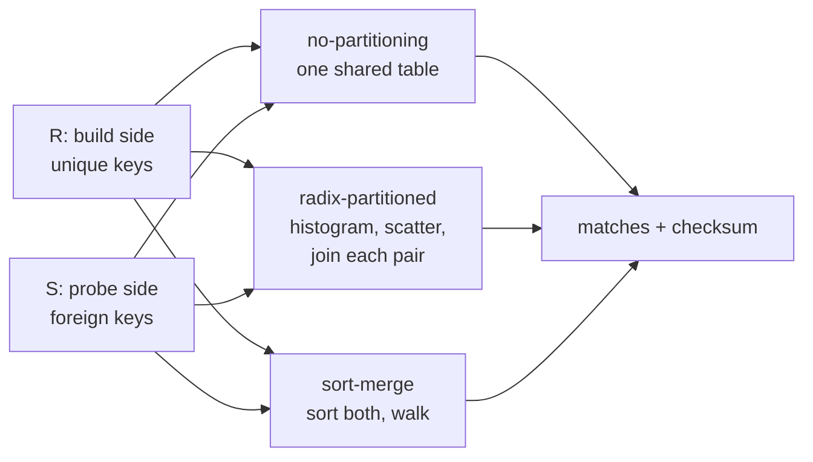

# Topic 54 — Main-Memory Join Algorithms: Hash, Radix-Partitioned & Sort-Merge

Topic 11 introduced the hash join as one box of a vectorised pipeline and
mentioned, in passing, that DuckDB partitions its build side by hash radix;
topic 47 put filters in front of it; topic 48 priced its two variants on a
CXL tier. This topic opens the box. A main-memory equi-join has three serious
designs — one shared hash table, hash partitions small enough for the cache,
and sorting — and the literature has changed its mind about the winner
several times, partly because the papers measured different machines, tuple
widths and code. A graph engine's `Expand` into a node set is this join, so
the question is not academic for FalkorDB's Rust rewrite: when it needs a
hash join over adjacency lists, which one does it build?



## The problem, measured (bench lane 1, provided — runs today)

`cargo run --release --bin join_bench` — R with 2¹⁴ to 2²⁴ unique-key tuples,
S with 2²⁵ = 33,554,432 foreign-key probes (256 MiB), 8-byte `<key, payload>`
tuples, one thread. Apple M3 Pro, measured 2026-10-26, load average 4.71 at the
start of the run (other benchmarks share the machine; every time below is the
thread's **CPU time**, best of 3, which does not include the slices other
processes took; counts and checksums are exact and reproduce).

First the machine, because every later number is read against it
(`sysctl`: performance-core L1d 128 KiB, **cache line 128 B**, **page 16 KiB**,
performance-cluster L2 16 MiB, efficiency-cluster L2 4 MiB; Apple does not
publish a system-level cache size and there is no `sysctl` for one — lane 0
measures what is there):

```
-- lane 0: the machine, measured --
   dependent-add period: 0.255 ns
   dependent-load latency (random cycle, one node per 128-byte line):
    working set    ns/load
         32 KiB       0.99
        128 KiB       1.07
        512 KiB       5.25
          2 MiB       6.04
          8 MiB       8.31
         16 MiB      45.26
         32 MiB      91.77
         64 MiB     102.84
       1024 MiB     112.71

   dependent-load latency by number of 16 KiB pages touched (one 128 B node per page):
      pages      reach   ns/load
        128      2 MiB       1.06
        256      4 MiB       2.65
       1024     16 MiB       4.22
       2048     32 MiB       6.56
       4096     64 MiB      15.16
      65536   1024 MiB      23.87

   sequential read bandwidth over 1 GiB:
    1 thread(s)     70.0 GB/s
   11 thread(s)    117.2 GB/s
```

Three things to take from it. The **cache cliff** is between 8 and 32 MiB —
8.3 ns at 8 MiB, 91.8 ns at 32 MiB (the 16 MiB point, 45 ns, is the knee:
it varied from 19 to 45 ns between runs): the performance cluster's 16 MiB L2
is the last-level cache that matters, and a build table above it pays DRAM
latency, about 100–113 ns. The **TLB reach** (the memory covered by cached
address translations) is visible too: with only one 128-byte node per page,
latency steps from 1.06 ns at 128 pages (2 MiB) to 2.65 ns at 256 pages, 6.6 ns
at 2,048 pages (32 MiB) and 15.2 ns at 4,096 pages (64 MiB): a random access
into a table above ~32–64 MiB pays an address-translation walk on top of the
cache miss. And one thread streams **70 GB/s**, a floor to compare scatter
costs against.

Then lane 1 — the no-partitioning join (one shared table, 4-slot buckets, 2
slots per build tuple; `scalar` is the textbook one-slot-per-step probe loop,
`probe` the bucket loop, `batch` the bucket loop with a batch of 32 loads
issued first):

```
-- lane 1: no-partitioning hash join, uniform FK probes — |S| = 33554432 (256 MiB), 8-byte tuples --
         |R|     R MiB  table MiB  build ms  scalar ms  probe ms  batch ms  ns/probe     Mtup/s
        2^14      0.12       0.25      0.08     464.16    290.79    284.87      8.49      117.8
        2^16      0.50       1.00      0.45     504.93    314.27    294.10      8.76      114.1
        2^18      2.00       4.00      2.09     535.40    338.17    301.39      8.98      111.4
        2^20      8.00      16.00      9.35     623.78    374.67    356.80     10.63       94.5
        2^22     32.00      64.00     56.11    1693.13    927.68    663.80     19.78       52.4
        2^24    128.00     256.00    241.51    2307.70   1112.20    719.42     21.44       52.4

-- lane 1a: the probe loop with no cache misses — |S| = 16777216, uniform --
         |R|  table KiB    scalar ns    bucket ns   batched ns
         2^4        0.2         8.59         6.02         6.46
         2^8        4.0        11.77         7.52         8.11
        2^14      256.0        13.74         8.61         8.43

-- lane 1d: probe order — S random vs S sorted by home bucket (sort not timed), |S| = 16777216 --
         |R|  table MiB      random ns      sorted ns     ratio
        2^14       0.25           8.70           4.38     1.99x
        2^20      16.00          12.17           5.00     2.43x
        2^22      64.00          27.66           5.10     5.42x
        2^24     256.00          32.66           5.80     5.63x

-- lane 1b: skew — Zipf(theta) probe keys, |S| = 33554432 --
         |R|  theta  probe ms  ns/probe vs uniform
        2^24   0.00   1118.17     33.32     1.00x
        2^24   0.75   1022.52     30.47     0.91x
        2^24   0.99    760.09     22.65     0.68x

-- lane 1c: threads on the probe — |R| = 2^24 (256 MiB table), |S| = 33554432 --
    threads  probe ms   Mprobe/s   speedup
          1    703.34       47.7     1.00x
          2    379.61       88.4     1.85x
          5    193.54      173.4     3.63x
         11    127.26      263.7     5.53x
```

(Lane 1b also prints a 2²⁰ build: 0.99 and 0.75 are within 1% of uniform
there. The full output is in [notes.md](notes.md).)

**The shared table has three regimes.** Up to 2¹⁸ (a 4 MiB table) the join
costs about 8.5–9 ns per probe and the table size does not matter; at 2²⁰ (16
MiB, the last-level cache) 10.6 ns; at 2²² and 2²⁴ (64 and 256 MiB, above both
the cache and the TLB reach) **19.8 and 21.4 ns** — the cache cliff of lane 0
as a join cost. Build is cheap until 2²² (56 ms) and 2²⁴ (242 ms).

Four honest observations from the lane itself:

- **The probe loop has a high floor.** Lane 1a: even a 16-tuple table, every
  access an L1 hit, costs 6–8 ns per probe, and the textbook one-slot-at-a-time
  loop 8.6–13.7 ns. The bucket layout (read eight slots, branch only when both
  buckets are full) removes about a third of that. What remains is the loop —
  hashing, an eight-way compare, a bit mask, and a branch on whether the
  buckets are full, which depends on the data. I did not separate branch
  misprediction from load-use stalls; Exercise 3 asks you to. It matters below.
- **Probe order is worth 2–5.6× (lane 1d).** The same probes, sorted by the
  table address they hash to (outside the timer), cost 4.4–5.8 ns at every
  table size, against 8.7 ns (2¹⁴) to 32.7 ns (2²⁴) in random order. At 2¹⁴ the
  table is 256 KiB, nowhere near the cache cliff, and sorting still halves
  the cost.
- **Batching the probe helps only above the cliff.** `batch` is 1.02–1.12×
  faster than `probe` up to 2²⁰ and **1.40×** at 2²² (927.68 → 663.80 ms) and
  **1.55×** at 2²⁴ (1112.20 → 719.42 ms): the 32 independent loads overlap
  misses that exist only above the cache.
- **Skew helps the shared table and threads help the probe.** At 2²⁴, Zipf
  θ = 0.99 makes the probe 0.68× as slow: hot entries stay in cache (Schuh et
  al. Figure 15's "unpartitioned … can match or even outperform" premise).
  Eleven threads give 5.5× on the probe, not 11×; the chip has five
  performance and six efficiency cores (`sysctl hw.perflevel0.physicalcpu`,
  `hw.perflevel1.physicalcpu`), and I did not look further.

**Sanity.** Matches equal |S| on every row (every probe hits), the three probe
loops and the threaded probe produce one checksum, and S is streamed at ≤ 1.5×
the measured read bandwidth, so the timer saw real work (the lesson of topic 12's
19,047,619 GB/s).

## Where the crossover is (lanes 2 and 3, reference solution)

Lanes 2 and 3 are exercises; their stubs fail until you write them
([notes.md](notes.md), "Reference numbers for the exercise lanes", holds the
full grids from a reference solution that is not committed). Same data as
lane 1, |S| = 2²⁵, one thread, best of 2–3, milliseconds of CPU time. `radix`
is the best single configuration of a 14-point grid (1 or 2 passes, 4–14
bits, with and without write-combine buffers); `sort-merge` is a 3-pass LSD
radix sort of both sides plus the merge:

| \|R\| | table | no-partitioning | best radix | its bits | partition + join ms | sort-merge (LSD) | NPJ ÷ radix |
|---|---|---|---|---|---|---|---|
| 2¹⁴ | 0.25 MiB | 288.8 | **221.3** | 12 | 60.3 + 161.0 | 250.2 | 1.31× |
| 2¹⁶ | 1 MiB | 303.7 | 248.9 | 12 | 61.6 + 187.3 | **248.4** | 1.22× |
| 2¹⁸ | 4 MiB | 307.3 | **264.8** | 9 | 54.5 + 210.3 | 268.8 | 1.16× |
| 2²⁰ | 16 MiB | 431.7 | 277.5 | 10 | 57.6 + 219.8 | **258.6** | 1.56× |
| 2²² | 64 MiB | 719.1 | **311.2** | 10 | 63.1 + 248.1 | 358.3 | 2.31× |
| 2²⁴ | 256 MiB | 973.5 | **424.9** | 12 | 97.1 + 327.8 | 544.1 | 2.29× |

(The bold cell is the fastest of the three per row; from 2¹⁴ to 2²⁰ the radix
and sort-merge numbers are within 13% of each other, inside the run-to-run
spread this machine showed — NPJ at 2²⁰ was 366 ms in the lane-1 run above and
432 ms here. The sizes ≥ 2²² are far outside that spread.)

**The result, honestly: partitioning pays at every build size tested, and the
reason is not the one in the literature.**

- **Above the cache cliff the literature reproduces.** At 2²² and 2²⁴ the
  radix join is 2.3× the shared table, the table is 4–16× the 16 MiB L2 and past
  the 32–64 MiB TLB reach, and lane 1d's sorted-order probe (4.4–5.8 ns, no
  partitioning cost) shows how much of the shared table's 20–33 ns is cache and
  address-translation misses. That is Balkesen's and Schuh's premise
  and it holds on this memory system.
- **Below the cliff the gain comes from order, not misses.** At 2¹⁴–2¹⁸ the
  shared table is entirely cache-resident (lane 0: 5–6 ns for an L2 hit, 1 ns
  for L1) and the radix join still wins by 1.2–1.3×. Lane 1a shows why the
  shared table is slow there: its probe loop costs 6–8 ns even for a 16-tuple
  table. Partitioning S groups the probes by table region, so the join phase
  runs the *same loop* at 4.8–6.5 ns per probe (161–219 ms for 33.5 M probes)
  — lane 1d's sorted-order number. The premise "a cache-resident table is
  cheap to probe" is absent here, and a better-tuned probe (SIMD compares, a
  branch-free layout) would move this crossover — Exercise 3. It is also why the grid's
  best configuration at 2¹⁴ uses 12 bits — 4,096 partitions for a 16,384-tuple
  build side, four tuples each — far more than any cache argument asks for.
  (Whether the gain is the branch pattern or the L1-to-L2 step of a 256 KiB
  table is not separated here: lane 1a's L1-resident tables also cost 6–8 ns
  in random order, which points at the loop's data-dependent control flow.)
  A sanity run at |R| = 2⁴…2¹² (not in the table) agrees: radix 183–201 ms
  against NPJ 214–268 ms, with a build side of 16 to 4,096 tuples.
- **Two-pass and write-combine buffers never won.** Best of the grid at every
  size is a single pass, and the best plain scatter beats the best
  write-combine-buffer variant at every size (2²⁰: 277.5 vs 297.9 ms; 2²⁴:
  424.9 vs 471.0). On this machine the scatter's partition count never exceeded
  what the 16 KiB-page TLB and the 128 KiB L1d absorb (lane 0 shows the TLB
  holding ~128–256 pages cheaply), and the buffers add a copy that
  non-temporal stores, which the paper's buffers used (Balkesen et al. §5.2)
  and the reference does not — a limit of the reference, not a claim about
  the hardware.
- **Sort-merge is competitive, not a winner.** An LSD radix sort is partitioning
  done three times, so sort-merge costs 250–544 ms: within 13% of the radix join
  at 2¹⁴–2²⁰, 15% slower at 2²², 28% slower at 2²⁴. The merge itself is 18–148 ms;
  the cost is in the sort, as Balkesen et al. say. It beats the shared table at
  every size here (at 2²⁰, 258.6 vs 431.7 ms).
- **The partition phase is far from the memory floor.** Partitioning R and S at
  2²⁰ (34.6 M tuples × 8 B = 277 MB read and 277 MB written, 554 MB in all) at
  lane 0's single-thread 70 GB/s would take 7.9 ms; the phase takes 54.5–63.1 ms
  up to 2²² (97 ms at 2²⁴, 12 bits), 7–8× more. That is 1.6–1.8 ns per tuple,
  a scatter bound by something other than bandwidth, and the room a tuned
  partition pass (and eleven threads) has.

### The numbers Equation (1) predicts

Schuh et al.'s rule `n_p = log2(|R|·st / (l·cache))` (reading guide 2,
Step 3) with the M3's 16 MiB L2, a load factor `l` = 0.5 and 8-byte tuples
predicts 4 bits at |R| = 2²⁴ (2²⁷ B / 2²³ B = 2⁴). Measured at 2²⁴: **4 bits is
the worst plain single-pass configuration, 933.1 ms**, against 424.9 ms at 12 bits.
Put the 128 KiB L1d in the cache slot instead: 2²⁷ / (0.5 · 2¹⁷) = 2¹¹ = 11 bits,
one below the measured optimum of 12 (11 and 12 bits were not both on the grid;
10: 467.7, 12: 424.9, 14: 464.3). At 2²⁰ the L1d rule gives 7 bits
(2²³ / 2¹⁶ = 2⁷), and the measured grid is flat from 8 to 12 bits
(285.6, 278.8, 277.5, 282.6 ms). On the M3 the rule works with the **L1d**
in the cache slot, not the L2 the paper tuned for: the best 2²⁴ configuration
holds 4,096 build tuples per partition, an 8,192-slot, 64 KiB table, half the
L1d.

### The negative result and the case that is not built

Bandle et al.'s finding — partitioning rarely pays in a real system, and the
build side must exceed the LLC — is **not reproduced** by lane 1's workload
family. The premises that are absent, each measured above: (1) *a shared table
that fits the cache is cheap to probe* (lane 1a: 6–8 ns even for 16 tuples);
(2) *partitioning costs a second pass of memory bandwidth* (it costs 1.7 ns per
tuple, 7× the floor but a fraction of a miss); and (3) *tuples are wide*. Lane
1's tuples are 8 bytes, the narrowest case in the paper, where partitioning moves
the least data. The case where Bandle et al. say the shared table wins is not
constructed by the reference: it needs a payload of 32–64 bytes per probe tuple
(their §5.4.2: the radix join "degrades by a factor of 7" over five times larger
tuples, the shared table "remains constant") or a selective join whose Bloom
filter drops most probes before the scatter (§5.4.1). Exercises 4 and 5 build
them. At a 10% hit rate the *plain* radix join (no pre-filter) still beat the
shared table here, 405.6 vs 863.9 ms at 2²⁴: the shared table's probe takes
its miss for every key, match or not.

## Step 1 — three designs, one cost model

Every main-memory join pays for the same four things; the designs differ in
which they minimise:

| | passes over the data | random accesses | extra memory |
|---|---|---|---|
| no-partitioning | build R once, probe S once | one per probe, to the whole table | the table, 2–4× \|R\| |
| radix-partitioned | scatter R and S, then join pairs | per probe, to a cache-sized table | a copy of R and S |
| sort-merge | sort R and S (≥ 3 passes), merge | none (sequential) | a copy of R and S |

Lane 1's table: 2 slots per tuple × 8 bytes = 16 bytes per build tuple. The
partitioned join's copy: 8 bytes per tuple on both sides. Worked at |R| = 2²⁴,
|S| = 2²⁵: table 256 MiB; partitioned copies 128 + 256 = 384 MiB; plus, for lane
1, the 256 MiB of S that the probe streams through either way.

## Step 2 — what one probe costs, from lane 0

A probe into a shared table of `T` bytes costs the loop's floor (lane 1a,
6–8 ns) plus whatever the memory system adds, which lane 0 prices: about 5 ns
per L2 hit, 90–110 ns per DRAM access above 32 MiB, and 15–24 ns more per access
for a page walk above the 32–64 MiB TLB reach. Lane 1 pays far less than that
sum: at |R| = 2²⁴ it takes 21.4 ns per probe (batched) against 109 ns of
DRAM latency, a ~5× overlap — 32 loads in flight and the processor's own
out-of-order window. The latency is not the cost; the cost is latency divided by
however many misses the loop keeps in flight, which is why `batch` only helps
above the cache and why sorting the probes (lane 1d) removes most of it.

## Production shape — DuckDB and DataFusion

| piece | where | what to notice |
|---|---|---|
| DuckDB: entry layout | `duckdb` `src/include/duckdb/execution/ht_entry.hpp:34-36, 74-76` | 8-byte entry = 16-bit salt + 48-bit row pointer; the tuple lives in row storage, not in the table |
| DuckDB: sizing | `src/include/duckdb/execution/join_hashtable.hpp:625-641` | `next_pow2(count × 2.0)` entries, "between 25% and 50% full"; 1.5 when going external |
| DuckDB: probe | `src/execution/join_hashtable.cpp:237-264`, salt threshold `join_hashtable.hpp:140-142` | linear probing; salt compared only above 8,192 entries (64 KiB) |
| DuckDB: build | `join_hashtable.cpp:715-727`, `physical_hash_join.cpp:412, 1164-1178` | rows are radix-partitioned on the way in (4 bits = 16 partitions), then inserted in parallel by partition range with a CAS (`join_hashtable.cpp:771-798`) into **one** table |
| DuckDB: the three hash fields | `src/include/duckdb/common/radix_partitioning.hpp:45-58` | partition = bits `[48 − radix_bits, 48)`, salt = top 16, slot = low bits |
| DuckDB: external join | `physical_hash_join.cpp:1985-2024`, `join_hashtable.cpp:2462-2481, 2656-2692` | the only cache-for-passes trade: up to 4,096 partitions, probe rows spilled by partition |
| DuckDB: perfect hash join | `physical_hash_join.cpp:278-288`, `perfect_hash_join_executor.cpp:121-128` | dense integer keys, range ≤ 1,048,576: an array, no hash |
| DataFusion: modes | `datafusion` `datafusion/physical-plan/src/joins/mod.rs:118-129`, `hash_join/exec.rs:1529-1551` | `CollectLeft` = one shared table; `Partitioned` = both inputs hash-repartitioned, one table per partition |
| DataFusion: the table | `joins/join_hash_map.rs:60-118, 170-177, 358-380` | hashbrown `HashTable<(u64, u32)>` of hash → last row, plus a `next` chain; keyed by hash, keys verified afterwards |
| DataFusion: array map | `hash_join/exec.rs:126-200, 629-657`, `datafusion/common/src/config.rs:922, :932` | dense integer keys → array; the docs warn `Partitioned` can make a dense build side sparse |
| DataFusion: the two seeds | `hash_join/exec.rs:113-115`, `repartition/mod.rs:677` | the join hashes with a different seed from the exchange so partition residues do not cluster the table |

Anchors are `duckdb` at v2.0.0 (`d54cbbe3df`) and `datafusion` at `350ca7650`, read
with `tools/pinned-source.py`. **Neither engine runs a cache-sized radix pass
for an in-memory join**: DuckDB builds one table and uses its partitions for
parallel build and for spilling; DataFusion partitions by thread count. Lane 2's
result — a single-pass 2¹⁰–2¹² fan-out is the best join phase on the M3 — is
what neither implements, which is the engineering question the capstone below asks.

## Reading guides

1. [reading-balkesen-sort-vs-hash.md](reading-balkesen-sort-vs-hash.md) — Balkesen et al. (PVLDB 2013): radix partitioning, the TLB bound on fan-out, software write-combine buffers, the SIMD sort-merge join and the "radix is more than 2× faster at hundreds of millions of tuples" verdict.
2. [reading-schuh-thirteen-joins.md](reading-schuh-thirteen-joins.md) — Schuh, Chen & Dittrich (SIGMOD 2016): why the literature contradicted itself, page size as an algorithm parameter, Equation (1) for the number of radix bits, and the two cases where no-partitioning wins.
3. [reading-bandle-to-partition.md](reading-bandle-to-partition.md) — Bandle, Giceva & Neumann (SIGMOD 2021): the radix join in a real system, one improved join out of 59 in TPC-H, and Table 4's ranges.
4. [reading-duckdb-join-hashtable.md](reading-duckdb-join-hashtable.md) — DuckDB v2.0.0: the salted-pointer table, three disjoint fields of one hash, and where the radix bits are really used.
5. [reading-datafusion-hash-join.md](reading-datafusion-hash-join.md) — DataFusion at `350ca7650`: `CollectLeft` vs `Partitioned`, the hashbrown-plus-chain table, and the array map that partitioning can defeat.

## Experiments

```
cd experiments
cargo test              # 9 provided tests pass; lanes 2 and 3's 12 stub tests fail until implemented
cargo run --release --bin join_bench
```

- `gen.rs` (PROVIDED) — seeded R (unique keys, shuffled) and S (uniform or Zipf
  foreign keys, optional `hit_pct`). `key_of` is a bijection on `u32`, so keys
  are sparse; Zipf by Gray et al.'s inversion, θ < 1.
- `tuple.rs`, `hash.rs` (PROVIDED) — the 8-byte tuple, the order-independent
  `JoinOutput` (match count + checksum), a fixed 64-bit finaliser hash with the
  partition taken from the low bits and the table slot from the high bits.
- `npj.rs` (PROVIDED, lane 1) — the no-partitioning join: bucketed open
  addressing, scalar, bucket and batched probes, a threaded probe, and the
  `insert`/`probe_one` helpers lane 2 may reuse.
- `hw.rs`, `timing.rs` (PROVIDED, lane 0) — dependent-load latency by bytes and
  by pages, read bandwidth, thread CPU time and the performance-core QoS hint.
- `radix.rs` (stub, lane 2) — `partition`, `partition_multipass` and
  `radix_join`. Contract: a stable grouped permutation by `radix_of(hash32(key),
  shift, bits)`; two passes give the same partitions as one over the combined
  bits (pass 1 takes the high bits of the window); the join equals the
  `HashMap` oracle for 0, 3, 8 and 5+5 bits, with skew, a 20% hit rate,
  duplicate keys on both sides and empty inputs.
- `sortmerge.rs` (stub, lane 3) — `sort_by_key`, `merge_join`,
  `sort_merge_join`. Contract: sorted permutation (including keys with the top
  bit set), equal-key runs on both sides give the cross product, inputs not
  mutated, equals the oracle.

## Exercises

1. Implement both stubs until every test passes, then reproduce the reference
   crossover table in [notes.md](notes.md): which build size does your
   best radix configuration first beat lane 1 at, and by how much?
2. **Predict, then measure.** Before running, write Equation (1)'s answer for
   |R| = 2²⁰ and 2²⁴ with the L1d and with the L2 (notes.md has the worksheet),
   then run your grid of bits and passes and compare.
3. **Break lane 1's floor.** The probe loop costs 6–8 ns on L1-resident
   tables (lane 1a) and 4.4 ns on the same table in sorted order (lane 1d). Write a
   probe with a lower floor — NEON compares, a branch-free layout, a two-choice
   table — and re-measure the crossover. How much of lane 2's win is gone?
4. **The case where partitioning loses.** Widen the tuples: give R and S an
   extra payload array (8, 16, 32 and 64 bytes per tuple) carried through
   the partition and the join, and rerun the crossover at 2²⁰ and 2²⁴.
   Bandle et al. §5.4.2 predicts the radix join slows 7× from 16 to 80 bytes
   while the shared table does not; at what width does it lose on the M3?
5. **A Bloom pre-filter.** Put a register-blocked Bloom filter (topic 47's
   `bloom.rs`) in front of the scatter, at `hit_pct` = 10 and 100. At which
   hit rate does the filter stop paying (Bandle et al. §5.4.1 say above 50%)?
6. **Dense keys.** Change `key_of` to the identity and run an array join
   (Schuh lesson 7, DuckDB's perfect hash join, DataFusion's `ArrayMap`).
   How does it compare with the best of lanes 1–3, and what does partitioning
   into 2¹² pieces do to its density?
7. **Threads.** Parallelise the partition and join phases over 5 and 11 threads
   (lane 1c's probe scaled 5.5× on 11). Does the partition phase hit the 117 GB/s
   wall before the join phase does?

## Cross-topic threads

- **Topic 11 (execution models) ↔ 54.** §5 introduces DuckDB's join table and
  its radix-partitioned build; Step 3 of
  [reading-duckdb-join-hashtable.md](reading-duckdb-join-hashtable.md) shows what the
  partitions are for (parallel finalize and spilling, not cache).
- **Topic 17 (SIMD) ↔ 54.**
  [reading-sigmod15-vectorization.md](../17-simd/reading-sigmod15-vectorization.md)
  Step 6 vectorises exactly the histogram-and-scatter of lane 2 and measures a
  hash join with a max-partition variant at 3.3× (its §10.5.1, Figure 15);
  Exercise 3 here is its premise on this machine.
- **Topic 47 (semi-join reduction) ↔ 54.** A Bloom or bitmap filter before the
  join is the BRJ of Bandle et al. (Exercise 5); topic 47's guides cover
  DuckDB's and DataFusion's filters built from the same table.
- **Topic 48 (memory tiering) ↔ 54.** Its Step 4 models the partitioned and the
  non-partitioned hash join on a slow tier; lane 0 here measures the fast tier
  those models assume.
- **Topic 18 (GPU) ↔ 54.** libcudf's hash join is the no-partitioning design
  with a GPU hash table; the bandwidth argument differs, the cost model of
  Step 1 does not.
- **Topic 13 (graph engines) ↔ 54.** An `Expand` into a node set that is not an
  adjacency lookup — a multi-way pattern, a join of two edge relations — is the
  hash join of this topic.
- **Topic 55 (Datalog engines) ↔ 54.** A semi-naive round is this topic's join
  run once per iteration on the newest facts only; topic 55 counts how many
  derivations that loop makes and prices the same join as a masked sparse
  product.

## Capstone M54 — a join operator for the Rust engine

- [ ] A `HashJoin` operator behind one trait with two implementations — a shared
      table and a single-pass radix-partitioned join with a fan-out chosen from
      the build size and the machine's L1d (Equation (1) with the measured cache,
      not the textbook one) — and a unit test that both agree with a `HashMap`
      oracle on skewed, duplicated and 10%-selective inputs.
- [ ] A planner rule that picks between them from the build-side estimate with
      the crossover **measured on the target machine** (lanes 1–2), and a debug
      assertion that logs when the estimate was off by enough to flip the choice.
- [ ] Late materialisation through the join: carry keys and row ids, gather the
      payload after (Bandle et al. §5.4.3), and benchmark it against carrying
      the payload at 8, 32 and 64 bytes.
- [ ] Benchmark: a three-hop `MATCH` from lane 1's graph in topic 47 with each
      join implementation; report the join's share of the query (Schuh et al.
      measured 10–15% on a TPC-H query, lesson 9) before claiming a speed-up.
