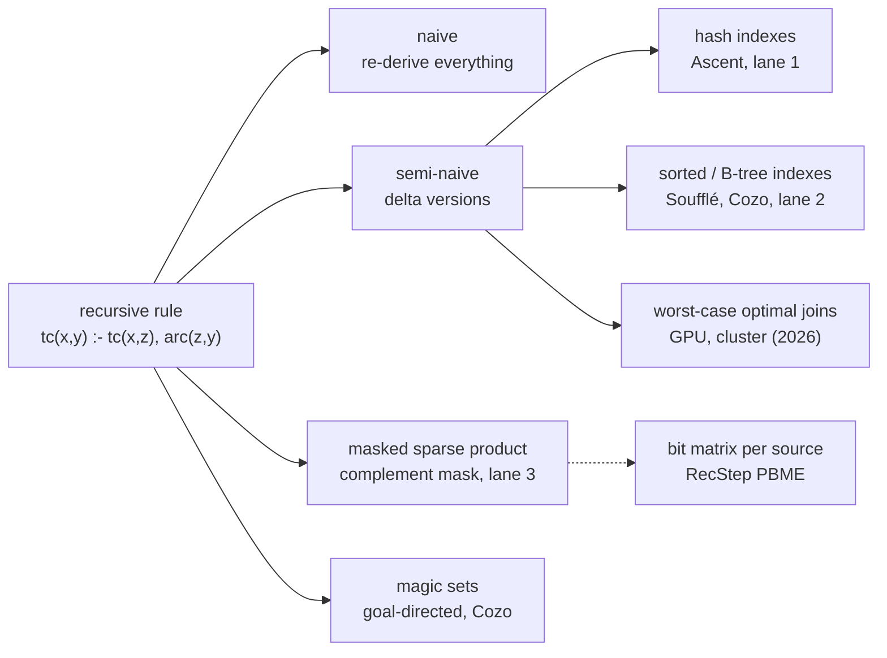

# Topic 55 — Datalog Engines: Recursion as Joins and as Sparse Algebra

Three earlier topics met Datalog from the side. Topic 27 showed semi-naive
evaluation as *incremental view maintenance* — the delta is a batch of
updates — and summarized FlowLog, the Differential-Dataflow Datalog engine.
Topic 44 showed it as an index seek on a timestamp inside egglog, whose
rules run as worst-case optimal joins. Topic 46 showed the same loop as
`WITH RECURSIVE … UNION` inside a relational engine, counting 40,832,336
tuples for a closure that the product-automaton BFS enumerates identically.
None of them opened a Datalog **engine**: what it compiles a recursive rule
into, which indexes it builds, who chooses the join order, and what changes
when the recursion is written as sparse matrix algebra instead — the
formulation a GraphBLAS database like FalkorDB already has the kernels for.

This topic reads four engines (Soufflé, RecStep, Ascent, CozoDB), two 2026
preprints that put worst-case optimal joins into the loop on a GPU and on a
cluster, and the algebra formulation, and prices all of them with one
yardstick: **derivations** — rule-body matches — and how many of them were
duplicates.



## The problem, measured (bench lane 1, provided — runs today)

`cargo run --release --bin datalog_bench` — transitive closure (`tc`) and
same generation (`sg`) on seeded graphs of four shapes: a low-diameter
**power-law** graph (1,500 vertices, 3,489 edges, source and destination
drawn from Zipf(1) with the destination ranks shuffled, so out-hubs and
in-hubs differ), a directed **24 × 24 grid** (diameter 46), a **500-vertex
chain** (diameter 499), and **6,000 disjoint 10-vertex chains** (60,000
vertices, a tiny closure). Every relation is a hash set plus hash-indexed
columns (an Fx-hashed `HashMap<u32, Vec<u32>>`, the same index Ascent
generates). A **derivation** is one successful rule-body match, whether or
not its head tuple is already known; **new** counts distinct head tuples
not yet known; **duplicates** = derivations − new. Apple M3 Pro, measured
2026-10-26, load average 13.51 at the start of the run (other benchmarks
were running on the machine; counts are exact and identical across two runs,
timings are best of 3 within one run):

```
   transitive closure — power-law n=1500  (n = 1500, arc = 3489)
   program / mode                      iters   derivations         new    duplicates   d/new        ms
   tc linear  naive                       21       2109908       65289       2044619   32.32    107.05
   tc linear  semi-naive                  21        137482       65289         72193    2.11     13.01
   tc nonlinear  naive                     6       5882220       65289       5816931   90.10    214.13
   tc nonlinear  semi-naive, textbook      6       2749550       65289       2684261   42.11    104.35
   tc nonlinear  semi-naive, old-delta      6       2143923       65289       2078634   32.84     95.76
   sanity: |tc| = 65289 vs BFS oracle 65289: agree
   sanity: semi-naive derivations 137482 vs |arc| + sum over tc of outdeg(z) = 137482: exact
   naive/semi-naive: derivations 15.3x, time 8.2x
   ?- tc(0,y)  goal-directed (reach)       9          1808         661          1147    2.74      0.04

   transitive closure — chain n=500  (n = 500, arc = 499)
   tc linear  naive                      499      41417499      124750      41292749  332.00   1550.63
   tc linear  semi-naive                 499        124750      124750             0    1.00     16.84
   tc nonlinear  naive                    10      45138521      124750      45013771  361.83   2750.89
   tc nonlinear  semi-naive, textbook     10      24420281      124750      24295531  195.75   1499.45
   tc nonlinear  semi-naive, old-delta     10      20708999      124750      20584249  166.00   1638.68
   naive/semi-naive: derivations 332.0x, time 92.1x
   ?- tc(0,y)  goal-directed (reach)     499           499         499             0    1.00      0.03

   same generation — power-law n=600  (n = 600, arc = 960)
   sg  naive                               6        278931       25408        253523   10.98     15.62
   sg  semi-naive                          6         64787       25408         39379    2.55      3.33
```

The full run also prints the grid and `6000 chains × 10` rows and a
same-generation grid row; the headline counts from all of them:

| program | graph | naive derivations | semi-naive | ratio | duplicates left in semi-naive |
|---|---|---|---|---|---|
| tc linear | power-law | 2,109,908 | 137,482 | **15.3×** | 72,193 (2.11 per new tuple) |
| tc linear | grid 24×24 | 5,248,416 | 165,600 | **31.7×** | 76,176 (1.85) |
| tc linear | chain 500 | 41,417,499 | 124,750 | **332×** | **0** |
| tc linear | 6000 chains × 10 | 1,494,000 | 270,000 | 5.5× | 0 |
| sg | power-law n=600 | 278,931 | 64,787 | 4.3× | 39,379 (2.55) |
| sg | grid 24×24 | 619,986 | 35,468 | 17.5× | 26,291 (3.86) |

**Semi-naive wins by the amount naive re-derives, and that amount is the
depth of the recursion.** The chain needs 499 rounds and naive re-derives
every earlier tuple in every round: 41,417,499 derivations for a 124,750-tuple
closure, **332 per tuple**; semi-naive derives each tuple exactly once (d/new
= 1.00, zero duplicates). The 10-vertex chains need 9 rounds and gain 5.5×.
The ratio tracks diameter, not size — which is why the speed-up in the
engine papers is largest on deep program analyses.

**Semi-naive does not remove duplicates; it removes re-derivation across
rounds.** On the power-law graph 72,193 of 137,482 derivations are
duplicates — *different* derivations of one tuple (two paths of equal or
unequal length). The chain has one path per pair and no duplicates; the
grid has many monotone paths per pair. Soufflé's head filter
([reading-souffle.md](reading-souffle.md) Step 4) removes duplicate
*insertions*, not duplicate *derivations*; only a different join (per-source
BFS, worst-case optimal joins) removes the latter.

**Fewer rounds is not less work.** The nonlinear form `tc(x,z), tc(z,y)`
converges in 6, 7 and 10 rounds against the linear form's 21, 46 and 499 —
and derives **15.6×, 39.7× and 166×** as many tuples to get there
(2,143,923 against 137,482; 6,581,680 against 165,600; 20,708,999 against
124,750), 7.4×, 31× and 97× the time. Round count is a latency metric; in a
setting where each round costs a kernel launch or a network barrier
(the GPU and cluster papers) the trade reverses, which is why those engines
report iteration counts. Within the nonlinear form, the textbook delta split
(`delta ⋈ full ∪ full ⋈ delta`) derives both-new matches twice; the disjoint
split Soufflé and Ascent use removes them — **22.0%** fewer derivations on
the power-law graph (605,627 of 2,749,550), 18.9% on the grid, 15.2% on the
chain. Cozo does neither: its rule-level semi-naive re-runs a rule that
mentions the recursive relation twice in full, so for this rule it *is* the
naive row (5,882,220 — 2.74× the disjoint split;
[reading-cozo.md](reading-cozo.md) Step 2).

**Goal-directed evaluation is the largest saving of all.** The query
`?- tc(0,y)` after a magic-set rewrite is a unary recursion seeded at
vertex 0: **1,808 derivations against 137,482** on the power-law graph
(76×), 1,104 against 165,600 on the grid (150×), 499 against 124,750 on the
chain (250×), 9 against 270,000 on the 10-chains (30,000×) — it computes the
661 closure tuples that start at vertex 0 and no others. Whether the
query binds anything is worth more than every engine optimization in the
chapters below.

The sanity lines are part of the result: the closure size must equal an
independent per-source BFS count on every graph; semi-naive linear TC's
derivation count must equal `|arc| + Σ outdeg(z)` over the closure — an
identity, not an estimate — to the digit; naive and semi-naive must agree on
an order-independent checksum; and the derivation rate (7–42 M/s) must be
far below any implausible figure (topic 12's 19,047,619 GB/s lesson).

### Lane 2 — sorted relations and a per-round join order (exercise)

Soufflé keeps relations as B-trees and Cozo as `BTreeMap`s: ordered, so a
join is a prefix range-scan and the delta merges in linearly. The stub
`src/sorted.rs` is that idea with the tree removed — sorted vectors,
CSR adjacency probes, the delta sorted, anti-joined against the closure by a
merge, and merged in. It also owns a **join-order choice** with a measurable
answer: linear TC can be written `tc(x,z), arc(z,y)` (extend on the right,
`Left`) or `arc(x,z), tc(z,y)` (extend on the left, `Right`). They compute
the same closure with different derivation counts — `Left` fires once per
out-edge of each closure tuple's *target*, `Right` once per in-edge of its
*source*. The reference numbers (notes.md) put the exact counts on the
power-law graph at 137,482 (`Left`), 124,357 (`Right`) and 119,159
(`Adaptive`, which re-chooses every round from the delta's own degrees);
the grid and chains are symmetric and tie.

### Lane 3 — the GraphBLAS formulation (exercise)

`src/algebra.rs`: the closure as the loop `D' = (D·A)⟨¬T⟩; T = T ∨ D'` over
the boolean semiring, with a complement mask — one `GrB_mxm(…,
GrB_DESC_RSC)` per round — and same-generation as `(Aᵀ·D·A)⟨¬SG⟩`, written
in pure Rust against a CSR kernel (consistent with topic 20). The stub tests
pin the central identity: **the masked product attempts exactly the
(frontier entry, arc) pairs semi-naive evaluation enumerates** —
`flops + |arc| = semi-naive derivations` — so the algebra can change the
cost of a derivation but never their number. The reference numbers are in
notes.md: the algebra form is **11–33× faster than lane 1's hash form
on the closure graphs that have a dense-enough closure, and 1.27× slower
where the vertex count is large and the closure sparse** (an n²-bit mask for
a 270,000-tuple closure).

## Reading guides

1. [reading-souffle.md](reading-souffle.md) — Soufflé's translator and index
   selection: delta versions, the head filter, the minimum chain cover of
   searches (PVLDB'18), at `f53dab8`.
2. [reading-recstep.md](reading-recstep.md) — RecStep (PVLDB'19): Datalog on a
   relational engine, optimization on the fly, dynamic set difference with a
   cost model worked, and the bit-matrix evaluation.
3. [reading-ascent.md](reading-ascent.md) — Ascent (CC'22) at `e52c84b`: the
   same loop as a Rust macro, hash indexes, versions spelled `Total`/`Delta`,
   and the one run-time join swap.
4. [reading-cozo.md](reading-cozo.md) — CozoDB at `481af05`: semi-naive per
   rule (and what that costs on nonlinear TC), magic sets, graph algorithms as
   fixed rules.
5. [reading-wcoj-gpu-distributed.md](reading-wcoj-gpu-distributed.md) — the 2026
   preprints on worst-case optimal Datalog on a GPU (SRDatalog) and on a
   cluster (HyperCube), with their headline numbers recomputed from their own
   tables.
6. [reading-datalog-as-linear-algebra.md](reading-datalog-as-linear-algebra.md) —
   Sato's linear-algebraic Datalog, and the sparse masked-product loop as
   multi-source BFS, with the identity between its work and semi-naive's.

## The production shape

| concern | Soufflé `f53dab8` | Ascent `e52c84b` | CozoDB `481af05` | RecStep (paper) |
|---|---|---|---|---|
| recursive rule → versions | one per recursive atom; atom *k* reads `@delta`, later atoms exclude their delta: `UnitTranslator.cpp:403-411`, `Utils.cpp:86-92`, `ClauseTranslator.cpp:523-533` | `versions_base`: `[Delta, Total+Delta]`, `[Total, Delta]`: `ascent_mir.rs:323-335` | per **rule**: changed relation once → delta; more than once → complete run: `eval.rs:520-537` | one `UNION ALL` query per round (§5.1, Alg. 1) |
| fixpoint loop | `@new`, `@delta`, swap, exit when `@new` empty: `UnitTranslator.cpp:526-531, 736, 770-778` | `__changed` flag, delta/total/new shuffle: `ascent_codegen.rs:603-617` | epochs, `merge_in`, stop when no delta: `eval.rs:129, 292-300`; `temp_store.rs:67-88` | dedup, set difference, append (§4) |
| indexes | minimum chain cover per relation, Hopcroft–Karp: `Index.cpp:250-264` | one hash index per bound-column set: `ascent_hir.rs:371-388` | ordered `BTreeMap`: `temp_store.rs:27-28` | engine's hash tables; bit matrix for dense TC/SG |
| relation structure | B-tree/brie/eqrel/indirect: `synthesiser/Relation.cpp:47-74`, `BTree.h:47-55` | `HashMap<K, Vec<V>, Fx>`: `internal.rs:90` | `EpochStore { total, delta }`: `temp_store.rs:249-254` | QuickStep tables |
| join order | user's, plus the profile-guided join optimizer (LOPSTR'22, not read) | user's; first two clauses swapped at run time by `len_estimate`: `ascent_codegen.rs:878-900` | user's | re-planned every round (OOF, §5.1) |
| goal direction | — | — | magic-set rewrite: `magic.rs:55-65` | — |

## Experiments

`experiments/` — crate `datalog-experiments`, committed `Cargo.lock`, seeded
generators (`gen.rs`: Zipf via correctly-rounded `+ * /` only, never `powf`,
so counts reproduce bit-for-bit on any machine). Lane 1 (`eval.rs`) is
provided; lanes 2 and 3 are stubs whose tests are the specification, and
`datalog_bench` prints `STUB` for them and exits 0 on a fresh clone.

```bash
cd experiments
cargo test                       # lane-1 tests pass; sorted/algebra tests fail until implemented
cargo run --release --bin datalog_bench
```

## Exercises

1. **Lane 2** — `tc_sorted` for `Left`, `Right` and `Adaptive` and the
   exact-count contract. Record in notes.md why a *static* choice from
   degree statistics cannot work: show that `Σ_z out(z)·(walks of length ≤ k
   ending at z)` equals `Σ_z in(z)·(walks of length ≤ k starting at z)` for
   every k, so the two forms look identical to any walk-count estimator.
2. **Lane 3** — `mxm_complement_mask`, `tc_algebra`, `sg_algebra`; assert the
   flops identity; then measure the three crossovers (n, closure density,
   depth).
3. Replace lane 3's dense mask with a per-row hash or sorted-list mask and
   re-run `6000 chains × 10`: the gap to lane 1 should close (the cost was
   the n² address space, not the algebra).
4. Per-source evaluation (RecStep Algorithm 2) as a fourth lane: for each
   source run the BFS to completion on a bit row. Compare with the per-round
   matrix loop on all four graphs, and say what the loop order changes.
5. Make the comparison fair: give lane 1's `tc_linear` a bit-matrix
   membership test instead of a hash set and re-measure. How much of lane 3's
   advantage was the formulation, and how much the bit test?
6. Magic sets for same-generation: `?- sg(5,y)`. Write the adorned program,
   the magic relation, and the evaluator; report derivations against the full
   `sg` on the grid.
7. Add Ascent's run-time swap to lane 1's nonlinear TC (compare `tc` sizes at
   round start) and count what it saves — then find a graph where it picks
   the dearer order.

## Cross-topic threads

- **Topic 27 (streaming) ↔ 55.** Semi-naive is the delta of an incremental
  view; FlowLog (summarized there) is the Differential-Dataflow Datalog
  engine, a baseline in every paper of this topic.
- **Topic 44 (e-graphs) ↔ 55.** egglog's engine is a Datalog engine whose
  joins are worst-case optimal; Step 1 of
  [reading-wcoj-gpu-distributed.md](reading-wcoj-gpu-distributed.md) uses topic
  44's AGM bound.
- **Topic 46 (relational graph) ↔ 55.** `WITH RECURSIVE … UNION` is the
  semi-naive loop in SQL; the closure it derives (40,832,336 tuples) is the
  quantity lane 1 counts.
- **Topic 47 (semi-join reduction) ↔ 55.** Magic sets' supplementary
  relations are semi-joins; goal-directed `tc(0,y)` is the same
  "keep only what can reach the answer" idea.
- **Topic 20 (GraphBLAS) ↔ 55.** Lane 3's loop is LAGraph's BFS level with
  the frontier promoted to a matrix: the descriptor `GrB_DESC_RSC`
  ([reading-lagraph.md](../20-graphblas/reading-lagraph.md)) is the head filter.
- **Topic 54 (main-memory join algorithms) ↔ 55.** Hash, sort-merge and
  worst-case optimal joins are what the loop's `⋈` can be; this topic holds
  the loop fixed and varies the structure beneath it
  (`topics/54-join-algorithms/`).
