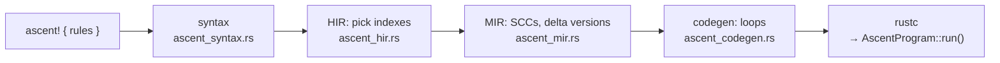

# Ascent: Datalog as a Rust macro — the same delta versions, hash indexes, and a join order chosen at run time

Ascent is the Datalog engine written for people who already write Rust: the
rules sit inside an `ascent! { … }` block, the macro expands them into plain
Rust loops at compile time, and the relations are ordinary struct fields you
can fill from and read back into Rust values. That makes it the smallest
real Datalog compiler to read in full — a few thousand lines, not Soufflé's
hundreds of thousands — and, for this topic, the one whose generated loops
look most like lane 1 of `datalog_bench`.

Read at `s-arash/ascent` commit `e52c84b` (a fresh clone at `~/repos/ascent`;
line numbers belong to it). The paper is Sahebolamri, Gilray, Micinski,
**"Seamless Deductive Inference via Macros"**, CC 2022, pp. 77–88
([pdf](https://s-arash.github.io/ascent/cc22main-p95-seamless-deductive-inference-via-macros.pdf),
linked from the repository's README); §4 is the compilation story, §5 the
evaluation. A later OOPSLA 2023 paper, *Bring Your Own Data Structures to
Datalog*, covers Ascent's pluggable relation types (`BYODS.MD` in the
repository); it is named here but not read.

Soufflé's translator, which this chapter compares against throughout, is in
[reading-souffle.md](reading-souffle.md) — read that first for the vocabulary
(*delta*, *stratum*, *derivation*).

## The problem in one sentence

How little machinery does it take to compile Datalog rules into fast nested
loops — which relations get which indexes, how the recursive rules are split
into delta versions, and who decides the join order?

## The concepts, step by step

### Step 1 — the pipeline: macro input to Rust loops

> **In:** an `ascent!` block, e.g. `path(x,z) <-- edge(x,y), path(y,z);`.
> **Out:** the four passes the macro runs, and the file each lives in.

A **procedural macro** is a Rust function that runs at compile time, receives
the tokens between the macro's braces and returns tokens to splice into the
program. `ascent!` parses the rules (`ascent_syntax.rs`), lowers them to a
high-level IR in which every body atom already names an index
(`ascent_hir.rs`), then to a mid-level IR in which recursive rules are
duplicated into delta versions and strata are ordered (`ascent_mir.rs`), and
finally emits Rust code (`ascent_codegen.rs`). There is no run-time rule
interpreter and no plan: the "query plan" is the generated Rust, compiled by
`rustc` together with the rest of your program.



### Step 2 — index selection: one hash index per bound-column set, no chain cover

> **In:** a rule body read left to right. **Out:** for each atom, the set of
> columns used as the index key — and what that costs next to Soufflé's.

For every body atom the HIR pass walks the arguments left to right and keeps
a list of **grounded** variables — variables already bound by an earlier
atom. A column is part of the atom's index key when it holds a constant or an
already-grounded variable; a column holding a fresh variable is not:

```rust
// ascent_macro/src/ascent_hir.rs:371-388 — index columns of one body clause (ascent e52c84b)
371              let mut indices = vec![];
372              for (i, arg) in bcl.args.iter().enumerate() {
373                 if let Some(var) = expr_to_ident(arg.unwrap_expr_ref()) {
374                    if grounded_vars.contains(&var) {
375                       indices.push(i);
376                       if first_clause_ind == Some(bitem_ind) {
377                          first_two_clauses_simple = false;
378                       }
379                    } else {
380                       grounded_vars.push(var);
381                    }
382                 } else {
383                    indices.push(i);
384                    if bitem_ind < 2 + first_clause_ind.unwrap_or(0) {
385                       first_two_clauses_simple = false;
386                    }
387                 }
388              }
```

The line to focus on is 375: a column enters the key exactly when its
variable was grounded earlier. For `path(x,z) <-- edge(x,y), path(y,z)` the
first atom `edge(x,y)` grounds `x` and `y` and has an empty key (it is
scanned); the second `path(y,z)` has `y` grounded, so its key is column 0.
The paper states the rule: "computing — for each relation — subsets of
columns relevant to joins" (§4, *Index selection*). Each distinct
(relation, key columns) pair becomes one **index**, named by
`ir_name_for_rel_indices` (`ascent_hir.rs:487`), and there is no step that
merges indexes: where Soufflé's chain cover (reading-souffle Step 5) would
let one index on `x≺y≺z` serve searches on `{x}` and `{x,y}`, Ascent builds
one for each, because a **hash** index can only answer an equality lookup on
its *whole* key, not a prefix. The index itself is
`HashMap<K, Vec<V>, BuildHasherDefault<FxHasher>>`
(`ascent/src/internal.rs:90`): an Fx-hashed map from key to a vector of
tuple indexes, i.e. exactly lane 1's `by0: FxMap<u32, Vec<u32>>`. The paper
says the quiet part plainly: "Ascent relies on hashing for indexing
relations, which allows more types to be used as relation columns, but
sacrifices some performance" (§7).

### Step 3 — delta versions, spelled with three states

> **In:** a recursive rule and Soufflé's version split from
> [reading-souffle.md](reading-souffle.md) Step 3. **Out:** the same
> partition written with `Total`, `Delta` and `TotalDelta`, and a count check.

Ascent gives every dynamic (recursive) relation three states: **total**
(found before the last round), **delta** (found in the last round) and
**new** (being found now) — "partitioning each relation into three sets: new,
delta, and total" (§4). Note the difference from Soufflé: Ascent's `total`
*excludes* the delta, and it provides a read of "total + delta" as a
combined view. A rule with `count` recursive atoms is expanded into one
version per atom:

```rust
// ascent_macro/src/ascent_mir.rs:323-335 — the version combinations (ascent e52c84b)
323     fn versions_base(count: usize) -> Vec<Vec<MirRelationVersion>> {
324        if count == 0 {
325           vec![]
326        } else {
327           let mut res = versions_base(count - 1);
328           for v in &mut res {
329              v.push(MirRelationVersion::TotalDelta);
330           }
331           let mut new_combination = vec![MirRelationVersion::Total; count];
332           new_combination[count - 1] = MirRelationVersion::Delta;
333           res.push(new_combination);
334           res
335        }
```

Work it for two recursive atoms (`count = 2`, like `tc(x,z), tc(z,y)`).
`versions_base(1)` is `[[Delta]]`. For `count = 2`: line 327 takes that,
line 329 appends `TotalDelta` to each → `[[Delta, TotalDelta]]`; lines
331–333 add `[Total, Delta]`. So the two versions are

| version | atom 0 | atom 1 | covers |
|---|---|---|---|
| 0 | delta | total + delta | new × (old ∪ new) |
| 1 | total (old) | delta | old × new |

— the "delta × full, then old × delta" split, the mirror image of Soufflé's
and exactly lane 1's `OldDelta`: every match containing a new tuple appears
once. Ascent gets disjointness from *which view is read* — `Total` is
already the old part — where Soufflé gets it from a negated-delta filter
(`ClauseTranslator.cpp:530-531`). Same counts, different mechanism; lane 1's
2,143,923 derivations (power-law, nonlinear TC) is the number either one
produces, against 2,749,550 for the split that reads full relations in both
versions.

The loop that drives it is the same shape as Soufflé's: evaluate the rules,
merge delta into total and new into delta, repeat until the `__changed` flag
stays false (`ascent_codegen.rs:603-617`; the exit test is line 616).

### Step 4 — the head check, and the join order chosen at run time

> **In:** the generated loop for one rule. **Out:** where duplicates are
> dropped, and the one place Ascent picks a join order from run-time sizes.

When a rule fires, the generated code inserts the head tuple only if it is
in neither total nor delta, and only if the insert into the `new` full index
succeeds:

```rust
// ascent_macro/src/ascent_codegen.rs:1200-1206 — head insertion (ascent e52c84b)
1200            let __new_row: #row_type = #new_row_tuple;
1201
1202            if !::ascent::internal::RelFullIndexRead::contains_key(&#head_rel_full_index_expr_total, &__new_row) &&
1203               !::ascent::internal::RelFullIndexRead::contains_key(&#head_rel_full_index_expr_delta, &__new_row) {
1204               if #rel_full_index_write_trait::insert_if_not_present(#new_ref #head_rel_full_index_expr_new,
1205                  &__new_row, ())
```

That is lane 1's `!tc.contains(x, y) && seen.insert(pack(x, y))` — two hash
probes per derivation, which is why lane 1 counts *derivations* and not
inserts as the work metric.

The second thing is a join-order decision. Body order is the user's: the
paper says "the order of clauses in Ascent is significant", but "the compiler
is capable of reordering clauses in cases where such reordering does not
introduce ungrounded variables" (§4, *Code generation*). The reordering is
narrow and happens at run time:

```rust
// ascent_macro/src/ascent_codegen.rs:878-900 — swap the first two clauses by size (ascent e52c84b)
878     if Some(clause_ind) == rule.simple_join_start_index && rule.reorderable {
879        let mut rule_cp1 = rule.clone();
880        let mut rule_cp2 = rule.clone();
881        rule_cp1.reorderable = false;
882        rule_cp2.reorderable = false;
883        rule_cp2.body_items.swap(clause_ind, clause_ind + 1);
884        let rule_cp1_compiled =
885           compile_mir_rule_inner(&rule_cp1, _scc, mir, par_iter_to_ind, head_update_code.clone(), clause_ind);
886        let rule_cp2_compiled =
887           compile_mir_rule_inner(&rule_cp2, _scc, mir, par_iter_to_ind, head_update_code, clause_ind);
// ... 888-891: destructure the two clauses ...
892        let rel1_var_name = expr_for_rel(&bcl1.rel, mir);
893        let rel2_var_name = expr_for_rel(&bcl2.rel, mir);
894
895        return quote_spanned! {bcl1.rel_args_span=>
896           if #rel1_var_name.len_estimate() <= #rel2_var_name.len_estimate() {
897              #rule_cp1_compiled
898           } else {
899              #rule_cp2_compiled
900           }
```

Line 896 is the line to focus on: the generated program compares the
`len_estimate()` of the two relations and runs the compiled copy that scans
the smaller one first. For a **simple
join** — the first two body atoms, neither depending on anything before
them (`reorderable`, computed at `ascent_mir.rs:421-424`) — the macro
compiles *both* orders and the generated program picks at run time, every
time the rule runs, by comparing the two relations' sizes. That is a
per-round, statistics-driven join-order choice, restricted to two clauses
and using cardinality (`len_estimate`) rather than the delta's degree sums.
Lane 2's `Form::Adaptive` is the same idea one step further: it chooses,
each round, which end of the delta tuple to extend, from the delta's own
degrees (`out(z)` against `in(x)` summed over the delta). The reference
numbers in notes.md put a number on what that buys on a skewed graph.

### Step 5 — what the paper measured, and what it did not

> **In:** the evaluation section. **Out:** which claims are about the
> macro-embedding and which are about evaluation strategy.

§5 compares Ascent against Datafrog (a Rust Datalog library), Flix and
Soufflé on the Rust borrow checker (Polonius), shortest paths and clique
finding. Two statements to hold on to, both from the paper's own text: on
the shortest-paths benchmark Ascent is "between 56× and 170× faster than a
comparable implementation in Flix" (§1, Table 2), and on 5-clique mining it
"is competitive with Soufflé's single-threaded performance" while "Soufflé is
capable of generating multithreaded code, a feature currently absent in
Ascent" (§5, Table 3 — the repository now has a parallel mode,
`is_parallel` in `ascent_hir.rs`, which the paper's version did not). None of
this evaluates semi-naive against alternatives; the delta machinery is
taken as given. The honest summary for this topic: Ascent shows how far a
hash-indexed, single-order nested-loop compiler gets — competitive with
Soufflé on small graph workloads — and the GPU and distributed engines
(next chapter) exist because that design meets the AGM bound on cyclic
queries no matter how the clauses are ordered.

## How to read the source (with the concepts in hand)

1. `ascent_macro/src/ascent_hir.rs:321-484` — `compile_rule_to_ir_rule`, the
   grounded-variable walk of Step 2.
2. `ascent_macro/src/ascent_mir.rs:322-433` — version combinations (Step 3)
   and the `reorderable` computation.
3. `ascent_macro/src/ascent_codegen.rs:448-640` — `compile_mir_scc`, the loop
   and the delta/total/new shuffles; then 874-900 for the join swap; then
   1185-1210 for the head insertion.
4. `ascent/src/internal.rs:88-100` and `rel_index_boilerplate.rs` — the
   index type and its read/write traits.

## Where each step lives in this topic

| step | file / lane | what to look at |
|---|---|---|
| 2 | `experiments/src/eval.rs`, `HashRel` | hash set + per-column `FxMap<u32, Vec<u32>>` |
| 3 | `eval.rs`, `Nonlinear::OldDelta` | the delta × full, old × delta split: 2,143,923 derivations |
| 4 | lane 2, `sorted.rs` `Form::Adaptive` | per-round choice from the delta |

## Questions (answer in notes.md)

1. For `foo(x,z) <-- bar(x,y), baz(x,y,z)` what index key does each atom get?
   How many indexes would Soufflé's chain cover need if the program also had
   a rule that looks `baz` up on `x` alone, and how many does Ascent build?
2. Work `versions_base(3)` by hand. How many versions, and which views does
   version 1 read?
3. Why is `total` allowed to *exclude* the delta in Ascent but must
   *include* it in Soufflé's formulation?
4. The run-time swap at line 896 compares `len_estimate()`. Construct a
   two-relation join where the smaller relation is the worse one to scan
   first.

## Done when

Answer each before unfolding it.

- [ ] You can say how Ascent chooses an atom's index key and why it cannot share indexes between searches.

  <details><summary>Answer</summary>

  A column is in the key when its variable was bound by an earlier atom or it
  is a constant (`ascent_hir.rs:373-375, 383`); each distinct (relation, key)
  gets its own hash index. A hash index answers equality on the whole key
  only, so `{x}` and `{x,y}` cannot share one, whereas a sorted index on
  `x≺y` serves both as prefixes — the chain-cover saving Soufflé gets and
  Ascent does not (paper §7: "relies on hashing … sacrifices some
  performance").

  </details>

- [ ] You can derive the version list for a rule with two recursive atoms.

  <details><summary>Answer</summary>

  `versions_base(2)` = `[[Delta, TotalDelta], [Total, Delta]]`
  (`ascent_mir.rs:327-333`): atom 0 delta with atom 1 over total+delta; then
  atom 0 over total (old) with atom 1 delta. Every match with at least one new
  tuple is produced exactly once; this is the same partition as lane 1's
  `OldDelta`, which derives 2,143,923 tuples on the power-law graph against
  2,749,550 for the textbook split.

  </details>

- [ ] You can describe the one run-time join-order decision Ascent makes.

  <details><summary>Answer</summary>

  For a rule whose first two atoms form a simple join (`reorderable`), the
  macro compiles both orders and emits an `if` comparing the two relations'
  `len_estimate()`; the smaller is scanned first (`ascent_codegen.rs:878-900`).
  Only those two clauses are considered and the criterion is relation size,
  not the delta's degree sums.

  </details>

- [ ] You can state what the paper does and does not show about semi-naive evaluation.

  <details><summary>Answer</summary>

  It describes the three-way new/delta/total partition (§4) and reports
  performance against Datafrog, Flix and Soufflé (§5: 56×–170× over Flix on
  shortest paths; competitive with single-threaded Soufflé on 5-cliques). It
  does not compare semi-naive with any alternative, so no figure in it says
  what the delta saves; lane 1 measures that (5.5×–332× fewer derivations
  than naive on linear TC).

  </details>

## References

- Arash Sahebolamri, Thomas Gilray, Kristopher Micinski, **"Seamless
  Deductive Inference via Macros"**, CC 2022 — §4 (index selection, SCCs and
  incrementalization, code generation), §5 (Tables 2–3), §7 (hashing).
- `s-arash/ascent` at `e52c84b`: `ascent_macro/src/ascent_hir.rs`,
  `ascent_mir.rs`, `ascent_codegen.rs`; `ascent/src/internal.rs`.
- Named but not read: **"Bring Your Own Data Structures to Datalog"**,
  OOPSLA 2023.
- [reading-souffle.md](reading-souffle.md) for the comparison; topic 44's
  [reading-egglog-source.md](../44-egraphs-egglog/reading-egglog-source.md)
  for a Rust engine whose joins are *not* nested loops.
