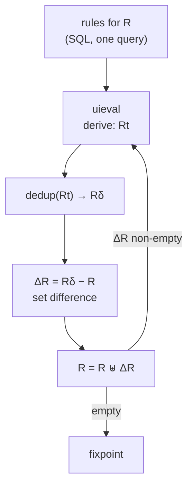

# RecStep: Datalog on top of a relational engine, and the bit-matrix that skips the join

Every other engine in this topic *compiles* Datalog to its own loops. RecStep
asks the opposite question: can the recursion be driven from **outside** an
ordinary parallel in-memory relational engine, one SQL query per rule per
round, and still win? The paper's answer is yes, but only after five
engineering changes to how that engine is used — and then, for dense graphs,
by abandoning joins and hash tables altogether for a **bit-matrix**, which is
the data structure lane 3 of `datalog_bench` uses for its mask.

**"Scaling-Up In-Memory Datalog Processing: Observations and Techniques"** —
Zhiwei Fan, Jianqiao Zhu, Zuyu Zhang, Aws Albarghouthi, Paraschos Koutris,
Jignesh Patel. PVLDB 12(6): 695–708, 2019
([arXiv 1812.03975](https://arxiv.org/abs/1812.03975), the version read
here). RecStep is built on QuickStep, a single-node in-memory parallel
relational engine (§1).

Topic 27's [README](../27-streaming/README.md) already cites the
**FlowLog** paper (Differential-Dataflow-based, VLDB 2026), which lists
RecStep as a baseline and whose authors include RecStep's Fan and Koutris;
this chapter reads RecStep itself.

## The problem in one sentence

Semi-naive evaluation turns a recursive rule into one non-recursive query per
round, so what stops a stock parallel relational engine from running it —
and which of the things that stop it are about the *queries* (plans, set
difference, duplicate elimination) rather than the recursion?

## The concepts, step by step

### Step 1 — the loop RecStep drives, and what each line costs

> **In:** the transitive-closure program `tc(x,y) :- arc(x,y).  tc(x,y) :-
> tc(x,z), arc(z,y).` **Out:** Algorithm 1's loop in lane-1 terms, and the
> three places it is slow.

RecStep's control loop (§4, Algorithm 1, lines 8–13 of the listing)
evaluates the stratum's rules as SQL and then does four things per round:

```
8:   Rt ← uieval(rules(R, s))      // run every rule for R as one query → a temporary table
10:  Rδ ← dedup(Rt)                // remove duplicates inside the round's output
12:  ΔR ← Rδ − R                   // set difference: keep tuples not yet in R
13:  R ← R ⊎ ΔR                    // append the new tuples
```

Map to lane 1's `tc_linear`: `uieval` is the double loop deriving tuples
(`derivations`); `dedup` is the `seen` set; `ΔR ← Rδ − R` is
`!tc.contains(x, y)`; the append is `merge`. The relational engine knows
nothing about recursion; every round is plain queries over tables that grew
by the previous round's delta. The paper's §1 states what that costs and
RecStep fixes: **the plan chosen for a query is stale** (Step 2), **the set
difference and the dedup are the bottleneck operators** (Steps 3–4), and
**intermediate results are huge on dense graphs** (Step 5).



### Step 2 — optimize on the fly (OOF): re-plan every round with real sizes

> **In:** Step 1's per-round queries. **Out:** why the plan must change
> between rounds and what the authors measured for it.

A relational optimizer picks a join order and algorithm from table
statistics (row counts, distinct counts). In a recursive program those
statistics change every round: `tc` is empty, then small, then huge. A plan
chosen once from the initial statistics is wrong later in the way topic 10's
cardinality chapter describes. RecStep's **optimization on the fly (OOF)**
re-runs the optimizer each round with fresh statistics — "the same set of
sql queries are re-optimized at each iteration considering the change of idb
tables and intermediate results" (§5). The measurement is on the paper's CSPA
(context-sensitive points-to) analysis over the httpd dataset, with the
runtime of RecStep with *all* optimizations off (RecStep-NO-OP) taken as
100% (Figure 2's caption; the §5.1 prose calls it Figure 4): with the plan
never updated (`oof-na`) the runtime is **63%**; with full statistics
re-collected every round (`oof-fa`) **41%**; with RecStep's lightweight
statistics **24%** — the authors' "∼2.5x speedup … for the specific
program" (63/24 = 2.6). It is the
database-side twin of lane 2's per-round `Adaptive` choice, driven by the
delta's actual degrees, and of Ascent's run-time `len_estimate` swap
([reading-ascent.md](reading-ascent.md) Step 4).

### Step 3 — dynamic set difference: build the hash table on the right side

> **In:** the cost of `ΔR ← Rδ − R` at round *i*. **Out:** the paper's two
> implementations, a cost model, and a worked example where each wins.

A **set difference** `Rδ − R` keeps the rows of Rδ that have no equal row in
R. A hash-based plan builds a table on one side and probes with the other.
Because R only grows, building on R gets dearer every round even when Rδ is
tiny. RecStep has two plans and chooses per round (§5.1, *Dynamic
Set-Difference*; costs in Appendix A, equation 1):

- **OPSD**, one-phase: build a hash table on R, probe with Rδ.
  Cost = C_b·|R| + C_p·|Rδ| (build cost C_b per row, probe cost C_p).
- **TPSD**, two-phase: first intersect — build on the smaller of R, Rδ and
  probe with the larger to get r = R ∩ Rδ — then build on r and probe with
  R. Cost = C_b·(min(|R|,|Rδ|) + |r|) + C_p·(max(|R|,|Rδ|) + |Rδ|).

Worked, in units of C_p with α = C_b/C_p = 2:

```
Case A: |R| = 1,000,000   |Rδ| = 10,000   |r| = 2,000      (a late, small delta)
  OPSD = 2 × 1,000,000 + 10,000                        = 2,010,000
  TPSD = 2 × (10,000 + 2,000) + (1,000,000 + 10,000)   = 1,034,000   → TPSD 1.94× cheaper

Case B: |R| = 5,000       |Rδ| = 8,000    |r| = 1,000      (an early, big delta)
  OPSD = 2 × 5,000 + 8,000                             = 18,000
  TPSD = 2 × (5,000 + 1,000) + (8,000 + 8,000)         = 28,000   → OPSD cheaper
```

The appendix proves the rule of thumb: with β = |R|/|Rδ|, OPSD always when
|R| ≤ |Rδ| (β ≤ 1; the difference is −(C_b|r| + C_p|Rδ|) < 0), TPSD when
β ≥ 2α/(α−1) — for α = 2 that is β ≥ 4, and case A has β = 100 — and in
between a heuristic using the previous round's |Rδ|/|r|. In lane 1 terms
this is the choice between probing `tc.contains` (a hash of the *whole*
closure) and a cheaper structure: lane 3's complement mask is a third
answer, an O(1) bit test with no hash table to rebuild at all.

### Step 4 — the other four optimizations, one line each

> **In:** Steps 1–3. **Out:** the remaining techniques of §5 and where each
> bites.

**Unified IDB evaluation (UIE)**: all rules with the same head, and all
sub-queries of a recursive rule, go out as one `UNION ALL` query instead of
many (Figure 4's Andersen-analysis example has seven sub-queries for `pointsTo`), so
the engine can use all its cores on one plan. **Evaluation as one single
transaction (EOST)**: the whole program is one transaction, nothing committed
until the end, which removes per-round logging and checkpoint cost.
**Fast deduplication**: a specialized hash table that packs the two 4-byte
columns of a binary tuple into one 8-byte key (Figure 5), so dedup compares
one word. And **parallel bit-matrix evaluation (PBME)**, Step 5 — the one the
rest of this topic leans on.

### Step 5 — PBME: when the relation is dense, store it as bits and merge join with dedup

> **In:** transitive closure over a graph with a small vertex domain.
> **Out:** Algorithm 2, why it removes the intermediate table, and what it
> costs in lane-3 terms.

On dense graphs the closure is enormous (the paper's G5K–G80K random
graphs, §6.2) and the hash tables for joins and dedup dominate memory; the
paper reports the stock engine "run[s] out of memory due to the high
materialization cost". If the relation's two attributes range over a small
domain 1..n, represent it as an n × n **bit matrix** M — bit (a, b) is 1
when the tuple (a, b) is present — instead of a set of tuples. Algorithm 2
(§5.3) evaluates TC row by row, each row independently:

```
for each row i (rows split across k threads, no coordination):
    δ ← { u | M_tc[i,u] = 1 }               // the row's current tuples
    while δ ≠ ∅:
        δn ← ∅
        for t in δ:
            for j with M_arc[t,j] = 1:       // out-neighbours of t
                if M_tc[i,j] = 0:  δn ← δn ∪ {j};  M_tc[i,j] ← 1
        δ ← δn
```

This is semi-naive evaluation *per source*: δ is the delta of row i. The
join `tc(i,t) ⋈ arc(t,j)` and the dedup `tc(i,j) not yet present` happen in
one step — the bit test `M_tc[i,j] = 0` — so **no intermediate relation is
materialized and no hash table exists**; the paper's phrase is that the
evaluation "naturally fuses the join and deduplication into a single
computation" (§6, *TC and SG experiments*). Threads own disjoint rows, so
there is no synchronization ("zero-coordination", §5.3). It is only used when
the bit matrix plus any index fits in memory (§5.3). The authors report
that for TC and SG on the dense Gn-p graphs RecStep "is the only one that
can complete the evaluation … on all Gn-p graphs" among the compared systems
(§6; Figures 10–11 plot time and memory).

Compare Step 5 with lane 3. A masked sparse matrix product with a complement
mask is the same computation with the loop order inverted — *all rows at
once, one round at a time* (breadth-first by frontier matrix) rather than
*one row at a time to completion* (per-source BFS). Both test a bit before
writing; both count exactly the same derivations as semi-naive (every
(delta tuple, arc) pair, once). The notes.md reference table gives
per-source PBME's time beside the matrix form's on the same graphs.

## How to read the paper (with the concepts in hand)

1. **§1–§3** — twenty minutes; skim the related-work discussion for the map
   of systems (BigDatalog, Myria, bddbddb, Graspan, Soufflé).
2. **§4, Algorithm 1 and Figure 1** — the loop of Step 1.
3. **§5.1 with Figures 2–5** and **Appendix A, C** — Steps 2–4; do the
   cost-model algebra yourself against Step 3's examples.
4. **§5.3 with Algorithms 2–3** — Step 5. Algorithm 3 (same generation) is
   the same loop with a pair frontier.
5. **§6, the TC/SG paragraph and Figures 10–11, 15** — what the bit matrix
   bought on dense graphs and on program analyses.

## Where each step lives in this topic

| step | file / lane | what to look at |
|---|---|---|
| 1 | `experiments/src/eval.rs`, `tc_linear` | derive / `seen` / `contains` / `merge` = Algorithm 1 |
| 2 | lane 2, `Form::Adaptive` | per-round re-planning from the delta's statistics |
| 3 | lane 3's mask | an O(1) membership test in place of a rebuilt hash table |
| 5 | lane 3, `tc_algebra` and notes.md's PBME row | the same bit test, two loop orders |

## Questions (answer in notes.md)

1. Step 3, case A with α = 3: compute OPSD and TPSD for |R| = 1,000,000,
   |Rδ| = 10,000, |r| = 2,000 and the β threshold 2α/(α−1). Is β above it?
2. Algorithm 2 never builds an `arc` hash index. What structure does
   `M_arc[t,j] = 1` iterate over, and what would you use for a *sparse*
   graph with n = 10⁷?
3. PBME needs n² bits. For n = 10,000, how many bytes? For n = 80,000 (the
   paper's G80K)? Compare with lane 3's `BitMatrix` at n = 60,000.
4. Which of Steps 2–5 would still help if the recursion were linear and
   the graph a single long chain (lane 1's chain dataset)?

## Done when

Answer each before unfolding it.

- [ ] You can name the per-round operations of RecStep's loop and map each to lane 1.

  <details><summary>Answer</summary>

  `uieval` (derive; lane 1's double loop and its `derivations` count), `dedup`
  (the `seen` set), set difference `ΔR ← Rδ − R` (`!tc.contains`), and the
  append (`merge`) — Algorithm 1 lines 8–13. The relational engine is
  recursion-oblivious: each round is ordinary queries.

  </details>

- [ ] You can choose between OPSD and TPSD for given sizes and justify it.

  <details><summary>Answer</summary>

  Compute C_b|R| + C_p|Rδ| and C_b(min + |r|) + C_p(max + |Rδ|). With α = 2,
  |R| = 1,000,000, |Rδ| = 10,000, |r| = 2,000: OPSD 2,010,000, TPSD 1,034,000,
  so TPSD (β = 100 ≥ 2α/(α−1) = 4). With |R| ≤ |Rδ| OPSD is always cheaper
  (difference −(C_b|r| + C_p|Rδ|), Appendix A eq. 3).

  </details>

- [ ] You can say why OOF is needed in a recursive program.

  <details><summary>Answer</summary>

  The statistics a plan was chosen from change every round (the IDB grows
  from empty to huge), so a plan fixed in round 0 degrades; RecStep re-plans
  each round with updated statistics. On CSPA over httpd the paper shows
  63% of the no-optimization runtime with stale statistics, 41% with full
  re-analysis and 24% with its lightweight version (§5.1, Figure 2).

  </details>

- [ ] You can explain how PBME avoids both the intermediate table and the hash table.

  <details><summary>Answer</summary>

  The relation is an n × n bit matrix. For each row i, the delta is the set of
  newly set bits; extending it walks the arc row of each delta vertex and the
  test `M_tc[i,j] = 0` both performs the join's dedup and records the new
  tuple, so the join result is never materialized and no hash table is built.
  Threads own disjoint rows, so no coordination is needed (§5.3, Algorithm 2).

  </details>

- [ ] You can state what PBME costs and when it is not usable.

  <details><summary>Answer</summary>

  n² bits regardless of how many tuples exist — 12.5 MB at n = 10,000 but
  800 MB at n = 80,000 and 450 MB at n = 60,000 — so it is used only when the
  domain is small or dense enough that the matrix fits in memory (§5.3).
  On a sparse many-vertex graph the matrix is mostly empty address space;
  notes.md's `6000 chains × 10` row shows lane 3 paying for exactly that.

  </details>

## References

- Zhiwei Fan, Jianqiao Zhu, Zuyu Zhang, Aws Albarghouthi, Paraschos Koutris,
  Jignesh Patel, **"Scaling-Up In-Memory Datalog Processing: Observations
  and Techniques"**, PVLDB 12(6), 2019 (arXiv 1812.03975) — §4 (Algorithm 1),
  §5.1–5.3 (UIE, OOF, DSD, EOST, fast dedup, PBME), §6 (TC/SG, Figures
  10–11), Appendix A (DSD cost model).
- Hangdong Zhao et al., **FlowLog** (PVLDB 19(3), VLDB 2026), summarized in
  topic 27's README, for a later engine that lists RecStep as a baseline.
- [reading-souffle.md](reading-souffle.md) for the compiled alternative;
  topic 10's [reading-selinger-cascades.md](../10-query-planning/reading-selinger-cascades.md)
  for why plans go stale.
