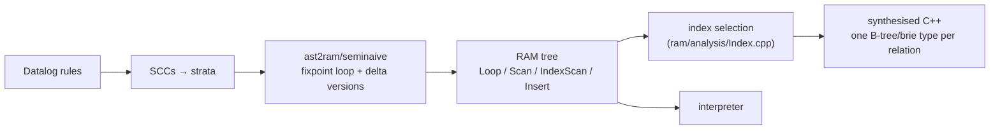

# Soufflé: Datalog compiled to nested loops — delta versions, a head filter, and the fewest indexes that cover every search

Soufflé is the engine the other Datalog papers measure themselves against
(FlowLog, RecStep, SRDatalog and the distributed WCOJ engine all list it as
a baseline, and the program-analysis frameworks DOOP and ddisasm run on it).
This chapter reads it from the inside, in two pieces: the **translator** that
turns a recursive rule into a fixpoint loop over `@delta` and `@new`
relations, and the **index selection** that decides which sorted copies of
each relation exist. It reads the source, not a benchmark: Soufflé is not
run here — lane 1 of `datalog_bench` is a hand-written re-implementation of
the evaluation strategy this chapter reads, and every claim about Soufflé's
code below is an anchor you can open.

Read at `souffle-lang/souffle` commit `f53dab8` (a fresh clone at `~/repos/souffle`; the
line numbers below belong to it). The paper is Subotić, Jordan, Chang,
Fekete, Scholz, **"Automatic Index Selection for Large-Scale Datalog
Computation"**, PVLDB 12(2), 2018, pp. 141–153
([pdf](http://www.vldb.org/pvldb/vol12/p141-subotic.pdf)). Soufflé's other
papers — the CAV'16 tool paper, and the PPoPP'19 B-tree and PMAM'19 brie
papers — are named in the references but were not read for this chapter, so
nothing here is attributed to them.

Topic 27's [README](../27-streaming/README.md) already covers semi-naive
evaluation as *incremental view maintenance* (the delta is an update batch),
and topic 44 covers it as an index seek on a timestamp. This chapter is the
batch-engine view: what a Datalog compiler emits.

## The problem in one sentence

A recursive Datalog rule must be evaluated until nothing new appears, without
re-deriving what earlier rounds already found, and each join inside it needs
an ordered index on exactly the columns it binds — how does a compiler get
both without writing either by hand?

## The concepts, step by step

### Step 1 — what a Datalog program is, and the shape Soufflé gives it

> **In:** nothing — the vocabulary. **Out:** the terms *rule*, *EDB/IDB*,
> *stratum*, *RAM*, and the transitive-closure program used in every step.

A **Datalog program** is a set of **rules** `head :- body.` read as "for
every binding of the variables that makes every atom in the body a known
fact, the head is a fact". An **atom** is a relation name applied to
variables or constants, like `tc(x,z)`. A relation filled by the input is
**EDB** (extensional database); one derived by rules is **IDB**
(intensional). A rule is **recursive** when its head's relation also appears
in its body (directly or through a cycle of rules). A **stratum** is a group
of mutually recursive relations evaluated together to a fixpoint before any
rule that depends on them runs; strata are evaluated in dependency order,
which is why negation (`!r(x)`) is allowed only of relations in earlier strata.

The running example (lane 1's `tc_nonlinear`):

```
tc(x,y) :- arc(x,y).               // rule r1: base
tc(x,y) :- tc(x,z), tc(z,y).       // rule r2: recursive, tc appears twice
```

Soufflé compiles this in two stages. First an AST-to-RAM translator
(`src/ast2ram/seminaive/`) lowers each stratum to **RAM**, its relational
algebra machine: a tree of `Loop`, `Query`, `Scan`, `IndexScan`, `Filter`,
`Insert`, `Swap`, `Clear`, `Exit` statements. Then either an interpreter
walks that tree or the synthesiser emits C++ with the same structure and one
C++ type per relation. The directory name — `seminaive` — is the design
decision: the translator *is* semi-naive evaluation, not an optimization
layered on a naive one.



### Step 2 — the fixpoint loop: main, `@delta`, `@new`

> **In:** Step 1's recursive stratum. **Out:** the loop skeleton — three
> copies of each recursive relation and the order of the loop body.

Every recursive relation `R` gets three physical relations
(`UnitTranslator.cpp:880-888` declares `@new_R` and `@delta_R` beside `R`):
**main** `R` holds every tuple known so far; **`@delta_R`** holds the tuples
new in the *previous* round — the **delta** — and **`@new_R`** collects what
the current round derives. The loop, assembled at lines 770–778:

```cpp
// ast2ram/seminaive/UnitTranslator.cpp:770-778 — the recursive stratum's loop (souffle f53dab8)
770      // Add in the main fixpoint loop
771      auto loopBody = generateStratumLoopBody(scc);
772      auto exitSequence = generateStratumExitSequence(scc);
773      auto updateSequence = generateStratumTableUpdates(scc);
774      auto fixpointLoop = mk<ram::Loop>(mk<ram::Sequence>(std::move(loopBody), std::move(joinSizeSequence),
775              std::move(exitSequence), std::move(updateSequence), std::move(increment_counter)));
776
777      appendStmt(result, mk<ram::Assign>(mk<ram::Variable>(loop_counter), mk<ram::UnsignedConstant>(1), true));
778      appendStmt(result, std::move(fixpointLoop));
```

One round is: (1) the **loop body** — every rule of the stratum, in every
delta version (Step 3), inserting into `@new`; (2) the **exit sequence** —
`Exit` if every `@new` is empty (`generateStratumExitSequence`, the
emptiness check at line 736); (3) the **table updates** — merge `@new` into
main, swap `@delta` with `@new`, clear `@new`. The update is the line to
focus on:

```cpp
// ast2ram/seminaive/UnitTranslator.cpp:526-531 — table update (souffle f53dab8)
526              updateRelTable =
527                      mk<ram::Sequence>(mk<ram::Clear>(deltaRelation), generateStratumLubSequence(*rel, true),
528                              generateMergeRelations(rel, mainRelation, deltaRelation));
529          } else if (!context->hasSubsumptiveClause(rel->getQualifiedName())) {
530              updateRelTable = mk<ram::Sequence>(generateMergeRelations(rel, mainRelation, newRelation),
531                      mk<ram::Swap>(deltaRelation, newRelation), mk<ram::Clear>(newRelation));
```

Lines 526–528 are the branch for relations with a lattice (aggregate)
column; 529–531 is the ordinary branch: merge `@new` into main (line 530),
**swap** the `@delta` and `@new` handles (line 531, a pointer swap, not a
copy) and clear the old delta. Compare lane 1's `merge(&mut tc, fresh, …)`:
same three moves, with the `Vec` of fresh tuples standing in for `@new`.
Two consequences to keep in mind. First, the round's rules read main *after*
the previous merge, so main already **includes** the delta; Step 3 depends on
that. Second, the loop exits when `@new` is empty — the *final* round derives
nothing new but still runs; lane 1's `iterations` column counts it too
(power-law: 21 rounds, of which 20 add tuples).

### Step 3 — one rule becomes several: delta versions

> **In:** Step 2's loop and the recursive rule `tc(x,y) :- tc(x,z), tc(z,y)`.
> **Out:** how many versions Soufflé emits, which relation each atom reads in
> each version, and why no pair is derived twice.

Evaluating a rule only against the delta must cover every body match that
uses *at least one* new tuple. With one recursive atom that is one version:
read the delta there. With two (`tc` twice), a match may use a new tuple in
the first atom, the second, or both. The naive split — "delta in atom 1, full
in atom 2; full in atom 1, delta in atom 2" — derives the both-new matches
twice. Soufflé generates one version per recursive atom and makes them
disjoint:

```cpp
// ast2ram/seminaive/UnitTranslator.cpp:403-411 — one clause version per SCC atom (souffle f53dab8)
403  VecOwn<ram::Statement> UnitTranslator::generateClauseVersions(
404          const ast::Clause* clause, const ast::RelationSet& scc) const {
405      const auto& sccAtoms = getSccAtoms(clause, scc);
406
407      // Create each version
408      VecOwn<ram::Statement> clauseVersions;
409      for (std::size_t version = 0; version < sccAtoms.size(); version++) {
410          appendStmt(clauseVersions, context->translateRecursiveClause(*clause, scc, version));
411      }
```

`sccAtoms` is the list of body atoms whose relation is in the current
stratum; the loop at 409 emits one translation per element. Which relation
each atom then reads is decided in `getAtomName`:

```cpp
// ast2ram/utility/Utils.cpp:86-92 — which physical relation an atom reads (souffle f53dab8)
86      if (clause.getHead() == atom) {
87          return getNewRelationName(atom->getQualifiedName());
88      }
89      if (sccAtoms.at(version) == atom) {
90          return getDeltaRelationName(atom->getQualifiedName());
91      }
92      return getConcreteRelationName(atom->getQualifiedName());
```

The head writes `@new` (line 87); the atom at position `version` reads
`@delta` (line 90); every other atom reads main (line 92), and main includes
the delta. That alone is the textbook split, which derives both-new matches
twice. The fix is in the clause translator:

```cpp
// ast2ram/seminaive/ClauseTranslator.cpp:523-533 — the head filter and the "not in delta" filters (souffle f53dab8)
523      if (isRecursive()) {
524          if (clause.getHead()->getArity() > 0) {
525              // also negate the head
526              op = addNegatedAtom(std::move(op), clause, clause.getHead());
527          }
528
529          // also add in prev stuff
530          for (std::size_t i = version + 1; i < sccAtoms.size(); i++) {
531              op = addNegatedDeltaAtom(std::move(op), sccAtoms.at(i));
532          }
533      }
```

The loop at 530 is the line to focus on: for every recursive atom *after*
the one reading the delta, add a filter "this tuple is **not** in that
atom's `@delta`". So for `tc(x,z), tc(z,y)`:

| version | atom 0 `tc(x,z)` | atom 1 `tc(z,y)` | covers |
|---|---|---|---|
| 0 | `@delta_tc` | main **minus** `@delta_tc` (line 531) | new × old |
| 1 | main (includes delta) | `@delta_tc` | (old ∪ new) × new |

The matches with a new tuple somewhere are *new×old*, *old×new* and
*new×new*; version 0 gets the first, version 1 gets the other two; none is
counted twice. (The split used in this repo's lane 1 `OldDelta` is the mirror
image — delta × full, then old × delta — it partitions the same set of
matches, so the counts are identical.) The measurement, power-law n=1500,
nonlinear TC, 6 rounds, exact counts:

```
tc nonlinear  naive                       5,882,220 derivations
tc nonlinear  semi-naive, textbook        2,749,550
tc nonlinear  semi-naive, old-delta       2,143,923   ← Soufflé's split
```

Old-delta derives **605,627 fewer** than the textbook split —
(2,749,550 − 2,143,923) / 2,749,550 = **22.0%**; on the grid 18.9%, on the
chain 15.2% (lane 1). The difference is exactly the matches whose two halves
were both in the same delta, derived twice by the textbook version.

### Step 4 — the head filter and what a "duplicate" really costs

> **In:** Step 3's versions and lane 1's *duplicates* column. **Out:** what
> the head filter at line 526 saves and what it cannot.

Line 526 negates the head against **main**: before a derived tuple is
inserted into `@new`, Soufflé checks it is not already known. That is lane
1's `if !tc.contains(x, y) && seen.insert(…)`. The check removes *insertions*
of known tuples; it does not remove the *derivation* — the join already
produced the tuple. Lane 1 separates the two: for linear TC on the power-law
graph semi-naive makes 137,482 derivations for 65,289 new tuples, **2.11 per
new tuple**, leaving 72,193 duplicates. Those survive any semi-naive
discipline because they are *different derivations of the same tuple* (two
different paths of the same length, or a longer path found after a shorter
one) — not re-derivations across rounds, which is all the delta removes. On
the chain, where each pair has one path, duplicates are **0**. Semi-naive
removes redundancy across rounds; only a different join algorithm (Step 1 of
[reading-wcoj-gpu-distributed.md](reading-wcoj-gpu-distributed.md), or the
per-source bit-matrix of [reading-recstep.md](reading-recstep.md)) removes
redundancy *within* them.

### Step 5 — index selection: the fewest ordered copies that serve every search

> **In:** a relation and the set of column-subsets its rules look it up by.
> **Out:** the minimum number of sorted indexes, via Dilworth's theorem —
> worked on the paper's own four searches.

Each join in a compiled loop is a **primitive search** on a relation: "all
tuples whose columns in set S equal these values" — written σ_S. An ordered
index (a B-tree sorted on a column order, a **lex order** `x ≺ y ≺ z`) serves
a search if the search's columns are a *prefix* of that order: a lookup on
`{x,y}` is a range scan from `⟨v1,v2,⊥⟩` to `⟨v1,v2,⊤⟩` on an index ordered
`x ≺ y ≺ z` (paper §4, Table 1). One index therefore serves many searches.
Naively each distinct search gets its own index; the paper asks (**MISP**,
§4.2) for the minimum number of indexes covering all of them.

The paper's relation `Role` has searches `{x}`, `{x,y}`, `{x,z}`,
`{x,y,z}` (Table 1) and Example 3 says two indexes suffice, `x ≺ y ≺ z` and
`x ≺ z`, against four naively. Check by hand with the prefix rule:

```
index x≺y≺z serves prefixes  {x}, {x,y}, {x,y,z}      → 3 searches
index x≺z    serves prefixes  {x}, {x,z}              → {x,z} is new
```

Together they cover all four; one index cannot, because `{x,y}` and `{x,z}`
are not nested — no single order has both as prefixes. The structure behind
that is a **chain**: searches ordered by ⊂ (`{x} ⊂ {x,y} ⊂ {x,y,z}`) can all
share one index. Covering the set of searches with the fewest chains is a
**minimum chain cover**, and **Dilworth's theorem** says its size equals the
size of the largest **antichain** (a set of searches no two of which are
nested). Here the antichain `{ {x,y}, {x,z} }` has size 2, so two chains are
needed — and the two chains above achieve it. The paper computes the cover
as a bipartite maximum matching (§5.2) in O(|S|^2.5 + |S|²·m) for m
attributes (§1), where a brute-force search over index sets is intractable
quickly: for a relation with 4 attributes it must test 2^64 ≈ 1.8 × 10^19
subsets (§5, after Theorem 1). Figure 3 of the paper draws exactly this
four-search example as bipartite graph, matching and chain cover. Soufflé's
implementation:

Soufflé's implementation:

```cpp
// ram/analysis/Index.cpp:250-264 — maximum matching, then chains (souffle f53dab8)
250                  continue;
251              }
252              if (left.precedes(right)) {
253                  matching.addEdge(mapping.getLeftNode(left), mapping.getRightNode(right));
254              }
255          }
256      }
257
258      // Perform the Hopcroft-Karp on the graph and receive matchings (mapped A->B and B->A)
259      // Assume: alg.calculate is not called on an empty graph
260      assert(!searches.empty());
261      const MaxMatching::Matchings& matchings = matching.solve();
262
263      // Extract the chains given the nodes and matchings
264      auto chains = getChainsFromMatching(matchings, searches, mapping);
```

The edge at line 253 connects search `left` to search `right` when `left`
**precedes** it (is a proper subset); line 261 runs Hopcroft–Karp
(`MaxMatching`, `Index.h:210`); line 264 turns the matching into chains, one
index order per chain. The authors report the scheme gives "considerable
speedups (up to 2x) and significantly less memory usage (up to 6x) compared
with other automated index selections" (abstract) — their claim; it is not
reproduced here.

### Step 6 — which data structure sits behind each index, and what lane 2 keeps

> **In:** Step 5's index orders. **Out:** the physical structure Soufflé
> picks, and the part of it lane 2 re-implements.

The synthesiser maps each RAM relation to a C++ type
(`synthesiser/Relation.cpp:47-74`): by default a `DirectRelation` — one
B-tree per selected index; `@btree_delete` for relations with deletion; a
`BrieRelation` (a trie over column values) when the program asks for
`brie`; an `EqrelRelation` for equivalence relations (a union-find that
stores the closure implicitly); and an `IndirectRelation` when arity exceeds
6 (lines 69–70). The B-tree is `btree<Key, Comparator, Allocator, blockSize,
SearchStrategy, isSet, …>` (`datastructure/BTree.h:47-55`): the node size
and the search inside a node (linear or binary) are template parameters, and
a set/multiset flag is another — the engine is tuned by instantiation, not at
run time.

Lane 2 keeps the *idea*, not the structure: sorted, merge-maintained
relations, the delta as a sorted run anti-joined against the closure by a
merge. The reference numbers (notes.md) show where that wins and where the
per-round merge, linear in the closure, loses to a hash set on a long chain.

## How to read the source (with the concepts in hand)

1. `src/ast2ram/seminaive/UnitTranslator.cpp:752-781` — `generateRecursiveStratum`,
   then the three pieces it assembles (`generateStratumLoopBody` 553,
   `generateStratumExitSequence` 717, `generateStratumTableUpdates` 514).
2. `ast2ram/utility/Utils.cpp:39-93` and `ClauseTranslator.cpp:523-533` —
   read together; the version logic is split across the two files.
3. `src/ram/analysis/Index.cpp:208-264` — `MaxMatching::solve` and the chain
   extraction; then the PVLDB paper's §5 with Figure 3's bipartite example.
4. `src/synthesiser/Relation.cpp:47-74` for the representation dispatch.

## Where each step lives in this topic

| step | file / lane | what to look at |
|---|---|---|
| 2 | `experiments/src/eval.rs`, `tc_linear` | round loop with snapshot semantics; `merge` is the `@new`→main step |
| 3 | `eval.rs`, `Nonlinear::{TextbookDelta, OldDelta}` | 2,749,550 vs 2,143,923 derivations (power-law) |
| 4 | lane 1 *duplicates* and *d/new* columns | 72,193 duplicates survive semi-naive on power-law; 0 on the chain |
| 5, 6 | lane 2, `src/sorted.rs` (stub) | the sorted-run alternative to hash indexes |

## Questions (answer in notes.md)

1. Soufflé's version 0 reads `@delta_tc` in atom 0 and *main minus delta* in
   atom 1. Lane 1's `OldDelta` does the opposite. Show the two partition the
   same set of matches, and say why they have identical derivation counts.
2. A rule has three recursive atoms. How many versions does Soufflé emit and
   what does version 1 read in each atom?
3. Searches on a 4-column relation: `{a}`, `{a,b}`, `{b}`, `{b,c}`, `{a,b,c}`.
   Draw the ⊂ order, find the largest antichain, and give the minimum number
   of indexes with their orders.
4. Lane 1's chain has 0 duplicates and the power-law graph 72,193. Which
   structural property of the graph decides it?

## Done when

Answer each before unfolding it.

- [ ] You can say what `@new`, `@delta` and main hold and what a round does to them.

  <details><summary>Answer</summary>

  Main holds every tuple known; `@delta` the tuples new in the previous
  round; `@new` what the current round has derived so far. A round runs every
  delta version of every rule, inserting into `@new` only tuples not already
  in main; then merges `@new` into main, swaps `@delta` and `@new` and clears
  `@new` (`UnitTranslator.cpp:530-531`). The loop exits when every `@new` is
  empty (line 736), so the last round derives nothing but still runs.

  </details>

- [ ] You can explain how Soufflé avoids deriving a both-new match twice.

  <details><summary>Answer</summary>

  One version per recursive atom; in version k atom k reads `@delta`, atoms
  before k read main (which includes the delta) and atoms after k are filtered
  to exclude their own delta (`ClauseTranslator.cpp:530-531`). Each match with
  at least one new tuple is then produced by exactly one version, the one for
  the *first* position holding a new tuple. Lane 1, power-law nonlinear TC:
  2,143,923 derivations against 2,749,550 for the textbook split, 22.0% fewer.

  </details>

- [ ] You can say what the head filter saves and what it cannot.

  <details><summary>Answer</summary>

  Line 526 checks the derived tuple against main before inserting it into
  `@new`, so known tuples are never inserted twice; it does not avoid the
  derivation, which already happened. Semi-naive removes re-derivation across
  rounds only: linear TC on the power-law graph still makes 2.11 derivations
  per new tuple (137,482 for 65,289), because different paths derive the same
  pair; on the chain it is 1.00.

  </details>

- [ ] You can compute the minimum index set for a list of searches.

  <details><summary>Answer</summary>

  A search is served by any index whose order has its columns as a prefix, so
  nested searches ({x} ⊂ {x,y} ⊂ {x,y,z}) share one index. The minimum number
  of indexes equals the largest set of pairwise non-nested searches
  (Dilworth). For the paper's `Role` searches {x}, {x,y}, {x,z}, {x,y,z} the
  antichain {x,y},{x,z} has size 2, and `x≺y≺z` plus `x≺z` achieve it,
  against 4 naive indexes (Example 3).

  </details>

- [ ] You can say how the cover is computed and what Soufflé does with it.

  <details><summary>Answer</summary>

  Build a bipartite graph with an edge from search A to search B when A is a
  proper subset of B, find a maximum matching with Hopcroft–Karp, and read
  chains off the matching; each chain becomes one B-tree order
  (`Index.cpp:252-264`). The paper gives O(|S|^2.5 + |S|²·m) against a brute
  force that is intractable at four attributes (§5).

  </details>

## References

- Pavle Subotić, Herbert Jordan, Lijun Chang, Alan Fekete, Bernhard Scholz,
  **"Automatic Index Selection for Large-Scale Datalog Computation"**, PVLDB
  12(2), 2018 — §4 (Table 1, Example 3), §5 (chain cover), abstract for the
  speed and memory claims.
- `souffle-lang/souffle` at `f53dab8`: `src/ast2ram/seminaive/UnitTranslator.cpp`,
  `ClauseTranslator.cpp`, `src/ast2ram/utility/Utils.cpp`,
  `src/ram/analysis/Index.cpp`, `src/synthesiser/Relation.cpp`,
  `src/include/souffle/datastructure/BTree.h`.
- Named but not read for this chapter: Jordan, Scholz, Subotić, **"Soufflé:
  On Synthesis of Program Analyzers"**, CAV 2016; Jordan, Subotić, Zhao,
  Scholz, **"A Specialized B-Tree for Concurrent Datalog Evaluation"**, PPoPP
  2019; **"Brie: A Specialized Trie for Concurrent Datalog"**, PMAM 2019.
- Related in this repo: [reading-differential-dataflow.md](../27-streaming/reading-differential-dataflow.md) Step 5
  (semi-naive as incremental maintenance) and
  [reading-egglog-source.md](../44-egraphs-egglog/reading-egglog-source.md)
  (semi-naive as a timestamp seek).
