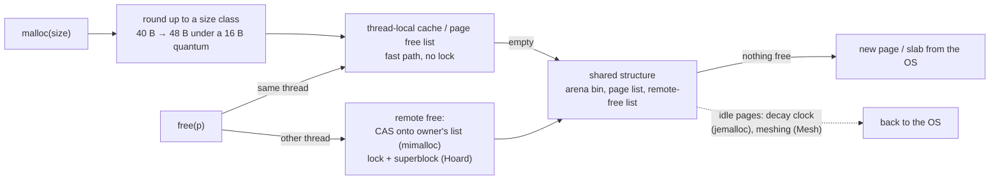

# Topic 56 — Memory Allocators for Database Workloads

Every topic so far assumed `malloc` is free. For a graph database it is not:
a bulk load makes millions of 40- to 256-byte allocations (nodes, edges,
property values), a property update frees a block and asks for a bigger one,
a query builds and discards millions of temporaries, and worker threads free
objects that other threads allocated. The allocator decides how fast each of
those is, how much memory the process holds afterwards, and — for a Redis
module like FalkorDB — whether the server's own `maxmemory` accounting can see
the data at all. Topic 6 read Redis's *ledger* (`zmalloc`: counting bytes on
top of the allocator); this topic reads the allocator underneath it, and
measures it.

The honest summary of what the measurements below say: on a **bulk load**
the allocator is nearly irrelevant (the system allocator is 1.4–1.7× slower
per call and holds exactly the same memory); on **churn, per-query
temporaries and cross-thread frees** it is a 2–15× difference in time and up
to 1.4× in memory — and one configure flag that Redis sets and most
Rust crates do not is worth 10%.



## The problem, measured (bench lane 1, provided — runs today)

`cargo run --release --bin alloc_bench` — a seeded graph-engine trace of
200,000 nodes: per node one 64-byte node record, 2–4 property values of 16–256
bytes, and an average of 5 out-edges of 40 bytes, in loader order (1,797,141
objects, 77.2 MiB requested; [`trace.rs`](experiments/src/trace.rs) — the
shapes are this repo's stand-ins, not FalkorDB's real structs). Four phases,
each in a **fresh child process** so a memory baseline can be subtracted:
**1a** a bulk load that keeps everything; **1b** three rounds of "free a random
half, insert replacements whose property values have grown" (the
property-update pattern); **1c** 400 queries of 20,000 short-lived
intermediates each, all freed at query end; **1d** four producer threads that
allocate 1,000,000 objects each and either free them themselves or hand them
to another thread to free. Each runs against `global` — whatever
`#[global_allocator]` the binary was built with, here libmalloc — and `bump`, a
bump arena (`heap.rs`: pointer increment to allocate, nothing to free, reset
at query end). Lanes 2 and 3 are stubs and print a
`[stub — …]` note. Apple M3 Pro, measured 2026-10-26, load average 4.72 at
the start (other benchmarks were queued behind the same machine-wide lock;
counts are exact, timings are the best of three fresh processes):

```
global allocator: system (macOS libmalloc)
load average (1/5/15 min) at start: 4.72 4.89 7.68
trace: 200000 nodes -> 1797141 objects, 77.2 MiB requested (seed 56)

edge records: 997374 x 40 B; an allocator whose smallest steps are 16 B rounds each to 48 B = 7.6 MiB of padding

-- lane 1a: bulk load (keep everything) --
   heap       ns/alloc   live MiB     resident    footprint  res/live
   global         14.0       77.2       86.3Mi       86.3Mi      1.12
   bump            4.8       77.2       77.6Mi       77.6Mi      1.00
   [stub — lane 2: PageHeap is todo!(); implement it and re-run]

-- lane 1b: churn (3 rounds: free a random 50%, insert replacements with grown properties) --
   heap           ns/op  live0 MiB       res0  live1 MiB       res1 res1/live1 footprint1 res1/live1 range
   global          29.6       77.2     86.3Mi      132.1    216.2Mi       1.64    216.3Mi     1.64-1.64
   bump            15.6       77.2     77.6Mi      132.1    288.6Mi       2.18    288.7Mi     2.18-2.18
   [stub — lane 2: PageHeap is todo!(); implement it and re-run]

-- lane 1c: query arena (400 queries x 20000 short-lived objects, all freed at query end) --
   heap        ns/obj (a+f)    footprint         peak
   global              26.4       1.27Mi       1.33Mi
   bump                 1.7       1.17Mi       1.25Mi
   [stub — lane 2: PageHeap is todo!(); implement it and re-run]

-- lane 1d: cross-thread frees under the global allocator (4 producers x 1000000 objects, batches of 1024) --
   pattern                   ns/obj    Mobj/s    footprint         peak
   free on own thread          33.1     115.6        0.8Mi        0.9Mi
   free on other thread        46.5      75.0        8.9Mi        9.1Mi

-- lane 3: SharedHeap, same producer/consumer pattern --
   [stub — lane 3: SharedHeap is todo!(); implement it and re-run]
```

**Reading it, one lane at a time.**

*Lane 1a — the allocator is not the bottleneck of a bulk load.* The arena
allocates in 4.8 ns, the system allocator in 14.0: 2.9× — but 1.8 million
allocations × 9.2 ns of difference is **17 ms** on a load that also has to
parse 200,000 nodes. Memory is the more interesting column: the arena holds
**1.00×** of the live bytes, the system allocator **1.12×** — 8.7 MiB more,
and 7.6 MiB of that is the first printed line: 997,374 edge records of 40 bytes
that a 16-byte-quantum allocator serves from 48-byte blocks (997,374 × 8 B =
7.6 MiB). The 40-byte edge is the case that makes the quantum visible; a 64-byte
node record is not padded at all.

*Lane 1b — churn is where the allocator earns its keep, and where it varies.*
After three rounds the heap holds 132.1 MiB of live objects. The arena —
which cannot reuse anything — holds **2.18×** (288.6 MiB: every byte ever
allocated). The system allocator holds **1.64×** (216.2 MiB) in the run
printed above, because the grown properties (48–512 bytes) do not fit the
holes the freed 16–256-byte values left. The range column matters: libmalloc's
post-churn residency is **bimodal across processes** — this binary gave 1.64×
in 20 of 20 fresh runs, a second binary of the same code gave 1.13–1.14× in 15 of
20 and 1.64× in 5 ([notes.md](notes.md)). The cause was not found (it is
exercise 3), so a single run of this lane cannot rank the system allocator
against anything; the range column exists so that no one tries.

*Lane 1c — a query arena is not an optimisation, it is a different cost
class.* **26.4 ns** per allocate-plus-free pair under libmalloc against **1.7 ns**
for the arena (15×): the arena's `free` is nothing and its `allocate` is an
add. Its footprint is 1.17 MiB (one retained chunk) against libmalloc's
1.27 MiB — no memory penalty at all, because the arena resets instead of
growing. The honest limit: this holds only because every temporary dies with
the query.

*Lane 1d — the penalty for freeing on the wrong thread.* The same
allocate/free work costs **33.1 ns** per object when each producer frees its
own blocks and **46.5 ns** when another thread frees them (1.4×), and the
process's peak resident set goes from 0.9 MiB to 9.1 MiB: blocks freed by a
thread that did not allocate them have to find their way back to a
heap that can reuse them. Under the producer/consumer pattern of
[Hoard §2.2](reading-hoard.md), this is where an allocator with no answer to
remote frees would grow without bound; libmalloc's growth is bounded, at
7–10× the same-thread peak (6.1 and 9.1 MiB in two runs).

### Lane 1d — the same trace under mimalloc and jemalloc (provided, feature-gated)

The bench builds with either allocator as the global allocator:
`cargo run --release --features mimalloc --bin alloc_bench` (crate `mimalloc`
0.1, whose default is mimalloc **2.x** C source) and `--features jemalloc`
(`tikv-jemallocator` 0.6, jemalloc 5.3.0). The `bump` rows are unchanged; the
`global` rows are the allocator under test. Same machine and day; load average
4.74 at the start of each run:

| `global` allocator | 1a ns/alloc | 1a res/live | 1b ns/op | 1b res1/live1 | 1c ns/obj | 1d own thread ns | 1d other thread ns | 1d peak (other) |
|---|---|---|---|---|---|---|---|---|
| libmalloc (system) | 14.0 | 1.12 | 29.6 | 1.64 (1.13–1.64) | 26.4 | 33.1 | 46.5 | 9.1 MiB |
| mimalloc 2.x | 8.2 | 1.12 | 19.2 | 1.15 | 9.7 | 9.2 | 21.1 | 4.3 MiB |
| jemalloc 5.3, default quantum | 10.1 | 1.13 | 23.7 | 1.15 | 16.1 | 13.6 | 15.4 | 6.6 MiB |
| jemalloc 5.3, `--with-lg-quantum=3` | 9.6 | **1.01** | 23.4 | **1.08** | 16.0 | 13.6 | 14.8 | 6.6 MiB |

A second, independent run of the mimalloc and jemalloc builds moved
individual timing cells by up to 30% (jemalloc's same-thread free: 13.6 →
17.7 ns) and no ranking in the table; both runs are in [notes.md](notes.md).

**Is the system allocator on macOS competitive? Not on this trace, and for
three different reasons.** *Speed:* on bulk load it is 1.4–1.7× slower per call,
which does not matter (17 ms); on query temporaries it is **2.7×** (vs mimalloc)
and **1.6×** (vs jemalloc) slower; on cross-thread frees **2.2×** and **3.0×**
slower. *Memory after churn:* 1.13–1.64× against 1.15× for both. *Cross-thread
cost:* mimalloc pays most for the *relative* penalty of a remote free (9.2 →
21.1 ns, 2.3×) but is still faster than libmalloc's local case (33.1 ns);
jemalloc's penalty is 13.6 → 15.4 ns (1.13×) — the thread cache absorbs it.
mimalloc, by contrast, has the fastest single-thread numbers (8.2 / 9.7 ns).
Everyone ties at load time: 1.12–1.13× resident, because all three round the
40-byte edge up to 48.

The last row is the finding that transfers: **the quantum**. Redis builds its
bundled jemalloc with `--with-lg-quantum=3`
([deps/Makefile:162](reading-falkordb-redis-allocator.md)) — 8-byte minimum
alignment instead of the 16 that jemalloc defaults to on x86-64 and arm64
(`quantum.h:23,29`). The crate exposes the same flag as the environment
variable `JEMALLOC_SYS_WITH_LG_QUANTUM=3`, and with it the bulk load holds
**78.2 MiB instead of 87.0 (−10.1%)** and 1.01× of live instead of 1.13× — the
40-byte edge stops being padded. A FalkorDB deployment on Linux gets the
8-byte quantum; this repo's default Rust jemalloc build does not.

## What is happening: seven mechanisms

**1. Size classes round up.** Every allocator rounds a request to a class so
that freed blocks are interchangeable. The rounding is internal fragmentation
you pay on every object: ≤ ~20% for jemalloc's four-classes-per-doubling
(worked in [reading-jemalloc.md](reading-jemalloc.md) Step 1), and a flat
8 bytes on a 40-byte object under a 16-byte quantum.

**2. A free list per size class scatters; a free list per page does not.**
Allocate from one page until it is full and the objects a query builds together
are adjacent ([reading-mimalloc.md](reading-mimalloc.md) Steps 1–2). Lane 2's
`allocation_stays_local_after_scattered_frees` test is the measurement: 1,000
allocations after scattered frees must touch ≤ 3 pages, where a single LIFO
list touches all 15 (a Python simulation, in the guide).

**3. The fast path is a few instructions and one branch.** mimalloc: "about 7
to 10 instructions with a single test" (`alloc.c:75–76`); jemalloc: a stack pop
compared on the pointer's low bits (`cache_bin.h:403`). Both keep expensive
work in a slow path that runs on a bounded cadence or a batch refill.

**4. A free from another thread is the hard case.** One free list cannot be
shared without a lock or a CAS; the designs differ in whom they make pay
(Hoard: two locks, bound proven; mimalloc: a CAS onto the page's own list,
batched collect; jemalloc: the thread cache, flushed to the arena). Lane 1d
and lane 3 measure it.

**5. Returning memory is a policy, not a mechanism.** jemalloc's decay clock
(10 s, smootherstep-weighted, [reading-jemalloc.md](reading-jemalloc.md) Step 4),
Hoard's "never return", TCMalloc's immediate `MADV_FREE`. Durner et al. show
the consequence for a query engine: resident memory misranks allocators
unless you also count what the engine asked for
([reading-durner-allocation-impact.md](reading-durner-allocation-impact.md)
Step 5: jemalloc's average inflation 2.23×, glibc 2.28's 2.10×, TCMalloc's a
misleading 3.02×).

**6. Fragmentation is the cost you cannot see in a profile.** Lane 1b's 1.64×
is 84 MiB nobody asked for. Mesh compacts without moving objects by merging
sparse pages' physical backing; Redis's `activedefrag` copies objects. Mesh
reports the same 39% heap reduction as `activedefrag` on Redis, with 0.23 s of
meshing against 1.49 s of defragmentation
([reading-mesh.md](reading-mesh.md) Step 4).

**7. For a module, the allocator belongs to the host.** FalkorDB's
`rm_malloc` is `RedisModule_Alloc`, a function pointer; Redis's Makefile picks
jemalloc on Linux and libc elsewhere. A macOS laptop is therefore a libmalloc
benchmark of a jemalloc product
([reading-falkordb-redis-allocator.md](reading-falkordb-redis-allocator.md)).

## Production shape — where each of these lives

| piece | where | what to notice |
|---|---|---|
| FalkorDB: every allocation | `FalkorDB` `src/util/rmalloc.h:21-35` | `rm_malloc` → `RedisModule_Alloc`; `rm_aligned_malloc` (`:30-32`) ignores its alignment |
| FalkorDB: GraphBLAS | `src/module.c:120-124` | `LAGr_Init(..., RedisModule_Alloc, Calloc, Realloc, Free)`: every matrix goes through the Redis allocator |
| FalkorDB: properties | `src/graph/entities/attribute_set.c:276-300` | one block per entity, `rm_malloc` then `rm_realloc` as attributes are added |
| FalkorDB: per-query cap | `src/util/rmalloc.c:21-117` | function pointers swapped at run time; `__thread` counter adds requested bytes, subtracts usable bytes (`:56`, `:83`) |
| Redis: `RM_Alloc` | `redis` `src/module.c:556-570` | `zmalloc_usable`: counted in `used_memory` |
| Redis: which allocator | `src/Makefile:81-85`; `deps/Makefile:162` | jemalloc on Linux, libc elsewhere; bundled jemalloc built with `--with-lg-quantum=3` |
| mimalloc: fast path | `mimalloc` `src/alloc/alloc.c:73-114` | one load, one branch; "7 to 10 instructions" |
| mimalloc: local and remote free | `src/alloc/free.c:45-78`, `:89-120`, `:293-319` | `local_free` push; CAS onto `thread_free`; one XOR picks the path |
| mimalloc: collect | `src/alloc/page.c:363-409` | atomic exchange of the remote list, then `local_free → free` |
| jemalloc: size classes | `jemalloc` `include/jemalloc/internal/sc.h:20-28`, `quantum.h:22-30` | four classes per doubling; 16-byte quantum on x86-64/arm64 |
| jemalloc: thread cache | `cache_bin.h:381-425`, `tcache_inlines.h:102-144`, `src/tcache.c:422-450` | pointer-stack pop; batch refill |
| jemalloc: decay | `arena.h:30-32`, `src/decay.c:100-145`, `smoothstep.h` | 10 s dirty decay; 200-epoch smootherstep backlog |

Anchors are `FalkorDB/FalkorDB@ccb449a9a` and `redis/redis@e87dda2a4`, both
read with `tools/pinned-source.py`; `microsoft/mimalloc@8b08dbb8f9c8` (branch
`main3`, v3.x) and `jemalloc/jemalloc@0697b617fbaa` (`dev`), read from clones at
`~/repos` that are not yet in the pin table. The `mimalloc` crate bundles
mimalloc 2.x by default and `tikv-jemallocator` bundles jemalloc 5.3.0, so the
*measured* allocators are the released versions and the *anchored* ones are
the development branches.

## Reading guides

1. [reading-mimalloc.md](reading-mimalloc.md) — Leijen, Zorn & de Moura (MSR-TR-2019-18): free-list sharding, the three per-page lists, the remote-free CAS, and the full-list corner case that cost 30% — against the v3 source.
2. [reading-jemalloc.md](reading-jemalloc.md) — jemalloc at `0697b617fbaa`: size-class groups and the quantum, arenas/bins/slabs, the thread-cache pointer stack, and the smootherstep decay clock.
3. [reading-durner-allocation-impact.md](reading-durner-allocation-impact.md) — Durner, Leis & Neumann (DaMoN'19): five allocators inside a query engine; Table 1 (NUMA) and Table 2 (requested vs resident) worked.
4. [reading-hoard.md](reading-hoard.md) — Berger et al. (ASPLOS 2000): blowup, superblocks, the emptiness invariant and its O(1) bound.
5. [reading-mesh.md](reading-mesh.md) — Powers, Tench, Berger & McGregor (PLDI 2019): compaction by remapping, randomised allocation, and a meshing-probability table the paper does not print.
6. [reading-falkordb-redis-allocator.md](reading-falkordb-redis-allocator.md) — from `rm_malloc` to jemalloc: the module boundary, Redis's allocator selection, the quantum flag, and the two biases in FalkorDB's per-query counter.

## Experiments

```
cd experiments
cargo test              # 10 provided tests pass; lane 2's 6 and lane 3's 4 stub tests fail until implemented
cargo run --release --bin alloc_bench
cargo run --release --features mimalloc --bin alloc_bench
cargo run --release --features jemalloc --bin alloc_bench
JEMALLOC_SYS_WITH_LG_QUANTUM=3 cargo run --release --features jemalloc --bin alloc_bench
```

(The first `--features` build compiles the bundled C allocator: about 20 s for
mimalloc, 40 s for jemalloc.)

- `rss.rs` (PROVIDED) — resident size and `phys_footprint` on macOS
  (`proc_pid_rusage`), `/proc/self/statm` on Linux, `ru_maxrss` for the peak.
- `trace.rs` (PROVIDED) — the seeded graph-engine trace and its size tables.
- `heap.rs` (PROVIDED) — the `Heap` trait (sized free, like `Layout`), the
  `Global` allocator wrapper and the `Bump` arena.
- `classes.rs` (PROVIDED) — 24 size classes (8-byte steps to 64, four per
  doubling to 1,024) and the 64 KiB page geometry the stubs share.
- `workloads.rs` (PROVIDED) — `load`, `churn`, `query`, generic over `Heap`.
- `pageheap.rs` (stub, lane 2) — a page-sharded size-class allocator.
  Contract: distinct aligned writable blocks; consecutive allocations share a
  page; frees are reused without new pages; after scattered frees 1,000
  allocations touch ≤ 3 pages; freeing everything leaves ≤ 2 pages; requests
  above 1,024 B fall back.
- `shared.rs` (stub, lane 3) — remote frees without blowup. Contract: a
  handle per thread; a remote free returns to the owning page; a
  producer/consumer pair with at most ~5,000 objects in flight needs ≤ 40
  pages (a heap that never reuses remote frees needs ~440).
- `bin/alloc_bench.rs` — the lanes, each phase in a fresh child process.

## Exercises

1. Implement both stubs until every test passes, then compare lanes 2 and 3
   with the reference numbers in [notes.md](notes.md). The tests are
   deliberately loose about design: try a bump-pointer fresh page and a
   `local_free` list (mimalloc §2.2–§2.3) and measure whether the report's
   "~2% worse" for the bump pointer reproduces on this trace.
2. **Price your structs under both quanta.** Read FalkorDB's entity layouts
   (`AttributeSet`, `Node`, `Edge` headers) at the pin and compute their size
   class under a 16-byte and an 8-byte quantum; predict, then measure with
   `JEMALLOC_SYS_WITH_LG_QUANTUM=3`.
3. **Find the libmalloc bimodality.** Lane 1b's system-allocator row is 1.64×
   in some processes and 1.13× in others, and the split depends on the
   binary. Use `vmmap`, `MallocStackLogging`, or `malloc_zone_statistics` to
   find which zone or madvise path differs, then say whether it is the
   allocator or the measurement.
4. **The counter's drift.** Re-implement `rm_alloc_with_capacity` /
   `rm_free_with_capacity` over `Heap`, using `classes::class_size` as the
   "usable size". For lane 1's trace, how far is the counter from zero after
   everything is freed, and how far from the true live bytes at the end of
   bulk load?
5. **Meshability.** After lane 1b under your lane-2 heap, extract each page's
   occupancy bitmap and compute the fraction of page pairs of the same class
   that are disjoint. Compare with the table in
   [reading-mesh.md](reading-mesh.md) Step 3: is the churned heap sparse
   enough for meshing to pay?
6. **Decay.** Add a jemalloc-style retention policy to lane 2's page release
   (keep emptied pages for N ms, release the oldest first). Alternate 30 ms
   of load with 30 ms of idle and plot resident bytes against N.
7. **A query arena for FalkorDB.** Design (do not build) an arena above
   `rm_malloc` for a query's intermediate results; say what the per-query
   memory cap would count, given [Step 4 of the FalkorDB
   guide](reading-falkordb-redis-allocator.md).

## Cross-topic threads

- Topic 6, [reading-redis-zmalloc.md](../06-buffer-pool/reading-redis-zmalloc.md):
  the accounting ledger over the allocator this topic reads; its Step 5
  (fragmentation, active defrag) is the same fragmentation lane 1b measures.
- Topic 9: false sharing is the allocator's passive hazard too
  ([reading-hoard.md](reading-hoard.md) Step 5).
- Topic 48, [README](../48-memory-tiering/README.md): page-granular tiering
  policies see the allocator's page layout; a heap whose hot and cold objects
  share pages (lane 1b's churned heap) is the "scattered" layout there.
- Topic 54 (`topics/54-join-algorithms/`): hash-table bucket arrays are the
  large allocations in Durner et al.'s byte profile.
