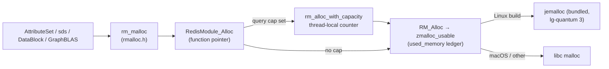

# What allocator does FalkorDB actually use? From `rm_malloc` to jemalloc

Every other chapter in this topic asks which allocator is best. This one asks
which allocator *you are running*, because the answer for FalkorDB is not a
setting in FalkorDB. FalkorDB is a Redis module; its allocations go through
function pointers that Redis hands it, so the allocator is whatever the host
`redis-server` was built with — and that depends on the operating system.
The chapter follows one allocation from a graph attribute to the kernel,
then reads the accounting wrapper FalkorDB adds on top, because the wrapper
has a bias that matters for the "memory per query" limit.

Anchors: `FalkorDB/FalkorDB@ccb449a9a` (the C engine at the repo's pin) and
`redis/redis@e87dda2a4`, both read with `tools/pinned-source.py`. Topic 6's
[reading-redis-zmalloc.md](../06-buffer-pool/reading-redis-zmalloc.md) covers
Redis's own accounting in depth; this chapter starts where it stops, at the
module boundary.

## The problem in one sentence

FalkorDB cannot choose its allocator at build time, yet its memory use, its
fragmentation and its per-query memory cap all depend on one — so a
developer must know the full path from `rm_malloc` to the allocator and what
each hop adds.

## The concepts, step by step

### Step 1 — `rm_malloc` is a function pointer

> **In:** nothing — the start of the chain.
> **Out:** the three places FalkorDB's big consumers allocate from, all
> resolving to `RedisModule_Alloc`.

A Redis module is a shared library loaded into the server. The server passes
the module a table of function pointers at load time (the module API), and
`RedisModule_Alloc`, `RedisModule_Realloc`, `RedisModule_Calloc` and
`RedisModule_Free` are four of them. FalkorDB wraps them in inline functions
so every call site reads `rm_malloc`:

```c
// FalkorDB/FalkorDB@ccb449a9a — src/util/rmalloc.h, 21-35
    21  static inline void *rm_malloc(size_t n) {
    22  	return RedisModule_Alloc(n);
    23  }
    24  static inline void *rm_calloc(size_t nelem, size_t elemsz) {
    25  	return RedisModule_Calloc(nelem, elemsz);
    26  }
    27  static inline void *rm_realloc(void *p, size_t n) {
    28  	return RedisModule_Realloc(p, n);
    29  }
    30  static inline void *rm_aligned_malloc(size_t alignment, size_t size) {
    31  	return rm_malloc(size);
    32  }
    33  static inline void rm_free(void *p) {
    34  	RedisModule_Free(p);
    35  }
```



Line 31 is worth a second look: `rm_aligned_malloc` **ignores its alignment
argument**. Any caller that relied on an alignment stricter than the
allocator's natural one (16 bytes under a 16-byte quantum; 8 under Redis's
build, Step 3) gets what the allocator happens to provide.

Three consumers show the reach. **Properties:** an entity's attribute set is
a single heap block, created with `rm_malloc` and *grown with `rm_realloc`* each
time an attribute is added (`src/graph/entities/attribute_set.c:290`, `:296`,
inside `AttributeSet_Accommodate`) — the "property grows" pattern lane 1b's
churn models, now with an allocator-level `realloc` instead of free-then-malloc.
**Strings:** the vendored `sds` library defines `s_malloc` as `rm_malloc`
(`src/util/sds/sdsalloc.h:42`). **GraphBLAS:** the matrices themselves.
`GraphBLAS_Init` passes the four function pointers to `LAGr_Init`
(`src/module.c:120–124`), so SuiteSparse allocates every matrix's index and
value arrays through the Redis allocator, not through libc.

### Step 2 — Redis's side: `RM_Alloc` is `zmalloc`

> **In:** Step 1's `RedisModule_Alloc`.
> **Out:** what the server does with the call, and the one build setting that
> picks the allocator.

On the server side `RedisModule_Alloc` points at `RM_Alloc`, whose body is
one line:

```c
// redis/redis@e87dda2a4 — src/module.c, RM_Alloc, 556-570
   556  /* Use like malloc(). Memory allocated with this function is reported in
   557   * Redis INFO memory, used for keys eviction according to maxmemory settings
   558   * and in general is taken into account as memory allocated by Redis.
   559   * You should avoid using malloc().
   560   * This function panics if unable to allocate enough memory. */
   561  void *RM_Alloc(size_t bytes) {
        // ... 562-568: a comment on why zmalloc_usable is used ...
   569      return zmalloc_usable(bytes,NULL);
   570  }
```

So a module allocation is a `zmalloc`: it is counted in `used_memory`, which
`maxmemory` enforces (topic 6's ledger), and then forwarded to whichever
allocator `zmalloc` was compiled against. That is chosen here:

```make
# redis/redis@e87dda2a4 — src/Makefile, 81-85
    81  # Default allocator defaults to Jemalloc on Linux and libc otherwise
    82  MALLOC=libc
    83  ifeq ($(uname_S),Linux)
    84  	MALLOC=jemalloc
    85  endif
```

Read line 81 — it is the whole answer. **On Linux, a stock `redis-server`
(and so FalkorDB in production) allocates through jemalloc; on macOS and
everywhere else it uses libc's `malloc`.** A FalkorDB developer on an Apple
Silicon laptop is therefore running their benchmarks on libmalloc, and the
service they deploy to runs jemalloc. This repo's lane 1 uses the same
libmalloc on this machine, and the `--features jemalloc` / `mimalloc` builds
exist so the other allocators can be measured here too. (The Redis binary can
be forced with `USE_JEMALLOC=yes` or `MALLOC=...`, lines 92–106.)

### Step 3 — the jemalloc that Redis builds is not the one you get from a crate

> **In:** Step 2's `MALLOC=jemalloc`.
> **Out:** one configure flag that changes the size classes, and the
> measurement of what it is worth on this repo's trace.

Redis builds its own bundled jemalloc (`deps/jemalloc`). The build line
matters:

```make
# redis/redis@e87dda2a4 — deps/Makefile, 162
   162  	cd jemalloc && ./configure --disable-cxx --with-version=5.3.0-0-g0 --with-lg-quantum=3 --disable-cache-oblivious --with-jemalloc-prefix=je_ CFLAGS="$(JEMALLOC_CFLAGS)" LDFLAGS="$(JEMALLOC_LDFLAGS)" $(JEMALLOC_CONFIGURE_OPTS)
```

`--with-lg-quantum=3` sets jemalloc's quantum — the minimum alignment — to
2³ = 8 bytes, where its default on x86-64 and arm64 is 16
([reading-jemalloc.md](reading-jemalloc.md) Step 1: `quantum.h:23,29`). The
effect is on every object whose size is an odd multiple of 8: **a 40-byte
object costs 40 bytes under Redis's jemalloc and 48 under the default**. The
`--with-jemalloc-prefix=je_` flag is why Redis calls `je_mallctl` rather than
`mallctl` (e.g. `src/zmalloc.c:914`).

Lane 1a measures the difference on this repo's trace (the 997,374 40-byte
edge records are the case). Same source, same trace, `tikv-jemallocator` built
two ways — default quantum and `JEMALLOC_SYS_WITH_LG_QUANTUM=3`, the crate's
spelling of the same configure flag — resident memory after loading
77.2 MiB (80,949,568 B) of live objects (lane 1a, median of three fresh
processes):

| jemalloc build | resident after load | resident ÷ live |
|---|---|---|
| default quantum (16) | 87.0 MiB | 1.13 |
| `--with-lg-quantum=3`, as Redis builds it | 78.2 MiB | 1.01 |

A 10.1% saving (8.8 MiB of 87.0) from a build flag — and the 40-byte case is not
contrived: the edge record in the trace is a typical "two endpoints, a type
and a property pointer" shape. FalkorDB's own entity layout decides whether
it lands on a size class boundary, which is exactly what the exercise at the
end of this chapter asks you to check.

### Step 4 — FalkorDB's accounting layer: a per-thread counter

> **In:** Steps 1–2's function pointers, which are *assignable*.
> **Out:** how the per-query memory cap works, and the two biases in its
> counter.

FalkorDB limits the memory one query may use (`query_mem_capacity`, set in
`src/configuration/config.c` and applied by `rm_set_mem_capacity` from
`src/configuration/reconf_handler.c:40`). Enforcing it needs an allocation
counter per query, and since Redis does not offer one, FalkorDB **replaces
the four function pointers at run time**:

```c
// FalkorDB/FalkorDB@ccb449a9a — src/util/rmalloc.c, 96-108
    96  	if(should_cap && !is_capped) {
    97  		// store the function pointer original values and change them
    98  		// to the capped version
    99  		RedisModule_Free_Orig     =  RedisModule_Free;
   100  		RedisModule_Alloc_Orig    =  RedisModule_Alloc;
   101  		RedisModule_Calloc_Orig   =  RedisModule_Calloc;
   102  		RedisModule_Strdup_Orig   =  RedisModule_Strdup;
   103  		RedisModule_Realloc_Orig  =  RedisModule_Realloc;
   104  		RedisModule_Free          =  rm_free_with_capacity;
   105  		RedisModule_Alloc         =  rm_alloc_with_capacity;
   106  		RedisModule_Calloc        =  rm_calloc_with_capacity;
   107  		RedisModule_Strdup        =  rm_strdup_with_capacity;
   108  		RedisModule_Realloc       =  rm_realloc_with_capacity;
```

With no cap configured the pointers are untouched and the hot path is
the plain `zmalloc`. With a cap, every allocation pays an extra indirect
call and a thread-local add:

```c
// FalkorDB/FalkorDB@ccb449a9a — src/util/rmalloc.c, 36-58
    36  static inline void _nmalloc_decrement(int64_t n_bytes) {
    37  	n_alloced -= n_bytes;
    38  }
    // ... 39-40: comment ...
    41  static inline void _nmalloc_increment(int64_t n_bytes) {
    42  	n_alloced += n_bytes;
    43  	// check if capacity exceeded
    44  	if(n_alloced > mem_capacity) {
    45  		// set n_alloced to MIN to avoid further out of memory exceptions
    46  		// TODO: consider switching to double -inf
    47  		n_alloced = INT32_MIN;
    // ... 48-52: raise the "query memory limit" error ...
    54  void *rm_alloc_with_capacity(size_t n_bytes) {
    55  	void *p = RedisModule_Alloc_Orig(n_bytes);
    56  	_nmalloc_increment(n_bytes);
    57  	return p;
    58  }
```

Two biases follow from reading lines 13–21, 55–56 and 83 together.

1. **Requested bytes in, usable bytes out.** Allocation adds the *requested*
   size (`n_bytes`, line 56); free subtracts `RedisModule_MallocSize(ptr)` —
   the allocator's usable size (line 83). The file's own comment (13–20) says
   so: `n_alloced` "can be negative" because "we're wrongly assuming that the
   number of bytes requested for an allocation is the actual number of bytes
   allocated". Under a 16-byte quantum, every free of a 40-byte block
   subtracts 48 after adding 40: the counter drifts **down** by 8 per object
   — under-counting the query, so the cap fires late. Under Redis's 8-byte
   quantum a 40-byte object is balanced, but a 100-byte one (served from the
   112-byte class of the base-64 group, `sc.h:20–28`) drifts by 12.
2. **The counter is thread-local** (`__thread`, line 21). A block allocated
   on the query's worker thread and freed on another (the producer/consumer
   shape of [reading-hoard.md](reading-hoard.md) Step 2) subtracts from a
   *different* thread's counter. I searched `src/**/*.c` at this pin for callers of
   `rm_reset_n_alloced` and found only its definitions, so how the counter
   is reset between queries was not verified for this chapter.

Neither bias is a bug in the sense of crashing; both are why "cap = 1 GiB"
means "roughly 1 GiB, as the allocator counts it, on this thread".

### Step 5 — what the chain costs, and what changes if you swap

> **In:** Steps 1–4.
> **Out:** a checklist for trying a different allocator under FalkorDB, and
> what each option would break.

- **Swapping the allocator under Redis** (rebuild `redis-server` with
  `MALLOC=tcmalloc` or `libc`, or `USE_JEMALLOC=no`) needs no FalkorDB change,
  but loses the jemalloc-specific tooling: Redis's per-bin
  fragmentation statistics (`src/zmalloc.c:914–940` walks jemalloc's bin
  counters through `je_mallctl`) and the active defragmentation built on them.
- **Replacing `RedisModule_Alloc` inside the module** (e.g. interposing
  mimalloc) means GraphBLAS's matrices and FalkorDB's blocks leave Redis's
  ledger: `used_memory`, `maxmemory` and eviction would stop seeing them. That
  is the first thing to price before reading mimalloc's 14% (reading-mimalloc.md,
  Question 3).
- **Arenas for query temporaries** — the lane 1c pattern — would be a
  module-internal allocator *above* `rm_malloc`: it changes neither Redis's
  accounting (blocks are still `zmalloc`ed in large chunks) nor the allocator,
  and is the choice Durner et al.'s engine made for everything under 32 KB
  (reading-durner-allocation-impact.md Step 1).

## How to read the source (with the concepts in hand)

1. **`src/util/rmalloc.h:21–56`** — Step 1; note the `#ifndef REDIS_MODULE_TARGET`
   branch at line 50: the unit-test build maps `rm_malloc` to plain `malloc`.
2. **`src/module.c:120–124`** — GraphBLAS's allocator hookup.
3. **`src/util/rmalloc.c:13–127`** — Step 4, top to bottom; then
   `Alloc_Reset` at `:132` (the tests' reset to libc).
4. **Redis: `src/module.c:556–570`, `src/Makefile:81–106`,
   `deps/Makefile:162`** — Steps 2–3.
5. **`src/graph/entities/attribute_set.c:276–300`** — the realloc-on-grow
   pattern.

## Where each step lives in this topic

| step | file / lane | what to look at |
|---|---|---|
| 1 | lane 1b | property replacement with larger values (the `GROWN_SIZES` table) |
| 2 | `alloc_bench` header | "global allocator: system (macOS libmalloc)" — what a dev laptop runs |
| 3 | notes.md, jemalloc quantum rows | `JEMALLOC_SYS_WITH_LG_QUANTUM=3` build vs default |
| 4 | lane 1d, notes.md | cross-thread frees under the global allocator |

## Questions (answer in notes.md)

1. With `--with-lg-quantum=3`, which of FalkorDB's per-entity structs
   (`_AttributeSet` header, `Node`, `Edge`) land exactly on a size class, and
   which are padded? (Print `sizeof` from a debug build or read the struct
   definitions at the pin.)
2. Step 4's drift is 8 bytes per 40-byte object under a 16-byte quantum.
   For a query that builds 10 million such objects, how many bytes is the
   counter off by when everything is freed? Which direction does that bias
   the memory cap?
3. `rm_aligned_malloc` ignores `alignment`. Name a FalkorDB or GraphBLAS
   structure for which that is safe on jemalloc with quantum 8, and one for
   which it would not be on a SIMD path.
4. On macOS, `RedisModule_Alloc` reaches libmalloc. Pick one number from
   lane 1 that could mislead a laptop benchmark of a bulk load, and say which
   direction it errs for a Linux deployment.

## Done when

Answer each before unfolding it.

- [ ] You can trace a graph-attribute allocation to the kernel.

  <details><summary>Answer</summary>

  `AttributeSet_Accommodate` → `rm_malloc`/`rm_realloc`
  (`attribute_set.c:290,296`) → `RedisModule_Alloc` (`rmalloc.h:22`) →
  `RM_Alloc` → `zmalloc_usable` (`module.c:569`) → jemalloc on Linux or libc
  elsewhere (`Makefile:81–85`) → `mmap`/`brk` and `madvise` for returned pages.
  With a query cap set, the hop `rm_alloc_with_capacity` sits between the first
  two (`rmalloc.c:54–58`).

  </details>

- [ ] You can say which allocator a FalkorDB developer on macOS is using
      and how it differs from production.

  <details><summary>Answer</summary>

  libc (macOS libmalloc), because Redis's Makefile defaults `MALLOC` to libc
  except on Linux (`Makefile:81–85`). Production Linux builds use Redis's
  bundled jemalloc configured with `--with-lg-quantum=3` (`deps/Makefile:162`),
  which has different size classes (8-byte quantum) and allocator-specific
  tooling (`je_mallctl` bin statistics, `zmalloc.c:914–940`).

  </details>

- [ ] You can explain the quantum flag's measured effect.

  <details><summary>Answer</summary>

  With the default 16-byte quantum a 40-byte request is served from the 48-byte
  class; with quantum 8 it is served from the 40-byte class. On the bench trace
  (997,374 such objects among 1.8 M), `tikv-jemallocator` held 87.0 MiB
  resident for 77.2 MiB live (1.13×) by default and 78.2 MiB (1.01×) built with
  `JEMALLOC_SYS_WITH_LG_QUANTUM=3`.

  </details>

- [ ] You can state the two biases in the per-query counter.

  <details><summary>Answer</summary>

  It adds requested bytes but subtracts usable bytes (`rmalloc.c:56`, `:83`;
  comment `:13–20`), so it drifts negative by the padding per object; and it
  is `__thread` (`:21`), so cross-thread frees debit the wrong counter.

  </details>

## References

- `FalkorDB/FalkorDB@ccb449a9a`: `src/util/rmalloc.h`, `src/util/rmalloc.c`,
  `src/module.c:120–124`, `src/graph/entities/attribute_set.c:276–300`,
  `src/util/sds/sdsalloc.h:42`, `src/configuration/reconf_handler.c:40`.
- `redis/redis@e87dda2a4`: `src/module.c:556–570`, `src/Makefile:81–106`,
  `deps/Makefile:162`, `src/zmalloc.c:914–940`.
- Previous: [reading-jemalloc.md](reading-jemalloc.md). Topic 6's
  [reading-redis-zmalloc.md](../06-buffer-pool/reading-redis-zmalloc.md) for the
  accounting ledger, and Mesh's Redis result in
  [reading-mesh.md](reading-mesh.md) Step 4 (jemalloc plus `activedefrag`).
