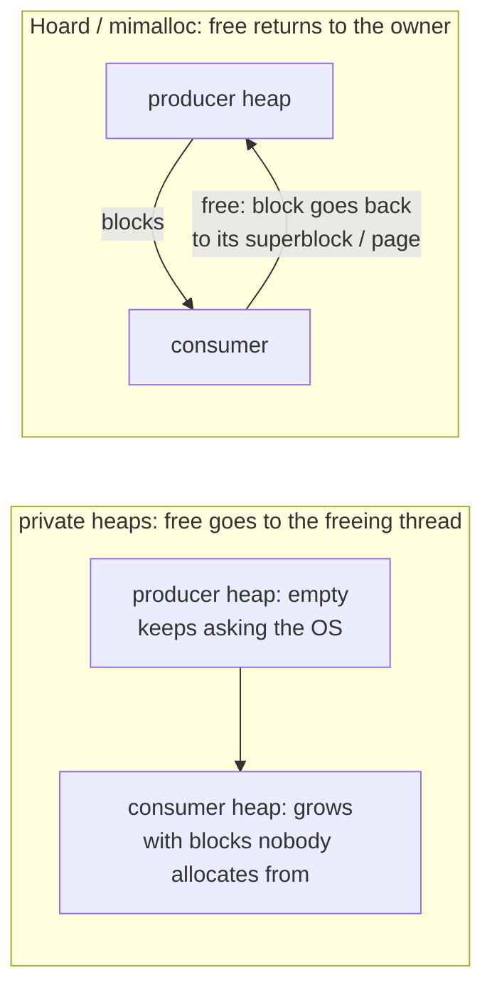

# Hoard: blowup, and the one invariant that bounds it

Topics 8 and 9 taught that sharing a cache line between cores costs an order
of magnitude. An allocator can create that sharing without the program's
knowledge — and can do something worse: let a producer/consumer pair eat
memory without bound. This chapter reads the paper that named both problems
and bounded them, because mimalloc's remote free list
([reading-mimalloc.md](reading-mimalloc.md) Step 4) and lane 3 of this topic
are the same answer in a later dress.

**"Hoard: A Scalable Memory Allocator for Multithreaded Applications"** —
Emery D. Berger, Kathryn S. McKinley, Robert D. Blumofe, Paul R. Wilson.
ASPLOS 2000. Twelve pages; section numbers below are the paper's. The paper
measures a 14-processor 400 MHz UltraSPARC Sun Enterprise 5000 on Solaris 7
(§5), so no absolute timing from it transfers to a modern machine; what
transfers is the design and the proof.

## The problem in one sentence

A multithreaded allocator that gives each thread a private heap for speed can
use `P` times the memory a single-threaded one would — or an unbounded
amount, if memory freed by one thread is never reusable by another.

## The concepts, step by step

### Step 1 — blowup, defined

> **In:** nothing — this step defines the measure.
> **Out:** the term **blowup** and the fixed-point test for it.

**Fragmentation** is memory an allocator has taken from the operating system
beyond what the program is using. The paper defines it as "the amount of
memory allocated from the operating system divided by the maximum amount of
memory required by the application" (§1). **Blowup** is the multi-threaded
special case: "the maximum amount of memory allocated by a given allocator
divided by the maximum amount of memory allocated by an ideal uniprocessor
allocator" (§1). A blowup of 1 means the concurrent allocator never needs
more than a single-threaded one running the same program. A blowup of `P`
means every processor hoards a private copy of the working set; a blowup that
grows with time means memory the program freed is lost for good.

### Step 2 — how private heaps blow up

> **In:** Step 1's definition.
> **Out:** the two failure shapes the paper cites — linear in `P`, and
> unbounded — each with the program that triggers it.

§2.2 gives the producer/consumer case: "a producer thread repeatedly
allocates a block of memory and gives it to a consumer thread which frees it.
If the memory freed by the consumer is unavailable to the producer, the
program consumes more and more memory as it runs." An allocator where `free`
returns a block to *the freeing thread's* heap (a "pure private heaps" design;
the paper names Cilk's and the STL's allocators) leaves the producer's heap
empty after every allocation and the consumer's heap full of blocks it will
never allocate. Memory in use is fixed; memory taken from the OS grows
without bound.

The `P`-fold case needs no pair of threads: "Each thread calls
`x=malloc(s); free(x)`. If these threads are serialized, the total memory
required is `s`. However, if they execute on `P` processors ... the memory
requirement [rises] to `P ∗ s`," and an allocator that multiplies that by
another `P` reaches `P² ∗ s` (§2.2). With `P = 14` and `s` = 1 KiB that is
196 KiB instead of 1 KiB — harmless for 1 KiB, fatal for a hash-table arena
of 1 GiB.



### Step 3 — superblocks, per-processor heaps and one global heap

> **In:** Step 2's failure shapes.
> **Out:** Hoard's structure and the one rule — the emptiness threshold —
> that moves memory between heaps.

Hoard allocates from the OS in fixed-size chunks called **superblocks** (the
experiments use `S` = 8 KiB, §5), each divided into equal-sized blocks of one
size class (class sizes grow by a factor `b` = 1.2). There are `P`
per-processor heaps and one **global heap**; a thread hashes to a
per-processor heap. Each heap tracks `u_i`, the bytes in use in it, and `a_i`,
the bytes of superblock it holds. When a free leaves a heap too empty, a
nearly-empty superblock moves to the global heap, where any heap that runs
out of memory takes it before asking the OS.

The test is the paper's pseudocode, step 9 of `free` (§3.4):

```
// ILLUSTRATION — the paper's Algorithm, step 9 of free (§3.4), not source code
9.  If u_i < a_i − K·S and u_i < (1 − f)·a_i,
10.   transfer a mostly-empty superblock s1 to heap 0 (the global heap)
```

`f` is the **empty fraction** (1/4 in the experiments) and `K` a slack of
whole superblocks (4). Transfer happens only when *both* hold: more than `f`
of the heap's capacity is idle, **and** more than `K` superblocks' worth is
idle.

Work it. With `S` = 8 KiB, `K` = 4, `f` = 1/4: a heap holding `a_i` = 64 KiB
(8 superblocks) transfers a superblock when `u_i < 64 − 4·8 = 32` KiB *and*
`u_i < 0.75 · 64 = 48` KiB, i.e. when in-use falls below **32 KiB**. A small
heap, `a_i` = 16 KiB, never transfers (`a_i − K·S = −16`): small heaps keep
their slack, which is what prevents thrashing — a thread that allocates and
frees one block repeatedly would otherwise ping-pong a superblock through
the global lock.

### Step 4 — the invariant and the theorem

> **In:** Step 3's rule.
> **Out:** the invariant it maintains, and the bound the paper proves from it.

Because a heap that crosses the threshold sheds a superblock, every heap
satisfies, after every operation, `(u_i ≥ a_i − K·S) ∨ (u_i ≥ (1 − f)·a_i)`
(§3, with §3.1 "Bounding Blowup"): either at most `K` superblocks are idle, or at most a fraction `f` of
its capacity is. Summing over `P` heaps, idle memory is at most
`P · K · S` plus an `f` fraction of the live set, so total allocated memory
is `O(U + P)` where `U` is the maximum memory the program needs. §4.1:
"Hoard's blowup is `O((U(t) + P)/U(t)) = O(1)`" assuming `P ≪ U(t)` — a
constant factor "that does not grow with the amount of memory required by the
program". Producer/consumer is covered because the consumer's `free`
returns the block to its *superblock's owner* and, if the consumer's own heap
goes over the threshold, whole superblocks flow to the global heap where the
producer picks them up.

The cost is synchronisation: step 3 of `free` locks the superblock and step 4
locks its owner heap — a remote free takes two locks (§3.4, lines 3–4).
mimalloc's answer to the same problem (CAS onto a per-page list, batched
collect) trades Hoard's lock for an atomic push; the invariant is replaced by
the owner's scan of its full pages.

### Step 5 — false sharing the allocator causes

> **In:** the false-sharing definition from topic 9.
> **Out:** the two ways an allocator creates it, and the single rule that
> avoids the active one.

False sharing is two threads writing different words on the same cache line.
An allocator causes it **actively** when it carves one line into 8-byte
chunks and hands consecutive chunks to different threads (§2.1), and
**passively** when `free` lets a block migrate to another thread, which
later allocates a neighbour of a block the first thread still uses. Hoard
avoids the active kind because a superblock belongs to one heap, so a thread
allocates from one superblock — one run of cache lines — until it is full
("the same processor almost always reuses ... from a given cache line", §1).
The graph-database consequence is concrete: two worker threads that each
build a node's property vector from the same allocator should not have
their vectors interleaved at 8-byte granularity.

## How to read the paper (with the concepts in hand)

1. **§1–§2** — the definitions (Step 1) and the two blowup examples (Step 2).
2. **§3 and Figure 1** — structure (Step 3); read the pseudocode of §3.4,
   `malloc` steps 1–18 and `free` steps 1–13, against Step 3's worked
   example.
3. **§3 and §3.1** — the invariant; **§4.1** — the proof (Step 4). Skim the
   synchronisation analysis of §4.2.
4. **§5** — benchmarks. Treat the factors-of-ten as a statement about 2000-era
   Solaris allocators with global locks, not a result to cite for today.
5. **§5.5** — sensitivity to `f`: the authors "varied the empty fraction from
   1/8 to 1/2 and saw very little change".

## Where each step lives in this topic

| step | file / lane | what to look at |
|---|---|---|
| 2 | `experiments/src/shared.rs` test `producer_consumer_memory_is_bounded` | a heap that never reuses remote frees needs ~440 pages here; the test caps it at 40 |
| 3 | lane 3 (stub) | the owner id on each page, the registry of all pages |
| 4 | lane 3 | the reference solution bounds memory by scanning full pages, not by a global heap |
| 5 | `alloc_bench` lane 1d | allocators' behaviour with frees on a different thread |

## Questions (answer in notes.md)

1. Step 3's `a_i − K·S` term means small heaps never shed. Construct a
   program with `P` = 14 threads where this slack alone wastes `P·K·S` =
   14 × 4 × 8 KiB = 448 KiB, and say whether that is blowup in the §1
   sense.
2. Lane 3's reference collects remote frees by scanning its *own* full pages.
   Hoard instead moves superblocks to a global heap on the *consumer's*
   `free`. Which side pays the cost, and when does each lose?
3. The `f = 1/4` empty fraction means a heap can be 25% idle forever. With
   64 GiB of live nodes, how much memory is that, and what would a graph
   database trade to shrink it?
4. §1 says Hoard "does not currently return empty superblocks to the
   operating system". Which of Durner et al.'s four goals does that give up?

## Done when

Answer each before unfolding it.

- [ ] You can define blowup and give both failure shapes.

  <details><summary>Answer</summary>

  Blowup is peak memory taken by the concurrent allocator divided by peak
  memory of an ideal uniprocessor allocator (§1). Failure shapes: linear
  in `P` (each processor keeps a private copy of its working memory; §2.2
  names ptmalloc and LKmalloc) and unbounded (a producer/consumer pair
  where freed memory never returns to the allocating thread; Cilk and STL
  allocators).

  </details>

- [ ] You can apply the emptiness test to a heap and say what it prevents.

  <details><summary>Answer</summary>

  A superblock moves to the global heap when `u_i < a_i − K·S` and
  `u_i < (1 − f)·a_i`. With `S` = 8 KiB, `K` = 4, `f` = 1/4 and `a_i` = 64 KiB
  the threshold is `u_i < 32` KiB; with `a_i` = 16 KiB it never fires. The
  rule bounds blowup (Step 4) while the `K·S` slack stops a thread that
  alternates one `malloc` and one `free` from moving superblocks back and
  forth through the global lock.

  </details>

- [ ] You can state the theorem and what makes it work.

  <details><summary>Answer</summary>

  Hoard's memory is `O(U(t) + P)`, so blowup is `O(1)` for `P ≪ U(t)` (§4.1).
  It follows from the invariant `(u_i ≥ a_i − K·S) ∨ (u_i ≥ (1 − f)·a_i)` after
  every operation: each heap's idle memory is at most `K` superblocks or an
  `f` fraction, and idle superblocks above that go to a heap that can use
  them.

  </details>

- [ ] You can explain how this repo's lane 3 differs from Hoard.

  <details><summary>Answer</summary>

  Hoard bounds idle memory by moving mostly-empty superblocks to a shared
  global heap, taking two locks on a remote free. Lane 3's blocks return to
  the *owning* page's atomic thread-free list (mimalloc §2.4) with a CAS and no
  lock, and the owner reuses them on its slow path by scanning its full
  pages. Both prevent the producer/consumer blowup; neither returns pages to
  the OS in lane 3.

  </details>

## References

- Emery D. Berger, Kathryn S. McKinley, Robert D. Blumofe, Paul R. Wilson,
  **"Hoard: A Scalable Memory Allocator for Multithreaded Applications"**,
  ASPLOS 2000 — §1 (definitions; the "factor of 60" speed-up is stated in the
  abstract and is a 2000-era Solaris comparison), §2.1–§2.2 (false sharing,
  blowup), §3 (structure, invariant), §3.1 (bounding blowup), §3.4 (algorithms), §4.1
  (bound), §5 (setup: S = 8 KiB, f = 1/4, K = 4, b = 1.2), §5.5 (sensitivity
  to f). `people.cs.umass.edu/~emery/pubs/berger-asplos2000.pdf`.
- Previous: [reading-mimalloc.md](reading-mimalloc.md). Next:
  [reading-mesh.md](reading-mesh.md), which attacks the fragmentation Hoard
  leaves behind. Topic 9's false-sharing lane for the 17.8× figure.
