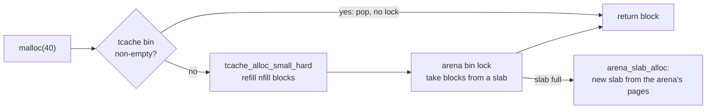

# jemalloc: size-class groups, thread caches and a decay clock

jemalloc is the allocator the Redis server ships (and so, through
`RedisModule_Alloc`, the one most FalkorDB deployments allocate through — see
[reading-falkordb-redis-allocator.md](reading-falkordb-redis-allocator.md)).
It looks nothing like mimalloc: no per-page free lists, but **thread caches**
in front of **arenas** of **slabs**, and a wall-clock process that hands
unused pages back to the kernel. This chapter reads it by following one
`malloc(40)` down the fast path, then one freed page back out through the
decay clock.

Code anchors are `jemalloc/jemalloc` at `0697b617fbaa` (branch `dev`),
read from `~/repos/jemalloc`; that repo is not yet in the pin table at the end
of `resources/codebases.md`. The `dev` branch is newer than the 5.3 release
that the `tikv-jemallocator` crate (used by this topic's `--features
jemalloc` build) and Redis's bundled copy are built from, so line numbers
here locate the *ideas*; check the corresponding file in a 5.3.0 checkout
before quoting a line against a release. The 2006 BSDCan paper that introduced
jemalloc (Jason Evans) could not be obtained for this chapter, so nothing here
cites it; the sources are the code and `TUNING.md`.

## The problem in one sentence

A general-purpose allocator for a long-running multithreaded server must be
fast on the common path, keep fragmentation low for *any* size mix, and
return memory to the OS without paying a system call on every `free` — and
those three pull in different directions.

## The concepts, step by step

### Step 1 — size classes in groups of four

> **In:** nothing — this step defines the rounding rule.
> **Out:** the formula for jemalloc's size classes, the worked table, and why
> a 40-byte record costs 48.

jemalloc rounds a request up to one of a fixed list of **size classes**.
Above a minimum, classes come in **groups**: within a group the gap between
consecutive classes — the **delta** — is constant and equal to the group's
base divided by `SC_NGROUP`, and `SC_NGROUP = 4`:

```c
// jemalloc/jemalloc@0697b617fbaa — include/jemalloc/internal/sc.h, 20-28
    20   * each one covers allocations for base / SC_NGROUP possible allocation sizes.
    21   * We call that value (base / SC_NGROUP) the delta of the group. Each size class
    22   * is delta larger than the one before it (including the initial size class in a
    23   * group, which is delta larger than base, the largest size class in the
    24   * previous group).
    // ... 25-27 ... SC_NGROUP is a power of two, defined via SC_LG_NGROUP (= 2, line 173) ...
    28   * lg_delta == lg_base - SC_LG_NGROUP.
```

Work the group with base 128 (the largest class of the previous group): the
delta is 128 ÷ 4 = 32, so the classes are **160, 192, 224, 256**, covering
the request ranges (128, 160], (160, 192], (192, 224], (224, 256]. The worst
internal waste in a group is a request one byte above the base: 129 bytes in
a 160-byte class wastes 31 bytes, 31 ÷ 160 = **19.4%**; for the group with
base 64 (delta 16) it is 65 in 80, 15 ÷ 80 = 18.75%. The bound is "a bit
under 20%" for every group, which is the price of having only four classes
per doubling instead of dozens.

Below the groups, classes step by the **quantum**, the minimum alignment,
`2^LG_QUANTUM` bytes. The quantum is chosen per platform:

```c
// jemalloc/jemalloc@0697b617fbaa — include/jemalloc/internal/quantum.h, 22-24, 28-30
    22  #	if (defined(__amd64__) || defined(__x86_64__) || defined(_M_X64))
    23  #		define LG_QUANTUM 4
    24  #	endif
    // ... 25-27: 32-bit ARM uses 3 ...
    28  #	if defined(__aarch64__) || defined(_M_ARM64)
    29  #		define LG_QUANTUM 4
    30  #	endif
```

Lines 23 and 29 are the ones to read: on x86-64 *and* arm64 the quantum is
16 bytes. Therefore a **40-byte object is served from the 48-byte class**
(40 → 48, 8 bytes or 20% of padding), and a 24-byte object from the 32-byte
class. This repo's lane 1a measures exactly that: the edge record in the
bench trace is 40 bytes, 997,374 of them, and every global-allocator build —
libmalloc, mimalloc 2.x, jemalloc — comes out at 1.12–1.13 resident bytes
per live byte against 1.00 for the arena (997,374 × 8 B = 7.6 MiB of 77.2).
A graph engine that designs a 40-byte edge record on the belief that
`malloc(40)` costs 40 bytes pays 20%.

### Step 2 — arenas, bins and slabs

> **In:** Step 1's size classes.
> **Out:** the three nouns that name where a block lives, and the lock each
> one implies.

An **arena** is an independent allocator instance: its own lock, its own
bookkeeping, its own pages. Threads are assigned to arenas (by default four
times the number of CPUs, `doc/jemalloc.xml.in:1116–1118`), which is how jemalloc avoids one global lock; `TUNING.md`
notes the cost — "high arena count may also increase overall memory
fragmentation, since arenas manage memory independently" — and suggests
lowering `narenas` when parallelism at the allocator is not needed. Inside an
arena each small size class has a **bin**, and a bin owns **slabs**: runs of
pages carved into equal slots of that class. An allocation that gets past the
thread cache (Step 3) takes the bin's lock, finds a slab with a free slot
(`bin_malloc_no_fresh_slab`, `src/bin.c:312`) or makes one
(`arena_slab_alloc`, `src/arena.c:707`; called at `:850` and `:887`).

A slab is the analogue of mimalloc's page and Hoard's superblock; the
difference is who touches it. In mimalloc the *thread* owns the page and
allocates from its free list lock-free; in jemalloc many threads share the
arena, so the lock exists, and the **thread cache** (next step) exists
precisely to avoid taking it.

### Step 3 — the thread cache: a stack of pointers and one comparison

> **In:** Step 2's bin lock.
> **Out:** the fast path in source, and what the slow path amortises.

Each thread has a **tcache** holding, per small size class, a **cache bin**: a
small array used as a stack of free blocks. `malloc` pops the top; `free`
pushes. No lock, no atomic. The code that checks for emptiness is worth
reading for its trick: it never compares the pointer it loads to `NULL`.

```c
// jemalloc/jemalloc@0697b617fbaa — include/jemalloc/internal/cache_bin.h, cache_bin_alloc_impl, 395-407
   395	void          *ret = *bin->stack_head;
   396	cache_bin_sz_t low_bits = (cache_bin_sz_t)(uintptr_t)bin->stack_head;
   397	void         **new_head = bin->stack_head + 1;
   // ... 398-402: comment — the low-water mark is at most empty ...
   403	if (likely(low_bits != bin->low_bits_low_water)) {
   404		bin->stack_head = new_head;
   405		*success = true;
   406		return ret;
   407	}
```

The comment at lines 383–389 says why: "We avoid checking (ret == NULL) because
there is never a null stored on the avail stack ... and eagerly checking ret
would cause pipeline stall (waiting for the cacheline)." The emptiness test
compares the *low 16 bits of the stack pointer* against a precomputed
low-water value — a register-only test — instead of waiting for the loaded
block's cache line. Lines 395 and 403 are the whole fast path.



When the stack is empty, the caller falls through to the slow path,
`tcache_alloc_small` (`include/jemalloc/internal/tcache_inlines.h:102–144`),
which at lines 127–128 calls `tcache_alloc_small_hard`, which refills the bin
with a *batch* of blocks from the arena (`arena_ptr_array_fill_small`,
`src/tcache.c:439`): one bin-lock acquisition buys `nfill` blocks, not one,
and the fill size adapts (`bin_nfill[binind]` at `:431`, updated after each
refill at `:449`). Amortisation is the point: with a refill of 32, the lock is
taken once per 32 allocations.

The cost of the design is memory that **no thread can see**: blocks sitting in
thread A's cache are free but unavailable to thread B. That is the Hoard
blowup of [reading-hoard.md](reading-hoard.md) in miniature, bounded here by
the cache's maximum size per class and by periodic flushing back to the arena.

### Step 4 — returning memory: dirty pages, muzzy pages and a clock

> **In:** Steps 2–3 (pages that become free inside an arena).
> **Out:** the decay schedule, with the `smootherstep` weights worked, and
> the trade the defaults make.

When a slab empties, its pages become **dirty**: free from jemalloc's point
of view but still mapped and holding the old data, so reusing them costs
nothing and returning them costs a system call plus a re-fault later. A page
goes through up to two stages before it is released: **dirty** (still
resident, reusable for free) and **muzzy** (marked `MADV_FREE`: the kernel may
reclaim it lazily; reusing it before then is also free). The two timeouts:

```c
// jemalloc/jemalloc@0697b617fbaa — include/jemalloc/internal/arena.h, 30-32
    30  /* Default decay times in milliseconds. */
    31  #define DIRTY_DECAY_MS_DEFAULT ZD(10 * 1000)
    32  #define MUZZY_DECAY_MS_DEFAULT (0)
```

Dirty pages decay over **10 seconds**; muzzy decay is **0**, and the manual
(`doc/jemalloc.xml.in:1226–1228`) says what that means: "A decay time of 0
causes all unused muzzy pages to be purged immediately upon creation. Muzzy
decay is disabled by default." So the 10-second dirty clock is the whole
schedule. `TUNING.md` states the trade: "Shorter decay time purges
unused pages faster to reduces memory usage (usually at the cost of more CPU
cycles spent on purging), and vice versa" (lines 38–47).

The decay is not a sharp timeout. Time is divided into `SMOOTHSTEP_NSTEPS` =
**200** epochs across the decay interval, and the allocator keeps a
**backlog**: how many pages became dirty in each recent epoch. The number of
dirty pages it will *allow itself to keep* is a weighted sum:

```c
// jemalloc/jemalloc@0697b617fbaa — src/decay.c, decay_backlog_npages_limit, 107-111
   107	uint64_t sum = 0;
   108	for (unsigned i = 0; i < SMOOTHSTEP_NSTEPS; i++) {
   109		sum += decay->backlog[i] * h_steps[i];
   110	}
   111	size_t npages_limit_backlog = (size_t)(sum >> SMOOTHSTEP_BFP);
```

`h_steps[i]` are fixed-point values of the **smootherstep** curve
`6x⁵ − 15x⁴ + 10x³`, rising from 0 to 1 (`SMOOTHSTEP_BFP` = 24 fractional
bits, `smoothstep.h:26–28`). Index 0 is the oldest epoch. Work three of the
weights, with `x = i / 200`: at `x = 0.25`, `6(0.25)⁵ − 15(0.25)⁴ +
10(0.25)³ = 0.00586 − 0.05859 + 0.15625 =` **0.1035**; at `x = 0.5`,
**0.5**; at `x = 0.75`, **0.8965**. So pages that became dirty in the oldest
quarter of the window are allowed to stay with weight about 10%, those from
the middle 50%, and the most recent quarter about 90–100%. The limit
therefore falls *smoothly* as time passes with no new activity, instead of
dropping a cliff at 10 s, and a burst of frees is not purged all at once —
which would make a latency spike and then a burst of re-faults when the load
returns. This is the "decay-based purging with a wall-clock" that Durner et
al. credit for jemalloc's memory behaviour (§3.3 of
[reading-durner-allocation-impact.md](reading-durner-allocation-impact.md)).

The other half of the trade is who runs the clock. By default the decay
epochs advance when threads *allocate and free*, which means a thread that
goes idle stops advancing the clock and its dirty pages stay. `TUNING.md`
recommends `background_thread:true` for jemalloc-managed threads (line 16–23)
so a separate thread purges on schedule. Whether Redis's bundled jemalloc has
it on is a build and config question the reading guide for FalkorDB's
allocator takes up.

## How to read the source (with the concepts in hand)

1. **`include/jemalloc/internal/sc.h:1–60`** — the group comment, then
   `SC_LG_NGROUP` at `:173`. Reproduce Step 1's table for base 256.
2. **`include/jemalloc/internal/quantum.h`** — which line applies to your
   machine.
3. **`include/jemalloc/internal/tcache_inlines.h:102–144`** then
   **`cache_bin.h:381–425`** — Step 3's fast and slow path.
4. **`src/tcache.c:422–450`** — the batch refill and its adaptive size.
5. **`src/arena.c:707`, `:850`, `:887`** and **`src/bin.c:312`** — slab
   creation and the bin's no-fresh-slab path.
6. **`include/jemalloc/internal/arena.h:30–32`**, **`src/decay.c:100–145`**,
   **`smoothstep.h`** — Step 4.

## Where each step lives in this topic

| step | file / lane | what to look at |
|---|---|---|
| 1 | lane 1a, `res/live` column | 40 → 48 padding: 7.6 MiB on 77.2 MiB |
| 3 | lane 2 (stub) `PageHeap` | the fast path is a free-list pop, not a stack, but the slow-path batching is the same idea |
| 3 | `--features jemalloc` runs | the real tcache against libmalloc and mimalloc on lanes 1a–1d |
| 4 | lane 1b | `res1` after a churn that frees half the heap: how much is handed back |

## Questions (answer in notes.md)

1. Add up the padding for lane 1's trace under a 16-byte quantum: nodes
   are 64 B (no padding), edges 40 B (+8), properties
   16/24/32/48/64/96/128/256 B. Which property sizes are padded, and what
   share of live bytes is padding overall (compare with the measured
   1.12–1.13)?
2. A thread cache holds up to `ncached_max` blocks per class. With 100
   threads and 40 classes, give an upper bound on the bytes parked in
   caches if each bin holds 200 blocks of the average class (say 128 B).
3. Dirty decay is 10 s. A graph workload alternates 30 s of bulk loading with
   30 s of queries that free everything. When does the process shrink, and
   would 1 s decay change the load phase's throughput (hint: lane 1d's
   footprint column)?
4. The manual says muzzy pages are "in an indeterminate state" (they were
   `MADV_FREE`d). Which Durner et al. observation makes that state
   complicated to measure from outside the process?

## Done when

Answer each before unfolding it.

- [ ] You can compute the size class for any request and its worst-case
      waste.

  <details><summary>Answer</summary>

  Within a group with base `B`, classes are `B + k·(B/4)` for `k = 1..4`
  (`sc.h:20–28`). A request is rounded up to the next one; the worst case is
  `B + 1` bytes: for `B` = 128, 129 → 160, 31 ÷ 160 = 19.4% waste. Below the
  groups, classes step by the 16-byte quantum on x86-64 and arm64
  (`quantum.h:23,29`), so 40 → 48.

  </details>

- [ ] You can explain why the tcache fast path is lock-free and cheap.

  <details><summary>Answer</summary>

  The cache bin is thread-private: popping a block moves a stack pointer
  (`cache_bin.h:395,404`). Emptiness is detected by comparing the low bits of
  the stack pointer against a precomputed low-water value (`:403`), not by
  testing the loaded pointer for NULL, so the branch does not wait on the
  block's cache line (comment at `:383–389`). A refill takes the bin lock once
  per batch (`tcache.c:439`).

  </details>

- [ ] You can describe how dirty pages decay and why it is smooth.

  <details><summary>Answer</summary>

  Default dirty decay is 10 s (`arena.h:31`). The allowed dirty page count is
  a weighted sum of a 200-epoch backlog, weighted by the smootherstep curve
  `6x⁵ − 15x⁴ + 10x³` (`decay.c:107–111`): weights 0.1035, 0.5 and 0.8965 at
  quarter, half and three-quarter positions. Old dirt is allowed less and less
  continuously, so purging is spread over the window rather than done at a cliff.

  </details>

- [ ] You can state the cost of thread caches.

  <details><summary>Answer</summary>

  Free blocks held in one thread's cache are invisible to other threads, so
  memory can be parked: bounded by the cache's maximum size per class and by
  flushing, but real. It is the same blowup shape as Hoard's private heaps
  (reading-hoard.md Step 2), kept to a constant factor by the bounds.

  </details>

## References

- `jemalloc/jemalloc@0697b617fbaa` (`dev`): `include/jemalloc/internal/sc.h`,
  `quantum.h`, `cache_bin.h`, `tcache_inlines.h`, `arena.h`, `smoothstep.h`,
  `src/tcache.c`, `src/arena.c`, `src/bin.c`, `src/decay.c`, `TUNING.md`.
- Previous: [reading-mimalloc.md](reading-mimalloc.md). Next:
  [reading-falkordb-redis-allocator.md](reading-falkordb-redis-allocator.md).
  Related: [reading-durner-allocation-impact.md](reading-durner-allocation-impact.md).
