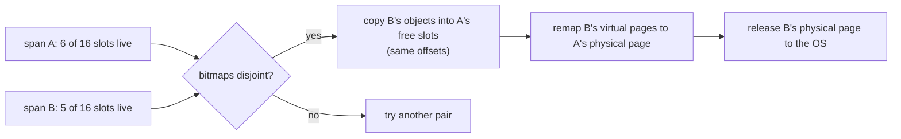

# Mesh: compacting a heap you are not allowed to move

Fragmentation is the allocator problem a database feels last and hardest.
Throughput is visible in a profile; a heap that holds 2× the data it needs is
visible only as a bill, or an out-of-memory kill. The cure everyone knows —
compact the heap by moving objects — is unavailable in C and C++ because
nothing can find every pointer to the object being moved. Mesh's idea is to
compact without moving anything, by changing what the *virtual memory
hardware* believes about two pages.

**"Mesh: Compacting Memory Management for C/C++ Applications"** — Bobby
Powers, David Tench, Emery D. Berger, Andrew McGregor. PLDI 2019
(arXiv:1902.04738, [pdf](https://arxiv.org/pdf/1902.04738)). Section numbers
are the paper's. This repo does not implement Mesh; the chapter reads it so
that lane 1b's fragmentation numbers have a ceiling to be compared against.

## The problem in one sentence

An allocator that cannot relocate objects can be forced to hold far more
memory than the program uses, and the usual defence — redis's `activedefrag`,
which copies objects to fresh memory — works only for code that knows where
every pointer is.

## The concepts, step by step

### Step 1 — fragmentation without relocation

> **In:** nothing — this step defines the problem Mesh attacks.
> **Out:** the terms **span**, **occupancy** and **Robson bound**, and the
> number the paper quotes for how bad it can get.

A **span** is a run of contiguous 4 KiB pages that Mesh divides into
equal-sized slots, like mimalloc's page or jemalloc's slab (§2.1). Its
**occupancy** is the fraction of slots holding live objects. A heap of
spans each 10% occupied holds 10× the data it needs, and none of them can be
returned to the OS because each has one live object somewhere in it.

Robson (1971, cited in §1) proved this is not just an unlucky workload: **any**
allocator can be driven to fragmentation as large as "the log of the ratio
between the largest and smallest object sizes allocated". The paper's
example: "an application that allocates 16-byte and 128KB objects ... can
consume 13× more memory than required". Check: 128 KiB ÷ 16 B = 8,192 =
2¹³, so `log₂(8192) = 13`. That is the **Robson bound** for that size range,
and the paper's claim is that Mesh "breaks" it "with high probability" (§5).

### Step 2 — meshing: two virtual pages, one physical page

> **In:** Step 1's spans.
> **Out:** the **mesh** operation and the condition under which it is legal.

Two spans can be **meshed** if no slot is occupied in both: their occupancy
bitmaps are disjoint. Mesh copies the live objects of one span into the free
slots of the other — each object keeps its *offset within the span* — and
then rewrites the page table so that **both virtual spans point to the same
physical span**. Every pointer the program holds is still valid, because
virtual addresses did not change; one physical span is released to the OS
(§2.1, Figure 1: utilisation of the pair goes from 37.5% to 75%).

The page-table rewrite uses ordinary system calls. The arena is backed by a
temporary in-memory file made with `memfd_create`; `mmap` can map the same
file offset at two virtual addresses (§4.5.1). During the copy, concurrent
readers see correct data through the atomic semantics of `mmap`, and a write
barrier — the source page is `mprotect`-ed read-only and a segfault handler
makes a writer wait for the mesh to finish — protects against writes
mid-copy (§4.5.2).

### Step 3 — randomised allocation, so meshing works at all

> **In:** Step 2's disjointness condition.
> **Out:** why Mesh allocates at *random* offsets, with the probability
> arithmetic the paper does and one the chapter adds.

If a program happened to leave an object at the same offset in every span,
no two spans would ever be meshable. Mesh prevents that by allocating each
object at a uniformly random free slot in its span (§2.2), using a
**shuffle vector** — a per-thread array of free slot indices in random order
(Knuth–Fisher–Yates), one byte each, popped to allocate (§4.2). The paper's
guarantee: with `b` slots per span and `n` spans, the probability that all
objects sit at the same offset is `(1/b)^(n−1)`. Worked with its example,
`b` = 256 (16-byte objects in a 4 KiB span) and `n` = 64: `256⁻⁶³ =
10^(−63 × 2.408) = 10^(−151.7)`, which the paper rounds to **10⁻¹⁵²** (§2.2).

That bound is about the *worst case*. The ordinary case depends on
occupancy, and this is arithmetic the paper does not print. Take two spans of
`b` = 256 slots, each holding `k` live objects at independent uniformly
random slots. They are meshable when the second span's `k` objects all fall in
the `b − k` slots the first left empty: probability `C(b−k, k) / C(b, k)`.

| live objects per span `k` | occupancy | P(two random spans mesh) |
|---|---|---|
| 8 | 3.1% | 0.773 |
| 16 | 6.25% | 0.345 |
| 32 | 12.5% | 0.0103 |
| 64 | 25% | 3.8 × 10⁻¹⁰ |

(Computed with `C(256−k, k) / C(256, k)`; not a figure from the paper.)
Meshing pays only on **sparse** spans: at 12.5% occupancy only about one pair
in a hundred is meshable by luck, at 25% effectively none. That is why §3.3's
`SplitMesher` probes many pairs (`t` = 64 per span, §3.3) and why Mesh
tracks spans in occupancy bins and meshes only the sparse ones.

### Step 4 — measured: Firefox, Redis, and what "compaction" cost

> **In:** Steps 1–3.
> **Out:** the paper's three data points relevant to a server, with section
> numbers, and what each does and does not show.

- **Firefox** (§6.2.1): the paper reports "Mesh requires 530 MB (σ = 22.4 MB)
  to complete the benchmark, while the Mozilla allocator needs 632 MB (σ =
  25.3 MB)" — average resident set over the Speedometer 2.0 run, three runs
  each. Arithmetic: (632 − 530) ÷ 632 = **16.1%**, which the paper reports
  as 16%, with under 1% change in the Speedometer score.
- **Redis** (§6.2.2): on an adapted version of the Redis test suite's
  fragmentation test (values of 240 and 492 bytes so every allocator uses
  similar size classes), Mesh "automatically and portably achieves the same
  heap size reduction (39%) as Redis's active defragmentation". Insertion took
  1.76 s under Mesh and 1.72 s under default jemalloc. Meshing took 0.23 s in
  total (longest pause 22 ms); active defragmentation took 1.49 s, "5.5×
  slower" — but 1.49 ÷ 0.23 = 6.5×, so the printed ratio and the printed
  seconds disagree; trust the two times, not the ratio).
- **Randomisation matters in practice only when allocation is regular**
  (§6.3): on Firefox and Redis there was "no significant difference" with
  randomisation disabled, but a synthetic Ruby string benchmark with a
  regular pattern got a 19% heap reduction with randomisation versus 3%
  without (at 10.7% vs 4% runtime overhead).

What this does not show: that Mesh is faster. It "generally matches" other
allocators' speed (abstract); the benefit is memory. And it is a *research*
allocator measured on 2018 workloads.

## How to read the paper (with the concepts in hand)

1. **§1 and Figure 1** — Steps 1–2; Robson's 13× example.
2. **§2.2–§2.3** — Step 3's probability and the framing of "finding spans to
   mesh" as a partition problem.
3. **§3.3 and Figure 2** — `SplitMesher`; note `t = 64`.
4. **§4.2 and Figure 3** — shuffle vectors; **§4.5** — page tables and the
   write barrier (the part that makes this a systems paper).
5. **§5** — the analysis. Read the statement of each theorem; skip the proofs
   on a first pass.
6. **§6.2** — the three results of Step 4.

## Where each step lives in this topic

| step | file / lane | what to look at |
|---|---|---|
| 1 | `alloc_bench` lane 1b, `res1/live1` column | the fragmentation ratio Mesh claims to cut: system allocator vs reference page-allocator |
| 3 | notes.md exercise | compute the meshable fraction for the *churned* heap of lane 1b |
| 4 | [reading-falkordb-redis-allocator.md](reading-falkordb-redis-allocator.md) | the allocator FalkorDB would be compared against |

## Questions (answer in notes.md)

1. The Step 3 table says 12.5% occupancy meshes ~1% of pairs. After lane 1b's
   churn, the reference heap's `res1/live1` is about 1.07 — what mean
   occupancy of 64 KiB pages does that imply, and is meshing worth
   attempting on it?
2. §4.5.2's write barrier faults a writer that touches an object during
   a mesh. Which kind of FalkorDB operation (bulk load, `SET` on an existing
   property, a query's temporary allocation) would hit it?
3. Mesh must never move an object's *offset within its span*. Which size
   classes in lane 2's `CLASSES` table make that constraint hardest (hint:
   how many slots per 64 KiB page for a 1024-byte class?).
4. Compare redis `activedefrag` (copies live objects to fresh allocations,
   needs allocator-specific APIs, §6.2.2) with meshing. What does each need
   from the application?

## Done when

Answer each before unfolding it.

- [ ] You can state Robson's bound and the paper's example.

  

Answer

  Any allocator can be forced to waste memory up to the log of the ratio
  between the largest and smallest allocated object size (§1). For 16-byte and
  128 KiB objects the ratio is 8,192 = 2¹³, so 13× more memory than required.

  

- [ ] You can describe the mesh operation and when it is legal.

  

Answer

  Two spans can mesh if their occupancy bitmaps are disjoint. The live
  objects of one are copied into the other's free slots at the same offsets,
  both virtual spans are remapped to one physical span via `mmap` of a
  `memfd`-backed file, and the other physical span is released. Pointers stay
  valid because virtual addresses do not change (§2.1, §4.5.1).

  

- [ ] You can compute the probability that two random spans mesh and say
      what it implies.

  

Answer

  `C(b − k, k) / C(b, k)`. For `b` = 256: 0.773 at `k` = 8, 0.345 at 16,
  0.0103 at 32, 3.8 × 10⁻¹⁰ at 64. Meshing needs sparse spans (below about 10%
  occupancy) or many probes; at 25% occupancy a random pair never meshes,
  which is why Mesh bins spans by occupancy and uses `t` = 64 probes (§3.3).

  

- [ ] You can say what Mesh saved on Firefox and Redis, and what it did not.

  

Answer

  Firefox: 632 MB → 530 MB mean RSS (16.1%) at under 1% score change; Redis:
  the same 39% heap reduction as `activedefrag`, with 0.23 s of meshing time
  versus 1.49 s of defragmentation (§6.2.1, §6.2.2). It did not make
  allocation faster, and randomisation helped little on irregular workloads
  (§6.3).

  

## References

- Bobby Powers, David Tench, Emery D. Berger, Andrew McGregor, **"Mesh:
  Compacting Memory Management for C/C++ Applications"**, PLDI 2019,
  arXiv:1902.04738 — §1 (Robson), §2 (overview; 10⁻¹⁵² example), §3.3
  (SplitMesher), §4.2 (shuffle vectors), §4.5 (page tables, write barrier),
  §5 (analysis), §6.2–§6.3 (Firefox, Redis, Ruby).
- Previous: [reading-hoard.md](reading-hoard.md). Next:
  [reading-jemalloc.md](reading-jemalloc.md) and
  [reading-falkordb-redis-allocator.md](reading-falkordb-redis-allocator.md).
