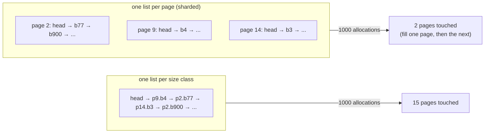

# mimalloc: free-list sharding, and why one list per page is the whole idea

An allocator has one job — hand out a block when asked, take it back when
told — and one hard constraint: both must cost a handful of instructions,
because a database does them millions of times a second. This chapter reads
the design that made that cheapest in 2019 and is still the reference for
"small, regular, fast": mimalloc. It builds the idea in four steps (what a
free list is and why a single one scatters your data; sharding it per page;
the extra lists that keep the fast path to one branch; remote frees), then
reads the current source to see which parts of the paper survived.

**"Mimalloc: Free List Sharding in Action"** — Daan Leijen, Benjamin Zorn,
Leonardo de Moura. Microsoft Technical Report MSR-TR-2019-18, June 2019
(APLAS 2019). Section numbers below are the technical report's. Code anchors
are `microsoft/mimalloc` at `8b08dbb8f9c8` (branch `main3`, the v3 line,
`MI_MALLOC_VERSION 30600`) read from the clone at `~/repos/mimalloc`. That
repo is not yet in the pin table at the end of `resources/codebases.md`; the
anchors are line numbers at that commit. The v3 line has been rewritten in
places since the report (the heap is a `theap`, pages come from arenas, not
4 MiB segments); where that matters the text says so.

## The problem in one sentence

A database allocates and frees millions of small objects per second from many
threads, so the allocator's fast path must be a few instructions with no lock,
*and* the objects a query allocates together must end up near each other in
memory — two goals that a single free list per size class satisfies only by
accident.

## The concepts, step by step

### Step 1 — free lists, and how one list scatters your data

> **In:** nothing — this step defines the vocabulary.
> **Out:** the term **free list**, the term **size class**, and one
> measurable claim: a single list per size class spreads consecutive
> allocations across the whole heap once frees have been scattered.

A **size class** is a block size the allocator hands out; a request for 40
bytes is rounded up to the smallest class that fits (48, say) so that every
block in a region is the same size and any freed block can serve any later
request of that class. A **free list** is a singly linked list threaded
through the freed blocks themselves: each free block's first word holds the
address of the next free block, so the list costs no memory beyond the blocks
it tracks. `malloc` pops the head; `free` pushes onto it.

The cost of the classic design — one free list per size class for the whole
heap — is locality. A list is LIFO, so it hands blocks out in the *reverse of
the order they were freed*. If a query freed its temporaries in a scattered
order, the next query's objects land wherever the list happens to point. The
report's §2.1 draws the situation with a three-element list; here is the same
effect with numbers. Take 20,000 blocks of 48 bytes in 15 pages of 1,364
blocks each (this repo's `classes::blocks_per_page` for class 48 is
`(65536 − 64) / 48 = 1364`), free a random 10,000, then allocate 1,000. A
Python simulation of exactly that (seeded, not the crate) pops the 1,000
most recently freed blocks and finds them in **15 of the 15 pages**. Every
page is touched, every one of its cache lines and TLB entries is in play, and
the 1,000 objects that a graph traversal will read together are spread over
about 1 MB of address space instead of 48 KB.



### Step 2 — shard the list: one free list per page

> **In:** Step 1's free list and its scatter problem.
> **Out:** mimalloc's central rule — allocate from one page until it is full —
> and the claim the authors measured for it.

mimalloc divides the heap into **pages** (not OS pages: 64 KiB regions that
each hold blocks of a single size class; §2.1 footnote 1 says they "correspond
more closely to a superblock") and gives *each page its own free list*. The
heap keeps, per size class, the page it is currently allocating from.
`malloc` pops that page's list; only when it is empty does the allocator move
to another page. So an allocation sequence fills a page, then fills the next
one, **regardless of where other blocks were freed** (§1, first bullet). In
Step 1's example, 1,000 allocations then touch two pages.

The authors tested whether this alone matters: replacing the Lean compiler's
single-free-list small-object allocator with "just a sharded free list per
slab (page)" gave "performance improvements of over 25% with this single
change" on benchmarks with large data structures in a 1 GiB heap (§2.1). The
mechanism is locality, not allocator speed — the allocator's own instructions
did not get cheaper, the program's *other* memory accesses did.

One design choice surprises: no bump pointer. Many allocators carve a fresh
page by advancing a pointer instead of threading a free list through it
first. mimalloc §2.2 tested a bump-pointer variant and found it "consistently
about 2% worse" across their benchmarks, because it adds a second
conditional to the fast path ("either use the bump pointer, or use the free
list") that the branch predictor cannot learn — which one applies depends on
which page the allocation happens to land in. A second reason is security:
bump allocation is predictably sequential.

### Step 3 — three lists, so the fast path has exactly one branch

> **In:** Step 2's per-page free list.
> **Out:** why each page carries three lists (`free`, `local_free`,
> `thread_free`), and what the code does with each on the allocation path.

If the fast path is "pop the head, and if it is empty call the slow path",
the slow path can be given every piece of periodic maintenance for free — as
long as it is guaranteed to run regularly. A page that is allocated from and
freed into repeatedly might never run dry, so the slow path would never run.
mimalloc fixes that with a second list (§2.3): while the allocator pops from
`page->free`, **local frees push onto a different list, `page->local_free`**.
`free` therefore runs dry after a bounded number of allocations — at most the
page's capacity — and the slow path (`malloc_generic`) runs then, moving
`local_free` into `free` in two assignments. The authors call this a
**temporal cadence**: the slow path is entered after a fixed number of
allocations, so expensive work (collecting remote frees, retiring empty
pages, running a user callback) is amortised across them without a second
check in the fast path.

Here is the current fast path. Read lines 87 and 93 together: the whole
fast-path decision is one load and one branch.

```c
// microsoft/mimalloc@8b08dbb8f9c8 — src/alloc/alloc.c, mi_page_malloc_zero, 86-93
    86    // check the free list
    87    mi_block_t* const block = page->free;
    88    mi_used_t xused = page->xused;
    89    #if defined(__GNUC__)
    90    __asm("" : : "r"(xused) : );     // load the `xused` field before the test
    91    #endif
    92    xused.used_alloc += 0x10001;
    93    if mi_unlikely(block == NULL) {
    // ... 94-111: slow-path call, then the pop is below ...
   112    // update the page free list and used count
   113    page->free  = next;
   114    page->xused = xused;
```

The comment at line 75–76 states the result: "in release mode the (inlined)
routine is about 7 to 10 instructions with a single test." The `used` count
(here packed with an allocation counter into `xused`; the report's `used++`)
exists so the allocator can tell when a page is completely free.

The free side mirrors it. Line 66 is the push onto `local_free`; line 67 is
the emptiness test that drives page retirement.

```c
// microsoft/mimalloc@8b08dbb8f9c8 — src/alloc/free.c, mi_free_block_local, 60-67
    60    // actual free: push on the local free list fast-path
    61    mi_used_t xused = page->xused;
    62    mi_block_t* lfree = page->local_free;
    63    xused.used_alloc--;
    64    mi_block_set_next(page, block, lfree);
    65    page->xused = xused;
    66    page->local_free = block;
    67    const bool is_empty = (mi_xused_used_count(xused) == 0);
```

How does `free(p)` find `page` from only a pointer? In the report (§3.2) the
heap lives in 4 MiB **segments** aligned to 4 MiB, so `p & ~(4 MiB − 1)` is
the segment header and a shift gives the page index — no lookup table, no
per-block header. This repo's lane 2 reproduces the trick at a smaller scale
(64 KiB pages; `classes::PAGE_MASK`). The v3 source finds the page through a
page map instead (`src/heap/page-map.c`) and asserts it agrees with the
aligned computation (`free.c:274`), because v3 pages can be larger than the
alignment granule.

### Step 4 — remote frees: a third list and a CAS

> **In:** Step 3's `local_free` and the thread that owns a page.
> **Out:** how a free from the *wrong* thread is made safe without a lock,
> and why the owner collects the whole list in one step.

Each page belongs to one thread's heap, and only that thread allocates from
it — so the allocation fast path needs no atomic operation at all. But any
thread may free any block, and the freeing thread must not touch the owner's
`local_free`. mimalloc gives the page a third list, `thread_free` (§2.4), and
a non-owner **pushes the block with a compare-and-swap (CAS)** — an atomic
"set this word to the new value only if it still holds the old one", retried
on failure. The code (current line numbers) is a plain loop:

```c
// microsoft/mimalloc@8b08dbb8f9c8 — src/alloc/free.c, mi_free_block_mt, 103-110
   103    // push atomically on the page thread free list
   104    // mi_theap_t* theap = _mi_page_associated_theap_peek(page);
   105    mi_thread_free_t tf_new;
   106    mi_thread_free_t tf_old = mi_atomic_load_relaxed(&page->xthread_free);
   107    do {
   108      mi_block_set_next(page, block, mi_tf_block(tf_old));
   109      tf_new = mi_tf_create(block, true);
   110    } while(!mi_atomic_cas_weak_acq_rel(&page->xthread_free, &tf_old, tf_new));
```

Two properties make this cheap. **It is sharded:** the list is per page, so
two threads freeing into different pages never contend (§2.4). **It is
batched:** the owner empties it with one atomic exchange, not one operation
per block — `mi_page_thread_free_collect` (`src/alloc/page.c:363–379`) swaps
the head to `NULL` and splices the whole captured chain onto `local_free`.
Batching is what makes an *asymmetric* workload — some threads only allocate,
others only free — scale; the paper's `xmalloc-test` benchmark exists to test
exactly that (§2.4, §4).

The free fast path chooses between local and remote with one comparison:
`xtid = _mi_prim_thread_id() ^ page_thread_id` is zero when the freeing thread
owns the page and the page needs no special handling (`free.c:298–300`). That
single XOR also folds in the page flags (full, aligned), so one test covers
the common case and the rare ones fall to `mi_free_generic_*`.

### Step 5 — the full list: the corner case that cost 30%

> **In:** Steps 2–4's pages and the slow path that walks them.
> **Out:** why a production allocator is mostly corner cases, with the
> report's own anecdote.

The slow path `malloc_generic` scans a size class's pages for one with space
(§3.3). On the SpecMark `gcc` benchmark, which allocates many large objects at
start-up and keeps them, mimalloc walked "over 18000" full pages on every
slow-path call and ran **30% slower** than other allocators (§3.4). The fix is a
separate **full list** that pages enter when they fill and leave when a block
is freed in them. It sounds small, and the report says it was not: a remote
free into a full page must tell the *owning* heap that the page has space again
without a lock, which needs a three-state flag packed into the low two bits of
the `thread_free` pointer (NORMAL / DELAYED / DELAYING) and a per-heap
delayed-free list. Dropping the "only one delayed free per page" optimisation
made `xmalloc-test` 30% slower (§3.4).

The lesson that is easy to miss: the headline design (three lists) fit in
two pages of the paper; the other half of the allocator is bookkeeping for
the cases where the headline design alone degrades. Lane 3's reference
solution in this repo has the same shape — its `full` list and the scan that
collects remote frees into it are the "boring" half, and the producer/consumer
test fails without them.

## How to read the source (with the concepts in hand)

1. **`src/alloc/alloc.c:73–100`** — `mi_page_malloc_zero`, Step 3's fast
   path. Count the branches (one) and compare with the report's
   `malloc_in_page` (§2.2).
2. **`src/alloc/alloc-generic.c:46`** — `mi_page_queue_find_free_ex`, the
   slow-path walk of Step 5 and the place `_mi_page_free_collect` is called
   (`:72`).
3. **`src/alloc/page.c:363–409`** — `mi_page_thread_free_collect` and
   `_mi_page_free_collect`: the atomic exchange of Step 4 and the
   `local_free → free` move of Step 3, in the usual case at lines 390–394.
4. **`src/alloc/free.c:45–120`** — the local and remote frees; **`:293–319`**
   the four-way dispatch on the XOR of thread ids.
5. **`include/mimalloc/types.h:224`** — arena slice of 64 KiB (`13 +
   MI_SIZE_SHIFT` with 8-byte words), the v3 successor of the report's
   64 KiB small pages.

## Where each step lives in this topic

| step | file / lane | what to look at |
|---|---|---|
| 1 | `experiments/src/pageheap.rs`, test `allocation_stays_local_after_scattered_frees` | 1,000 allocations touch ≤ 3 pages after scattered frees |
| 2 | lane 2 (stub) | one current page per class; no bump pointer needed |
| 3 | lane 2 (stub), optional `local_free` | the cadence is an optional refinement the tests do not require |
| 4 | `experiments/src/shared.rs` (stub, lane 3) | `thread_free` per page, CAS push, owner collects |
| 5 | lane 3's `producer_consumer_memory_is_bounded` | fails if remote frees never find their way back |
| — | `alloc_bench` lane 1d under `--features mimalloc` | system allocator vs mimalloc on cross-thread frees |

## Questions (answer in notes.md)

1. Step 2's example touches two pages for 1,000 allocations. What changes if
   the 10,000 frees are not random but come in runs of 100 consecutive
   blocks (a query deleting a contiguous range)? Which design gains less from
   sharding?
2. §2.2 reports bump-pointer allocation ~2% slower. Under what allocation
   pattern would you expect it to be *faster* — and does lane 1a's bump arena
   (4.8 ns per allocation versus the system allocator's 14.0) say anything
   about the report's claim? (Careful: the arena never frees.)
3. The paper's redis result (§4: mimalloc 14% faster than jemalloc on 1
   million requests that push 10 new list elements and then read the head
   10, redis 5.0.3) was measured with the
   allocator replacing *all* of redis's allocations. FalkorDB's allocations
   go through `RedisModule_Alloc` (see
   [reading-falkordb-redis-allocator.md](reading-falkordb-redis-allocator.md)).
   Name two things that would have to change to try mimalloc there.
4. Step 4's CAS loop can fail and retry. Under what workload does one page's
   `thread_free` become a contended hot spot, and what does lane 3's test
   (`sync_channel` of 4 batches) not exercise?

## Done when

Answer each before unfolding it.

- [ ] You can state why the fast path has one branch and what keeps the slow
      path from being starved.

  <details><summary>Answer</summary>

  The fast path pops `page->free` and branches only if it is empty
  (`alloc.c:87`, `:93`). Starvation is prevented by the `local_free` list:
  frees do not go back onto `free`, so `free` is empty after at most one page
  of allocations and the slow path — which moves `local_free` into `free` and
  does the periodic maintenance — runs on a fixed cadence (§2.3).

  </details>

- [ ] You can explain why allocation from one page at a time improves the
      *program's* speed, not just the allocator's.

  <details><summary>Answer</summary>

  Because consecutive allocations land in the same page, the objects a query
  builds together are adjacent in memory. The report's evidence is the Lean
  experiment: a sharded free list per slab alone gave over 25% on
  large-heap benchmarks (§2.1), with no change to the allocator's own
  instruction count. A single LIFO list instead returns the most recently
  freed blocks wherever they were — 15 of 15 pages in the 20,000-block
  simulation of Step 1.

  </details>

- [ ] You can describe how a free from another thread is made safe and cheap.

  <details><summary>Answer</summary>

  The freeing thread pushes the block onto the owning page's `thread_free`
  list with a CAS loop (`free.c:107–110`); because the list is per page,
  threads freeing into different pages do not contend. The owner never takes
  that list one block at a time: it swaps the whole list out with one atomic
  exchange on its slow path and splices it onto `local_free`
  (`page.c:363–379`), which batches the remote frees (§2.4).

  </details>

- [ ] You can say what the full list fixed and what it cost.

  <details><summary>Answer</summary>

  On SpecMark `gcc`, thousands of long-lived full pages (over 18,000) were
  re-scanned on every slow-path call, a 30% slowdown. A separate full list
  removes full pages from the scan. The cost is a lock-free signal from a
  remote free to the owning heap — three states in the low two bits of the
  `thread_free` pointer plus a heap-level delayed-free list (§3.4).

  </details>

## References

- Daan Leijen, Benjamin Zorn, Leonardo de Moura, **"Mimalloc: Free List
  Sharding in Action"**, MSR-TR-2019-18, 2019 — §1 (design bullets), §2.1
  (locality, Lean 25%), §2.2 (no bump pointer, 2%), §2.3 (local free list,
  cadence), §2.4 (thread free list), §3.1–§3.4 (heap layout, free, generic
  path, full list), §4 (benchmarks; redis 14% over jemalloc).
  `microsoft.com/en-us/research/uploads/prod/2019/06/mimalloc-tr-v1.pdf`.
- `microsoft/mimalloc` at `8b08dbb8f9c8` (main3): `src/alloc/alloc.c`,
  `src/alloc/free.c`, `src/alloc/page.c`, `src/alloc/alloc-generic.c`,
  `include/mimalloc/types.h`.
- Next: [reading-jemalloc.md](reading-jemalloc.md), the allocator redis
  ships — thread caches and decay instead of per-page free lists.
  Related: [reading-hoard.md](reading-hoard.md) for the producer/consumer
  blowup that Step 4 solves, and topic 6's
  [reading-redis-zmalloc.md](../06-buffer-pool/reading-redis-zmalloc.md).
