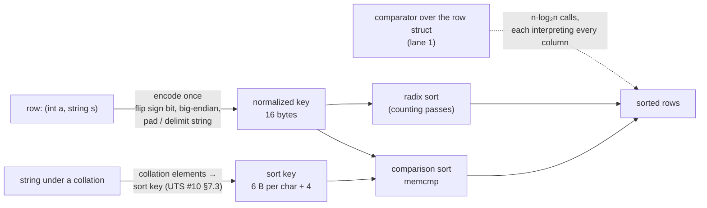

# Topic 57 — Sorting at Scale: Normalized Keys, Radix Sort & Collation

`ORDER BY` is the oldest blocking operator in a query engine, and it is still
where engines differ by integer factors. Topic 11 showed that the unit of work
in a vectorized engine is a *vector*, and that blocking operators (hash
aggregation, hash join build) re-pack their input into a **row format** so they
can touch it with predictable memory access; topic 12 priced the
sorted-clustered column; topic 17 priced the branchless kernel. This topic
puts them together on the operator that needs all three: sort ten million rows
by a key that is several columns, some of them strings, some of them under a
collation.

Three ideas carry it. **A comparison sort pays for its comparator** — about
`n log₂ n` calls of a function that must interpret types, directions, null
rules and collations per call; FalkorDB's own `ORDER BY` is exactly that
([production shape](#production-shape)). **A normalized key pays for the
interpretation once**: encode every row's key into a byte string whose
`memcmp` order is the `ORDER BY` order (Kuiper & Mühleisen, ICDE 2023), and the
comparator becomes `memcmp`, which makes a byte-wise **radix sort** possible.
**A collation is just a more expensive encoder**: Unicode's sort keys (UTS #10)
turn a language's order into bytes, once per string, and the sort never sees a
collation again. Then the part the papers do quickly: radix sort *loses* on
small inputs, on presorted input, and when the key prefix does not decide the
order — this topic measures each.



## The problem, measured (bench lane 1, provided — runs today)

`cargo run --release --bin sort_bench` — three comparison-sort workloads over
seeded data, each sorted with a comparator over the row struct. (a) 10,000,000
`Row64`s (a `u64` key and an 8-byte payload) by key; (b) 5,000,000 `(int,
string)` rows, the string out of line in an arena, in three shapes — `b1`: `a`
drawn from 1,000 values, random 8–24-letter strings; `b2`: `a` over the whole
`i32` range; `b3`: 1,000 values of `a` and every string starting with the same
20 bytes; (c) 2,000,000 strings under a case- and accent-insensitive collation,
the collation evaluated inside the comparator. Apple M3 Pro (11 cores),
measured 2026-10-26, load average 4.47 at the start of the run; timings are
*thread CPU time*, best of three runs each on a fresh copy of the input. Counts
and checksums are seeded and identical in four runs; timings moved by under 5%
between the two runs at similar load (`notes.md`):

```
-- lane 1a: u64 keys, n = 10,000,000 (Row64 = 16 B: key + payload) --
   sort_unstable on bare u64 (ipnsort, no payload)          112.4 ms  0.48 ns/(n·log2 n)
   sort_unstable_by comparator over Row64                   152.3 ms  0.65 ns/(n·log2 n)
   sort_by (stable, driftsort) comparator over Row64        211.9 ms  0.91 ns/(n·log2 n)
   rows/s: 65.7 M (comparator)   sorted bytes/s: 1.05 GB/s
   sanity: sorted + checksum 0812712ec852b87e preserved: ok

   n sweep, sort_unstable_by over Row64 (best of 3):
              n         ms    ns/(n·log2 n)
          1,000      0.006             0.62
         10,000      0.074             0.56
        100,000      1.070             0.64
      1,000,000     14.323             0.72

-- lane 1b: (int, string) keys, n = 5,000,000, IntStr = 12 B + out-of-line string --
   b1  a in 1,000 values, random strings                545.1 ms  4.90 ns/(n·log2 n)  ties on a: 4,999,000  checksum 534fdd4bcaf33e4b ok
   b2  a over all of i32, random strings                111.3 ms  1.00 ns/(n·log2 n)  ties on a:     2,904  checksum 1cd6d972296e3024 ok
   b3  a in 1,000 values, 20-byte shared prefix         530.0 ms  4.76 ns/(n·log2 n)  ties on a: 4,999,000  checksum c23c7c8734b16de6 ok

-- lane 1c: strings under a case/accent-insensitive collation, collating inside the comparator, n = 2,000,000 --
   2,000,000 strings, 13.6 bytes each on average, 1,978,777 collation classes (equal-collating groups)
   sort_unstable_by(collate_cmp) over indices               744.8 ms  17.79 ns/(n·log2 n)
   sanity: order is a permutation and collation-sorted: ok
```

**Three things the numbers say.** First, a comparison sort of ten million
integers is already fast and flat: 0.56–0.72 ns per `n log₂ n` from a thousand
rows to a million, 0.65 at ten million — about 15 ns per row, which is the
floor the radix lane has to beat. The stable sort costs 1.39× the unstable
one on the same rows, and the 8-byte payload costs 1.35× over a bare `u64`
(which also takes a different base case, a sorting network —
[reading-rust-sort.md](reading-rust-sort.md) Step 3).

Second, **the string is the cost, not the integer.** `b2` and `b1` sort the
same number of rows with the same string data; they differ only in how often
the integer ties. With `a` unique (2,904 ties in 5,000,000), the comparator
almost never leaves the first field and takes 1.00 ns per `n log₂ n`; with
1,000 values of `a` (4,999,000 ties) it chases a pointer into the arena on
nearly every comparison and takes 4.90 — **4.9× slower** for the same rows. `b3`
shows the shared 20-byte prefix costs the comparator almost nothing (4.76 vs
4.90): comparing 20 equal bytes is cheap next to the cache miss that reaches
them. That is the paper's memory-access argument
([reading-duckdb-sort.md](reading-duckdb-sort.md) Step 1) as a measurement.

Third, **evaluating a collation inside the comparator is 18× the per-comparison
cost of the integer sort** (17.79 vs 1.00 ns per `n log₂ n` against `b2`),
because every comparison decodes two UTF-8 strings and looks up their weights.
Nothing about this sort is slow except what the comparator does — which is
lane 3's premise.

The three sanity lines are part of the result: every plan must give the same
checksum (order-independent, so ties may land anywhere) and a sorted
permutation, and every figure is checked against `0.05 < ns/(n·log₂ n) < 500`
— topic 12's 19,047,619 GB/s lesson. All the figures above are 0.48–17.79.

## Step 1 — a comparison sort pays for its comparator

A comparison sort calls `is_less(a, b)` about `n log₂ n` times, and for a
relational row that call reads the type, direction and null rule of each key
column and chases a pointer for every string
([reading-duckdb-sort.md](reading-duckdb-sort.md) Step 1). The cost splits in
two. *Interpretation*: branches and indirect calls per column. *Memory*:
columnar rows are one random access per column per row, row format keeps a row's
key together, and the string case adds a pointer chase into an arena whenever
the integer part ties — lane 1b's `ties on a` column counts how often. The
engine's answer is to keep the comparison sort but make the comparison one
`memcmp` (below); the other answer is a radix sort.

Rust's `sort_unstable` is the baseline everyone competes against, so it is
read in detail: it detects an already-sorted input in `n − 1` comparisons,
peels off equal keys in one pass each, uses a branchless partition for rows up to
96 bytes and a sorting network for ≤ 8-byte types
([reading-rust-sort.md](reading-rust-sort.md)). IPS⁴o is the samplesort that
makes the number of *passes* small — three for 10 million rows instead of ~19 —
and the classification branch-free
([reading-ips4o.md](reading-ips4o.md)).

## Step 2 — a normalized key pays for the interpretation once

Encode each key column left to right into one byte string: signed integers
big-endian with the sign bit flipped, `DESC` as inverted bytes, a NULL byte per
column, a string as a prefix (or, in the pinned DuckDB, bytes + 1 followed by a
`0` delimiter). Worked on the paper's Fig. 5, `(GERMANY, 1924)` under
`c_birth_country DESC, c_birth_year ASC` becomes
`184 186 173 178 190 177 166 255 255 255 255 255 128 0 7 132`, and the two
rows of the example compare by their first byte (177 < 184)
([reading-duckdb-sort.md](reading-duckdb-sort.md) Step 2). DuckDB at the pin
derives the key's width class (8/16/24/32 bytes, or variable) from the column
types and statistics, byte-swaps the key into `uint64_t` parts so that integer
comparison *is* `memcmp`, and sorts it with vergesort + a radix sort over the
first 8 bytes (`ska_sort`) + comparison for the leftovers
(`src/common/sort/sorted_run.cpp:244-260`).

## Step 3 — radix sort, and the four ways it loses

A radix sort counts bytes instead of comparing keys: histogram, prefix sum,
scatter, once per byte ([reading-radix-sort.md](reading-radix-sort.md)). **LSD**
does one stable pass per byte, last byte first, `w × n` work whatever the data;
**MSD** recurses by bucket and can stop early. The reference solution for lane 2
(written to the stub contracts, run, then removed; numbers in
[notes.md](notes.md)) measures where the radix sort beats lane 1's comparison
sort and where it does not:

| input (reference solution vs `sort_unstable_by`, M3 Pro, load 4.3–4.6) | comparison sort | radix sort | radix speed-up |
|---|---|---|---|
| `u64`, uniform, n = 10,000,000 (LSD / MSD) | 150.4 ms | 73.2 / 92.9 ms | **2.06× / 1.62×** |
| `u64`, uniform, n = 50,000,000 (LSD) | 832.8 ms | 375.1 ms | 2.22× |
| `u64`, uniform, n = 100 (LSD) | < 0.001 ms | 0.002 ms | **0.19×** |
| `u64`, uniform, n = 10,000 (LSD) | 0.071 ms | 0.067 ms | 1.06× |
| `u64` already sorted, n = 10,000,000 (LSD) | 2.9 ms | 76.8 ms | **0.04×** (25× slower) |
| `u64` reverse sorted (LSD) | 5.9 ms | 77.1 ms | 0.08× |
| `u64`, 256 distinct values (LSD / MSD) | 50.4 ms | 35.5 / 93.0 ms | 1.42× / **0.54×** |
| `(int, string)` `b1`: 1,000 `a`-values, random strings | 532.7 ms | 177.7 ms | **3.00×** |
| `(int, string)` `b2`: `a` over all of `i32` | 111.9 ms | 104.0 ms | 1.08× |
| `(int, string)` `b3`: 20-byte shared string prefix | 513.3 ms | 721.3 ms | **0.71×** |

Four readings, all measured. **Radix wins where the key decides the order:** 2×
on uniform `u64`, 3× on `b1`, and the win does *not* shrink at 50 million
rows (800 MB of 16-byte rows) — Graefe's fourth objection, "worse cache
efficiency" (relayed by the paper, §VI-C), does not reproduce on this machine
at this scale. **It loses small:** the 256-bucket histogram is a fixed cost, and
LSD is slower than `sort_unstable_by` below about 10,000 rows (0.19× at 100
rows, 0.76× at 1,000, 1.06× at 10,000). **It loses on presorted input by an
order of magnitude**, because `sort_unstable` finds the run in n − 1
comparisons ([reading-rust-sort.md](reading-rust-sort.md) Step 2) and a radix
sort does all its passes regardless — while input that is sorted except for 1%
random swaps (no single run) is back to a 1.85× LSD win. **It loses when the key
prefix does not decide the order:** `b3`'s 12-byte string prefix is identical
in every row, so the radix passes are wasted and the tie-break *is* the sort
(0.71×); sweeping the shared-prefix length at 2,000,000 rows shows the
crossover between 8 and 12 shared bytes, where the shared bytes fill the
key's 12-byte string prefix — 0 / 4 / 8 shared bytes: 1.93× / 2.36× / 1.79×;
12 / 16 / 24 / 40: 0.69× / 0.71× / 0.72× / 0.73×.

Two surprises worth a line each. MSD loses to LSD on the 256-distinct-values
and shared-top-bytes inputs (0.54× and 1.05× against LSD's 1.42× and 3.38×):
LSD learns that a byte position is constant from its global histograms for
free and skips the pass, while the MSD built here only learns it by spending a
counting pass inside each bucket. And the paper's rule "LSD for keys of ≤ 4
bytes, MSD above" (§VI-C) is *not* what this machine prefers for an 8-byte key:
LSD with the skip optimisation beats the out-of-place MSD at every `n` above
10,000 except 100,000, where they tie (1.45× / 1.47×). The paper's MSD
recursion and this one differ (this is the simple copy-back version, not an
in-place American flag sort), so do not read that as a refutation.

Lane 3's reference — the collation evaluated once into a sort key, then
`memcmp` — beats the collating comparator **1.72–1.76× at 2,000,000 strings**
(446–457 ms vs 785–787 ms across two runs), at 82 bytes of key per 13.6-byte
string (6× the memory). It crosses over where the standard says it should:
speed-up 1.00–1.04× at 8.6 comparisons per string (n = 16), 1.26–1.27× at 12.0
(n = 64), and the break-even formula `m* = 2g / (c − b)` from the measured
key-build, comparator and key-comparison costs gives 8–14 comparisons per
string — UTS #10 §1.7 says "about 10"
([reading-unicode-collation.md](reading-unicode-collation.md) Step 5).
On this machine IPS⁴o, the 256-way samplesort in C++, sorts 10,000,000 16-byte
rows 2.34× faster than `std::sort` ([notes.md](notes.md)).

## Step 4 — a collation is a more expensive encoder

Under a case- and accent-insensitive collation a comparison needs three
passes over two strings and a weight lookup per character. UTS #10 §7.3 turns
the collation into a **sort key** — all primary weights, a `0000` separator,
all secondary weights, a separator, all tertiary weights — and the sort then
needs only `memcmp` ([reading-unicode-collation.md](reading-unicode-collation.md)).
The standard's own guidance is a break-even: direct comparison is "about 5 to
10 times faster" than generating a key and comparing it, but keys win "whenever
there will be more than about 10 comparisons per string" (§1.7). Lane 3's
reference sweep measures where this toy collation crosses over, and reports the
comparisons per string next to it. DuckDB at the pin does exactly this: a
collation is a scalar function that returns the ICU sort key as a BLOB,
evaluated once per row before the sort
(`extension/icu/icu_extension.cpp:132-158,210-213`).

## Production shape

| piece | where | what to notice |
|---|---|---|
| FalkorDB's `ORDER BY` | `FalkorDB` `src/execution_plan/ops/op_sort.c:23-46` (`_record_cmp`), `:234-235` (`sort_r`), `:164` (`Heap_new` for `LIMIT`) | an array of `Record` pointers sorted by `qsort_r`; the comparator loops over `ORDER BY` columns calling `SIValue_Compare` and multiplying by a direction — the interpreted, pointer-chasing comparator of lane 1, once per call |
| DuckDB: the key | `duckdb` `src/function/scalar/create_sort_key.cpp:97-102`, `:191-213`, `:232-255` | NULL byte `1`/`2`; sign flip + big-endian; strings as `byte + 1` and a `0` delimiter; `DESC` inverts bytes |
| DuckDB: key width | `src/common/types/row/tuple_data_layout.cpp:169-230` | NULL byte + type width, or statistics' max string length; rounded to 8/16/24/32 (+8 for a payload pointer) or variable; constant bytes recorded as skippable |
| DuckDB: comparing a key | `src/include/duckdb/common/sorting/sort_key.hpp:148-156`, `:189-192` | `uint64_t` parts compared as integers; bytes pre-swapped so that is `memcmp` order |
| DuckDB: the sort | `src/common/sort/sorted_run.cpp:244-260`, `third_party/ska_sort/ska_sort.hpp:1097-1107`, `:1487` | vergesort (run detection) → `ska_sort<128, 1024>` over ≤ 8 key bytes → full-key comparison for ties; below 128 rows `pdqsort_branchless` |
| DuckDB: collation | `extension/icu/icu_extension.cpp:132-158`, `:437`; `src/planner/collation_binding.cpp:35-38`, `:229-238` | the collation function returns the ICU sort key as a BLOB; a binary/C/POSIX collation adds no function at all |
| Rust std | `library/core/src/slice/sort/unstable/mod.rs:114-138`, `unstable/quicksort.rs:29-60`, `stable/drift.rs:36-43`, rustc 1.99.0 | ipnsort: run detection, equal-to-ancestor partition, depth limit; driftsort: runs ≥ √n and a powersort merge tree |
| IPS⁴o | `ips4o/ips4o` `include/ips4o/classifier.hpp:100-112`, `sampling.hpp:72-122`, `config.hpp:55-92` at `08a5b92` | branchless tree classification, 256-way, equality buckets when ≥ 5 splitters are duplicates |

Anchors: DuckDB at v2.0.0 (`d54cbbe3df`) and FalkorDB at `ccb449a9a` as in the pin
table of `resources/codebases.md`; `rust-src` of rustc 1.99.0; `ips4o` at
`08a5b92`. Guides: the five `reading-*.md` below.

## Reading guides

1. [reading-duckdb-sort.md](reading-duckdb-sort.md) — Kuiper & Mühleisen (ICDE 2023) and DuckDB at `d54cbbe3df`: normalized keys, the width classes, the byte-swapped integer comparison, vergesort + ska_sort, and how the pinned code differs from the paper.
2. [reading-radix-sort.md](reading-radix-sort.md) — counting sort, LSD and MSD worked by hand, the in-place American flag sort, Graefe's four objections as the paper relays them, and the shapes on which radix loses.
3. [reading-rust-sort.md](reading-rust-sort.md) — ipnsort and driftsort in rustc 1.99.0: run detection, the equal-keys partition, branchless partitions, driftsort's scratch and `√n` runs, and `sort_by_cached_key`.
4. [reading-ips4o.md](reading-ips4o.md) — Axtmann et al. (ESA 2017): 256-way samplesort, branch-free classification, in-place block distribution, equality buckets, and where the paper reports losing.
5. [reading-unicode-collation.md](reading-unicode-collation.md) — UTS #10: multi-level comparison, collation elements, sort keys, the §1.7 break-even, and DuckDB's ICU integration.

## Experiments

```
cd experiments
cargo test              # provided tests pass; lanes 2 and 3's stub tests fail until implemented
cargo run --release --bin sort_bench
SORT_SCALE=20 cargo run --release --bin sort_bench   # a 20x smaller run for a quick look
```

- `gen.rs` (PROVIDED) — seeded `u64` keys, `(int, string)` rows with an arena
  (three shapes), and the collation strings (`n/4` base words re-spelled with
  case and accents).
- `baseline.rs` (PROVIDED, lane 1) — the comparison sorts, the checksums and
  the sorted/permutation checks.
- `collation.rs` (PROVIDED `ce`, `collate_cmp`; stub `sort_key`,
  `sort_by_sort_keys`, lane 3) — the toy three-level collation and its tests.
- `normalize.rs` (stub, lane 2) — `encode_i32`, `encode_u64`,
  `encode_str_prefix`, `encode_int_str`. Contract: byte order equals value order,
  for negatives, ties and strings shorter than the prefix.
- `radix.rs` (stub, lane 2) — `sort_u64` and `sort_int_str`. Contract: sorted,
  a permutation of the input, correct on `n = 0, 1`, all-equal, sorted, reverse
  and shared-prefix inputs.
- `bin/sort_bench.rs` — times *thread CPU time* (`clock_gettime
  (CLOCK_THREAD_CPUTIME_ID)`), best of three on a fresh copy of the input, and
  prints the load average at the start and end.

## Exercises

1. Implement both lane-2 files until every test passes, then check the
   reference table in [notes.md](notes.md): your radix sort will not match its
   milliseconds, but it should reproduce which shapes win and which lose.
2. **Find your own crossover.** Sweep `n` from 100 to 50,000,000 for `sort_u64`
   against `sort_unstable_by`, with LSD and with MSD. At what `n` does each
   cross? Add a size cutoff that falls back to the comparison sort and measure
   what it saves.
3. **Presorted input.** Add a run-detection pass (ipnsort's
   `find_existing_run`, vergesort's idea) in front of your radix sort. How
   much does the pass cost on random input, and what does it buy on sorted
   input?
4. **Longer prefixes.** Change `PREFIX` from 12 to 8, 16, 24. Plot the `b3` and
   `b1` rows of lane 2. When does a longer key stop paying for itself?
5. **Lift the NUL restriction.** Replace `encode_str_prefix` with DuckDB's
   `(byte + 1)… 0` encoding for the whole string; what does it do to the key
   width and to lane 2's `b3` result?
6. **DESC and NULLS.** Add `DESC` and `NULLS FIRST/LAST` to the key as
   DuckDB does (a validity byte per column, bytes inverted for `DESC`). Add
   tests that mirror `create_sort_key.cpp:97-102`.
7. **Lane 3, honestly.** Implement `sort_by_sort_keys` three ways: one `Vec<u8>`
   per key, one contiguous buffer with offsets, and fixed-width 16-byte prefixes
   with a tie-break. Which wins, and at which `n` does building the keys stop
   mattering?
8. **A shorter key.** Apply UTS #10 §9.1.1–9.1.2 (drop the separators, store L2
   and L3 in 8 bits) to lane 3's key. How much shorter is it, and does the sort
   get faster?
9. **A tailoring.** Make the toy collation Swedish-like (å, ä, ö after z) by
   changing primary weights. Which of lane 3's tests change meaning?

## Cross-topic threads

- **Topic 11 (execution models) ↔ 57.** A sort is a pipeline breaker that
  materialises its input, and the paper notes that vectorized engines already
  convert to a row format for hash tables in joins and aggregations (§II, the
  situation topic 11's §5 describes); the pinned sort stores a column that is
  both key and payload only once (`sort.cpp:64-84`).
- **Topic 12 (columnar analytics) ↔ 57.** Sorted or clustered columns are the
  cheapest input a sort can have — ipnsort and vergesort exploit it, a radix
  sort does not — and `ORDER BY` at ingest is how MergeTree makes later scans
  cheap.
- **Topic 17 (SIMD) ↔ 57.** The branchless partition and the sorting-network base
  case are topic 17's branchless-selection idea applied to sorting; topic 17 has
  no sorting-network chapter, so the Rust guide reads the network's threshold
  and gating only.
- **Topics 3 and 4 (B-tree, LSM) ↔ 57.** Index and SSTable keys are compared with
  `memcmp` in most engines, which only works because the key is a normalized
  key: the encoding in lane 2 is what an index key encoder does.
- **Topic 23 (full-text) ↔ 57.** The analyzer's `tokenize → lowercase → stem`
  chain is case-insensitivity applied at index time; a collation's primary
  strength (reading-unicode-collation.md Step 2) applies the same idea, and
  accents, at sort time.
- **Topic 13 (graph engines) ↔ 57.** FalkorDB's `ORDER BY` (production shape
  above) sorts record pointers with an interpreted comparator; M57 replaces it.

## Capstone M57 — a normalized-key `ORDER BY` for the Cypher engine

- [ ] An order-preserving key encoder for the Cypher value types (integers,
      floats with the sign/exponent fix, booleans, strings, `null` last by
      default) with `DESC` per expression, tested against `SIValue_Compare`'s
      ordering for every pair of types (FalkorDB's cross-type ordering rules
      encoded as a leading type byte).
- [ ] A fixed-width key plus row-pointer sort for the common case
      (≤ 3 numeric keys), with a variable-size fallback when a string's
      maximum length is unknown.
- [ ] A radix sort with a size cutoff and run detection in front, chosen from
      `n` and the key width, with a regression test that sorted input does not
      get slower.
- [ ] Collation support as a once-per-row key function (case- and
      accent-insensitive first), with the comparison-count break-even asserted
      in a test against the on-the-fly comparator.
- [ ] Benchmark: `ORDER BY` over 10 million `(int, string)` rows against C
      FalkorDB's `op_sort.c` path on the same data, p50 and p99, with `LIMIT`
      (heap) and without.
